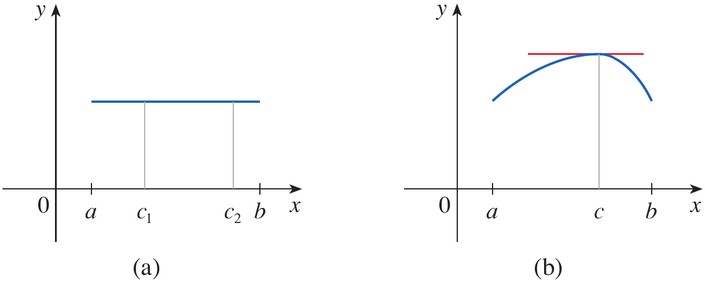
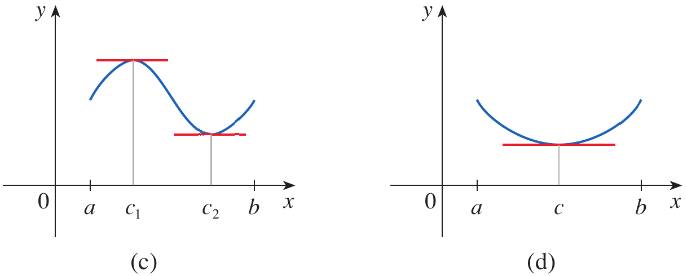
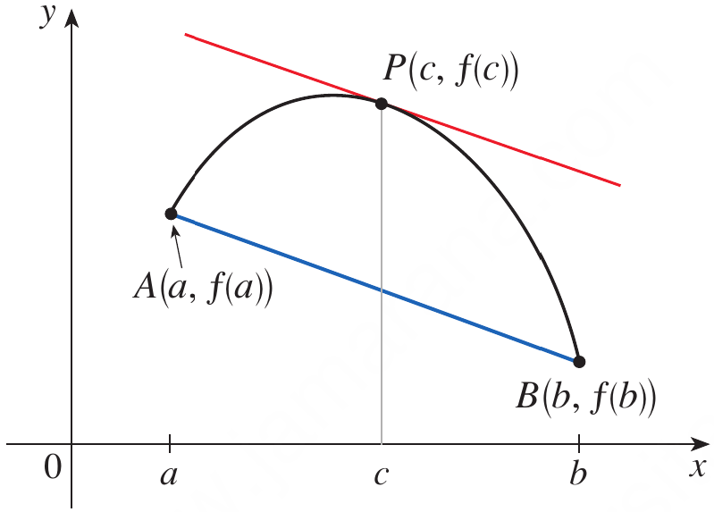
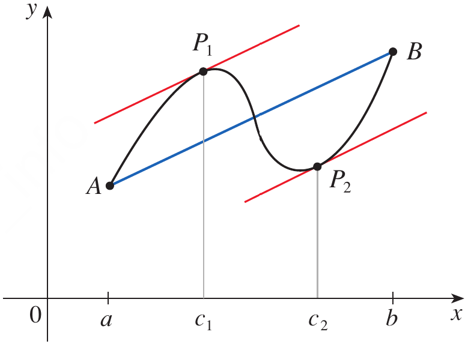
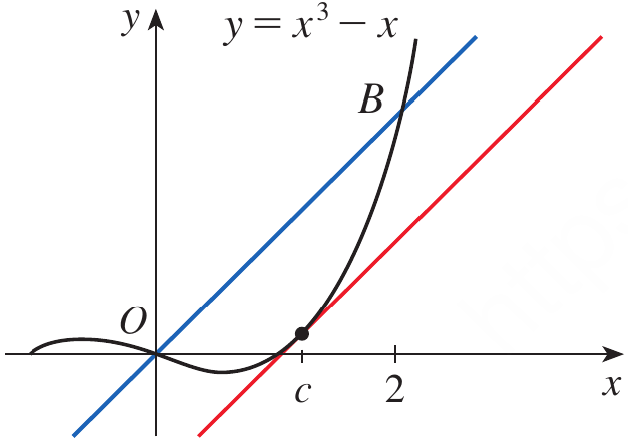

# Calculus and Analytical Geometry

## The Mean Value Theorem

### Dr. Aamir Alaud Din

### October 14, 2026

# Objectives

After preparing this topic, you should be able to:

1. State and apply Rolle's Theorem by checking continuity, differentiability, and equality of endpoint values, and determine the points at which the derivative is zero.
2. State and apply the Mean Value Theorem to identify a point where the instantaneous rate of change equals the average rate of change over a closed interval.

# The Why Section

* In engineering and computer science, we often know how a quantity changes over an interval, but we also want to understand what happens at a particular instant or input value.

* For example, a vehicle may travel a known distance during a measured time interval. Its average velocity can be calculated from the displacement and elapsed time, but this average alone does not tell us the vehicle's velocity at every instant.

* Rolle's Theorem gives a useful special case. If a differentiable position function has the same value at the beginning and end of an interval, then at some instant between them the instantaneous velocity must be zero. This is consistent with a ball thrown vertically upward: before returning to its initial height, the ball momentarily has zero vertical velocity at its highest point.

* The Mean Value Theorem generalizes this idea. When a function is continuous on a closed interval and differentiable inside it, there is at least one interior point where the instantaneous rate of change equals the average rate of change across the entire interval.

* This result is useful when interpreting motion, checking whether a measured rate is plausible, and reasoning about algorithms or models whose outputs change with an input. It connects the overall change across an interval with the derivative at a particular point.

* Consider a mechatronic vehicle whose position is recorded at two times. If we know its displacement and elapsed time, the Mean Value Theorem lets us conclude that, under its hypotheses, the vehicle's instantaneous velocity equalled its average velocity at least once during that interval. This type of problem can be solved by studying Rolle's Theorem and the Mean Value Theorem.

# Objective 1: Rolle's Theorem

## Statement of Rolle's Theorem

* Rolle's Theorem is a special result that guarantees the existence of a point where the derivative of a function is zero.

## Definition: Rolle's Theorem {.blue}

Let $f$ satisfy the following conditions:

1. $f$ is continuous on the closed interval $[a,b]$.
2. $f$ is differentiable on the open interval $(a,b)$.
3. $f(a)=f(b)$.

Then there is at least one number $c$ in $(a,b)$ such that

$$
f'(c)=0
$$

$\blacksquare$

## Explanation 

* The first condition ensures that the function has no break or jump on the closed interval.
* The second condition ensures that the derivative exists at every interior point.
* The third condition states that the function has equal values at the two endpoints.
* Geometrically, the theorem guarantees at least one interior point where the tangent line is horizontal.

<strong>Figure 1.</strong> Typical graphs illustrating Rolle's Theorem, including constant functions and functions with interior maxima or minima.

## Proof of Rolle's Theorem

## Proof {.orange}

There are three cases.

**Case I: $f$ is constant.**

* If $f$ is constant on $[a,b]$, then its derivative is zero at every point of $(a,b)$. Therefore, any number $c$ in $(a,b)$ satisfies the conclusion.

**Case II: $f(x)>f(a)$ for at least one interior point.**

* Because $f$ is continuous on $[a,b]$, the Extreme Value Theorem guarantees that $f$ attains a maximum on this interval.
* Since $f(a)=f(b)$ but an interior value is greater than this common endpoint value, the maximum must occur at some interior point $c$.
* Thus, $f$ has a local maximum at $c$. Since $f$ is differentiable at $c$, Fermat's Theorem gives $f'(c)=0$.

**Case III: $f(x)<f(a)$ for at least one interior point.**

* By the Extreme Value Theorem, $f$ attains a minimum on $[a,b]$.
* Since the endpoint values are equal and an interior value is smaller, the minimum occurs at some interior point $c$.
* Since $f$ is differentiable at $c$, Fermat's Theorem gives $f'(c)=0$.

* In every case, there is a number $c$ in $(a,b)$ for which $f'(c)=0$. This proves Rolle's Theorem.

$\blacksquare$

## Example 1 {.green}

Apply Rolle's Theorem to the position function $s=f(t)$ of a moving object. If the object is in the same place at two different instants $t=a$ and $t=b$, explain what the theorem tells us about its velocity.

## Solution {.green}

The object has the same position at the two endpoints, so

$$
f(a)=f(b)
$$

Suppose the position function is continuous on $[a,b]$ and differentiable on $(a,b)$. Rolle's Theorem then guarantees a time $c$ with $a<c<b$ such that

$$
f'(c)=0
$$

Since the derivative of position is velocity, $f'(c)$ is the instantaneous velocity at time $c$. Therefore,

$$
v(c)=0
$$

Thus, the object must have zero instantaneous velocity at least once between the two instants, provided the hypotheses of Rolle's Theorem are satisfied. A ball thrown straight upward and returning to its starting height is a familiar example.

$\blacksquare$

## Example 2 {.green}

Prove that the equation

$$
x^3+x-1=0
$$

has exactly one real solution.

## Solution {.green}

**Step 1: Show that a solution exists.**

Let

$$
f(x)=x^3+x-1
$$

Since $f$ is a polynomial, it is continuous everywhere. Also,

$$
f(0)=-1<0
\qquad\text{and}\qquad
f(1)=1>0
$$

By the Intermediate Value Theorem, there is at least one number $r$ in $(0,1)$ such that $f(r)=0$. Hence, the equation has a real solution.

**Step 2: Show that there cannot be two distinct real solutions.**

Suppose, for a contradiction, that the equation has two distinct real solutions $a$ and $b$, with $a<b$. Then

$$
f(a)=0=f(b)
$$

Since $f$ is a polynomial, it is continuous on $[a,b]$ and differentiable on $(a,b)$. Rolle's Theorem would therefore guarantee a number $c$ in $(a,b)$ such that $f'(c)=0$.

But

$$
f'(x)=3x^2+1
$$

Since $3x^2\geq0$ for every real $x$,

$$
f'(x)=3x^2+1>0
$$

Thus, $f'(c)$ cannot equal zero. This is a contradiction. Therefore, the equation cannot have two distinct real solutions.

Since a real solution exists and there cannot be more than one, the equation has exactly one real solution.

$\blacksquare$

# Quick Check

## Question 1 {.red}

Does Rolle's Theorem apply to $f(x)=x^2-4$ on $[-2,2]$? If it does, find the value of $c$ satisfying the conclusion.

## Answer {.red}

The function is a polynomial, so it is continuous on $[-2,2]$ and differentiable on $(-2,2)$.
Its endpoint values are equal:

$$
f(-2)=0=f(2)
$$

Therefore, Rolle's Theorem applies. Since

$$
f'(x)=2x
$$

the condition $f'(c)=0$ gives $2c=0$, so

$$
c=0
$$

## Question 2 {.red}

Can Rolle's Theorem be applied to $f(x)=|x|$ on $[-1,1]$? Explain your answer.

## Answer {.red}

The endpoint values are equal because $f(-1)=f(1)=1$, and the function is continuous on $[-1,1]$.
However, $f(x)=|x|$ is not differentiable at $x=0$, which lies inside $(-1,1)$.
Therefore, one of the required hypotheses fails, and Rolle's Theorem cannot be applied.

$\blacksquare$

# Objective 2: The Mean Value Theorem

## Statement of the Mean Value Theorem

* Rolle's Theorem requires the endpoint values to be equal. The Mean Value Theorem removes that requirement and relates the derivative at an interior point to the average rate of change over the whole interval.

## Definition: The Mean Value Theorem {.blue}

Let $f$ satisfy the following conditions:

1. $f$ is continuous on the closed interval $[a,b]$.
2. $f$ is differentiable on the open interval $(a,b)$.

Then there is at least one number $c$ in $(a,b)$ such that

$$
f'(c)=\frac{f(b)-f(a)}{b-a}
$$

Equivalently,

$$
f(b)-f(a)=f'(c)(b-a)
$$

$\blacksquare$

## Geometric Interpretation

* The quantity shown below is the slope of the secant line joining $A(a,f(a))$ and $B(b,f(b))$.

$$
\frac{f(b)-f(a)}{b-a}
$$

* The derivative $f'(c)$ is the slope of the tangent line at $P(c,f(c))$.

* The Mean Value Theorem states that at least one point $P$ on the curve has a tangent line parallel to the secant line through $A$ and $B$.

<strong>Figure 2.</strong> A tangent line at an interior point parallel to the secant line joining the endpoints of the interval.

<strong>Figure 3.</strong> A graph illustrating that more than one interior point may have a tangent parallel to the endpoint secant line.

* The theorem guarantees the existence of at least one such point, but it does not necessarily tell us its exact location.

## Proof of the Mean Value Theorem

## Proof {.orange}

We prove the theorem by applying Rolle's Theorem to a new function formed by subtracting the secant-line equation from $f(x)$.

The secant line through $A(a,f(a))$ and $B(b,f(b))$ has equation

$$
y=f(a)+\frac{f(b)-f(a)}{b-a}(x-a)
$$

Define

$$
h(x)=f(x)-f(a)-\frac{f(b)-f(a)}{b-a}(x-a)
$$

Because $f$ is continuous on $[a,b]$ and the other terms form a linear function, $h$ is continuous on $[a,b]$. Similarly, because $f$ is differentiable on $(a,b)$, $h$ is differentiable on $(a,b)$.

At $x=a$,

$$
h(a)=f(a)-f(a)-0=0
$$

At $x=b$,

$$
\begin{aligned}
h(b)&=f(b)-f(a)-\frac{f(b)-f(a)}{b-a}(b-a)\\
&=f(b)-f(a)-[f(b)-f(a)]\\
&=0
\end{aligned}
$$

Thus, $h(a)=h(b)$. All the hypotheses of Rolle's Theorem are satisfied, so there is a number $c$ in $(a,b)$ such that $h'(c)=0$.

Differentiating $h(x)$ gives

$$
h'(x)=f'(x)-\frac{f(b)-f(a)}{b-a}
$$

Therefore, at $x=c$,

$$
0=h'(c)=f'(c)-\frac{f(b)-f(a)}{b-a}
$$

Rearranging yields

$$
f'(c)=\frac{f(b)-f(a)}{b-a}
$$

This is the required result, so the Mean Value Theorem is proved.

$\blacksquare$

## Example 3 {.green}

Illustrate the Mean Value Theorem for $f(x)=x^3-x$ on the interval $[0,2]$.

## Solution {.green}

**Step 1: Verify the hypotheses.**

The function $f(x)=x^3-x$ is a polynomial. Therefore, it is continuous on $[0,2]$ and differentiable on $(0,2)$.

**Step 2: Calculate the average rate of change.**

We have

$$
f(0)=0
\qquad\text{and}\qquad
f(2)=8-2=6
$$

The slope of the secant line is

$$
\frac{f(2)-f(0)}{2-0}=\frac{6-0}{2}=3
$$

**Step 3: Find the point guaranteed by the theorem.**

The derivative is

$$
f'(x)=3x^2-1
$$

By the Mean Value Theorem, we need a value $c$ in $(0,2)$ satisfying

$$
f'(c)=3
$$

Substituting the derivative gives

$$
\begin{aligned}
3c^2-1&=3\\
3c^2&=4\\
c^2&=\frac43\\
c&=\pm\frac{2}{\sqrt3}
\end{aligned}
$$

Since $c$ must lie in $(0,2)$, only the positive value is acceptable. Thus,

$$
\boxed{c=\frac{2}{\sqrt3}}
$$

At this point, the tangent to the curve has the same slope as the secant line joining the endpoints.

<strong>Figure 4.</strong> The curve $y=x^3-x$ on $[0,2]$, showing a tangent parallel to the secant line from $(0,0)$ to $(2,6)$.

$\blacksquare$

## Example 4 {.green}

If an object moves along a straight line with position function $s=f(t)$, explain the Mean Value Theorem in terms of average and instantaneous velocity. If a car travels $180$ km in $2$ hours, what does the theorem tell us about its speed?

## Solution {.green}

The average velocity between times $t=a$ and $t=b$ is

$$
\frac{f(b)-f(a)}{b-a}
$$

The instantaneous velocity at time $t=c$ is $f'(c)$. If the position function is continuous on $[a,b]$ and differentiable on $(a,b)$, the Mean Value Theorem guarantees at least one time $c$ when

$$
f'(c)=\frac{f(b)-f(a)}{b-a}
$$

In the given example, the car travels $180$ km in $2$ hours, so its average speed over the journey is

$$
\frac{180\text{ km}}{2\text{ h}}=90\text{ km/h}
$$

Under the assumptions of the theorem, the car's instantaneous velocity must equal its average velocity at least once. If the car moves in the same direction throughout the journey, this means its speedometer must read $90$ km/h at least once.

$\blacksquare$

## Example 5 {.green}

Suppose that $f(0)=-3$ and $f'(x)<5$ for all $x$. How large can $f(2)$ possibly be?

## Solution {.green}

Since $f$ is differentiable, it is continuous. We can therefore apply the Mean Value Theorem on $[0,2]$.

There is a number $c$ in $(0,2)$ such that

$$
f(2)-f(0)=f'(c)(2-0)
$$

Since $f(0)=-3$,

$$
f(2)=-3+2f'(c)
$$

We are given that $f'(x)<5$ for all $x$, so in particular $f'(c)<5$. Hence,

$$
f(2)=-3+2f'(c)<-3+10=7
$$

Therefore, $f(2)$ must be less than $7$. The value $7$ is an upper bound; under the strict condition $f'(x)<5$, it is not attained. Values can approach $7$ arbitrarily closely if the derivative is close to $5$ throughout the interval.

$\blacksquare$

## Consequences of the Mean Value Theorem

## Theorem {.orange}

If $f'(x)=0$ for every $x$ in an interval $I$, then $f$ is constant on $I$.

## Proof {.orange}

Choose any two points $x_1$ and $x_2$ in $I$, with $x_1<x_2$. Since $f$ is differentiable on the interval, it is continuous on $[x_1,x_2]$ and differentiable on $(x_1,x_2)$.

By the Mean Value Theorem, there is a number $c$ in $(x_1,x_2)$ such that

$$
f(x_2)-f(x_1)=f'(c)(x_2-x_1)
$$

Since $f'(c)=0$,

$$
f(x_2)-f(x_1)=0
$$

Therefore, $f(x_2)=f(x_1)$. Because the two points were chosen arbitrarily, $f$ has the same value at every point in $I$ and is constant on that interval.

$\blacksquare$

## Corollary {.orange}

If $f'(x)=g'(x)$ for every $x$ in an interval $I$, then $f(x)-g(x)$ is constant on $I$. Equivalently,

$$
f(x)=g(x)+C
$$

where $C$ is a constant.

## Proof {.orange}

Define $F(x)=f(x)-g(x)$. Then

$$
F'(x)=f'(x)-g'(x)=0
$$

By the preceding theorem, $F$ is constant on $I$. Hence, $f(x)-g(x)=C$, or $f(x)=g(x)+C$.

$\blacksquare$

## Important Note {.red}

The conclusion that a function with zero derivative is constant applies when its domain is an interval. A domain with a gap need not satisfy this conclusion across the gap. For example, a function can be constant on each of the two separate intervals $(-\infty,0)$ and $(0,\infty)$ but take different constants on those intervals.

## Example 6 {.green}

Prove the identity

$$
\tan^{-1}x+\cot^{-1}x=\frac{\pi}{2}
$$

for real $x$, using the derivative-based argument in which the inverse cotangent is taken with values in $(0,\pi)$.

## Solution {.green}

Define

$$
f(x)=\tan^{-1}x+\cot^{-1}x
$$

Using the derivative formulas,

$$
\begin{aligned}
f'(x)&=\frac{1}{1+x^2}-\frac{1}{1+x^2}\\
&=0
\end{aligned}
$$

Therefore, $f$ is constant on the real line. To determine the constant, set $x=1$:

$$
\begin{aligned}
f(1)&=\tan^{-1}1+\cot^{-1}1\\
&=\frac{\pi}{4}+\frac{\pi}{4}\\
&=\frac{\pi}{2}
\end{aligned}
$$

Thus, the constant value is $\pi/2$, and

$$
\boxed{\tan^{-1}x+\cot^{-1}x=\frac{\pi}{2}}
$$

$\blacksquare$

# Quick Check

## Question 1 {.red}

For $f(x)=x^2$ on $[1,3]$, find a value $c$ satisfying the conclusion of the Mean Value Theorem.

## Answer {.red}

The function is a polynomial, so it is continuous on $[1,3]$ and differentiable on $(1,3)$.
The average rate of change is

$$
\frac{f(3)-f(1)}{3-1}=\frac{9-1}{2}=4
$$

Since $f'(x)=2x$, we solve $2c=4$, obtaining

$$
\boxed{c=2}
$$

## Question 2 {.red}

If $f'(x)=0$ for every $x$ in an interval, what can be concluded about $f$ on that interval?

## Answer {.red}

By the consequence of the Mean Value Theorem proved above, the function has the same value at every pair of points in the interval. Therefore,

$$
\boxed{f\text{ is constant on the interval}}
$$

$\blacksquare$

# Scenario Problem

## Problem {.green}

A mechatronic test vehicle moves along a straight track. Its position, in metres, after $t$ seconds is modelled by

$$
s(t)=t^2
$$

for $0\leq t\leq4$. Assume the model describes a continuous position function on $[0,4]$ that is differentiable on $(0,4)$.

1. Calculate the vehicle's average velocity over the four-second interval.
2. Use the Mean Value Theorem to find a time when the instantaneous velocity equals this average velocity.

## Solution {.green}

**Step 1: Calculate the average velocity.**

The positions at the endpoints are

$$
s(0)=0
\qquad\text{and}\qquad
s(4)=16
$$

Thus, the average velocity is

$$
\frac{s(4)-s(0)}{4-0}
=\frac{16-0}{4}
=4\text{ m/s}
$$

**Step 2: Apply the Mean Value Theorem.**

Since $s(t)=t^2$ is continuous on $[0,4]$ and differentiable on $(0,4)$, the theorem guarantees a time $c$ in $(0,4)$ such that

$$
s'(c)=\frac{s(4)-s(0)}{4-0}=4
$$

Differentiating the position function gives

$$
s'(t)=2t
$$

Therefore,

$$
\begin{aligned}
2c&=4\\
c&=2
\end{aligned}
$$

Hence, at $t=2$ seconds, the instantaneous velocity is $4$ m/s, equal to the average velocity over the full interval.

$$
\boxed{c=2\text{ s}}
$$

The Mean Value Theorem guarantees the existence of such a time; in this example, solving the derivative equation identifies it exactly.

$\blacksquare$

# Summary

* Rolle's Theorem states that if a function is continuous on $[a,b]$, differentiable on $(a,b)$, and satisfies $f(a)=f(b)$, then $f'(c)=0$ for at least one $c$ in $(a,b)$.
* Geometrically, Rolle's Theorem guarantees at least one horizontal tangent between equal endpoint heights.
* The Mean Value Theorem requires continuity on the closed interval and differentiability on the open interval.
* The Mean Value Theorem guarantees a point $c$ where the instantaneous rate of change equals the average rate of change over the interval.
* Geometrically, the tangent at such a point is parallel to the secant line through the endpoints.
* For a position function, the Mean Value Theorem connects average velocity over an interval with instantaneous velocity at some time inside it.
* If a derivative is zero everywhere on an interval, the function is constant there.
* If two differentiable functions have equal derivatives on an interval, they differ by a constant on that interval.
* The theorem guarantees that a suitable point exists, but finding its exact value may require solving an equation.

# Note {.red}

* The hypotheses of each theorem must be checked before applying its conclusion.
* The point $c$ is guaranteed to lie in the open interval $(a,b)$, not at either endpoint.
* In the Mean Value Theorem, $\frac{f(b)-f(a)}{b-a}$ is the signed average rate of change; for motion, it represents average velocity, not necessarily average speed.

# Exercises

## Exercises Set

Solve the odd number exercises from exercise 1 to 42.

* Exercises help transform theoretical concepts into practical understanding.

* Mathematics is learned by doing and solving exercises will train you to analyze problems, select appropriate methods, and construct logical solutions.

* Attempting problems sometimes leads to mistakes which provide opportunities for learning and improvement.

* Regular practice increases speed, accuracy, and confidence.

* Exercises are given in the Exercises file and you are expected to solve them on your own.
