# Calculus and Analytical Geometry

## Optimization Problems

### Dr. Aamir Alaud Din

# Objectives

After preparing this topic, you should be able to:

1. Formulate an optimization problem by identifying the quantity to be maximized or minimized, introducing suitable variables, and translating the given conditions into mathematical equations.
2. Construct and optimize a revenue or profit function in a business situation, interpreting the mathematical result in the context of the problem.

# The Why Section

- In engineering and computing, a design or decision often has to be selected from many feasible alternatives. A mechanical engineer may want to minimize material use while preserving a required capacity, while a mechatronics system may need to reach a destination in the least time.
- Optimization provides a systematic way to select the best feasible alternative. The word *best* must be translated into a measurable quantity, such as maximum area, minimum surface area, shortest distance, least travel time, minimum cost, or maximum revenue.
- The central challenge is usually not differentiation itself but constructing the correct function from the information in a word problem. A diagram, carefully chosen variables, and relationships between those variables help convert a real situation into a mathematical model.
- When the quantity to be optimized depends on several variables, a constraint can often be used to express it as a function of one variable. Calculus then helps identify candidate extrema, and the domain and endpoint values help determine whether a candidate gives an absolute maximum or minimum.
- Optimization is also important in business and economics. A company needs to understand how price affects demand, how sales affect revenue, and how production affects cost and profit. Derivatives describe marginal changes, while optimization identifies a production or sales level that gives the best outcome under the model.
- For example, a mechatronics team designing a small autonomous delivery robot may need to choose a route and a landing or transfer point that minimize total travel time, given different movement speeds. This type of decision can be modeled and solved by studying optimization problems.

# Optimizing a Function

## Steps in Solving Optimization Problems

- **Understand the problem.** Read the statement carefully and identify the unknown quantity, the given information, and the conditions that must be satisfied.
- **Draw a diagram.** When geometry is involved, draw a diagram and label the known and unknown quantities.
- **Introduce notation.** Assign a symbol to the quantity to be maximized or minimized and introduce symbols for the other unknown quantities.
- **Write the objective function.** Express the required quantity in terms of the variables.
- **Use the constraints.** If the objective function contains more than one variable, use the given relationships to eliminate variables until the objective is a function of one variable. State the domain in the context of the problem.
- **Find the absolute extreme value.** Use critical numbers and, when the domain is a closed interval, compare the function values at all critical numbers and endpoints. On an open or unbounded domain, justify the absolute extremum using the function's behavior or the sign of its derivative.

## Example 1 {.green}

A farmer has 1200 m of fencing and wants to fence off a rectangular field that borders a straight river. He needs no fence along the river. What are the dimensions of the field that has the largest area?

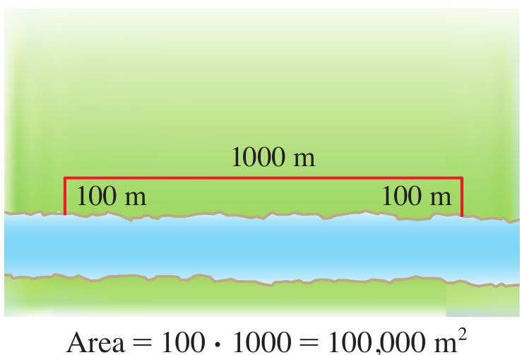
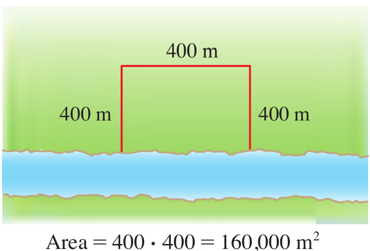
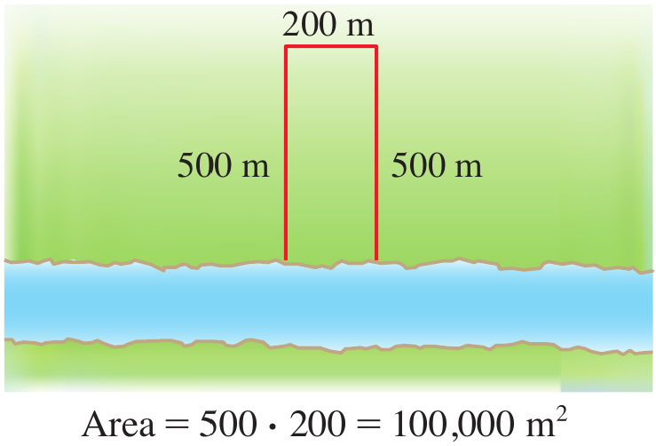

<strong>Figure 1.</strong> Three possible rectangular fields beside a river, illustrating how different dimensions produce different areas.

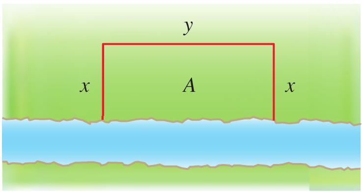

<strong>Figure 2.</strong> A general rectangular field beside a river, with depth $x$ and width $y$.

## Solution {.green}

Let $x$ be the depth and $y$ be the width of the field. The area to be maximized is $A=xy$.
Since the river forms one side of the rectangle, fencing is needed for only two depths and one width. Therefore, the constraint is

$$
2x+y=1200
$$

Solving for $y$ gives $y=1200-2x$. Substituting this into the area formula gives the objective function

$$
A(x)=x(1200-2x)=1200x-2x^2
$$

The depth cannot be negative, and it cannot exceed $600$ m. Thus, the domain is $0\leq x\leq600$.
Differentiating and setting the derivative equal to zero gives

$$
A'(x)=1200-4x=0
$$

Hence, the only critical number is $x=300$. We compare the area at the critical number and at the endpoints.

$$
A(0)=0 \qquad A(300)=180000 \qquad A(600)=0
$$

The maximum area is $180000\text{ m}^2$, attained when $x=300$ m. The corresponding width is $y=1200-2(300)=600$ m.

Therefore, the field should be **300 m deep and 600 m wide**.

$\blacksquare$

## Example 2 {.green}

A cylindrical can is to be made to hold 1 L of oil. Find the dimensions that will minimize the cost of the metal to manufacture the can.

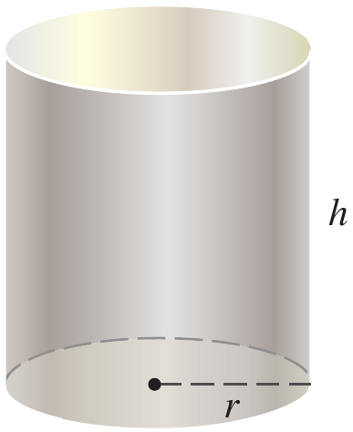

<strong>Figure 3.</strong> A cylinder with radius $r$ and height $h$.

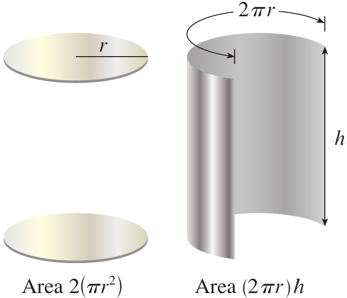

<strong>Figure 4.</strong> The cylindrical can's surface separated into two circular ends and a rectangular side.

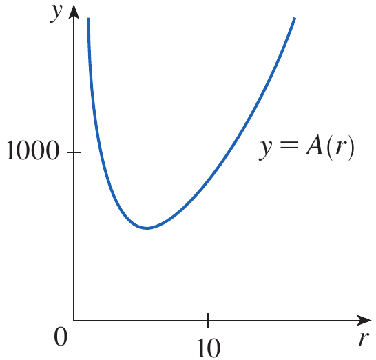

<strong>Figure 5.</strong> The graph of the surface-area function, showing its minimum.

## Solution {.green}

We assume that the cost of the metal is proportional to the total surface area. Let $r$ and $h$ be the radius and height in centimeters. The surface area is

$$
A=2\pi r^2+2\pi rh
$$

Since $1$ L equals $1000\text{ cm}^3$, the volume constraint is

$$
\pi r^2h=1000
$$

Solving for $h$ gives $h=1000/(\pi r^2)$. Substituting into the surface-area formula gives

$$
A(r)=2\pi r^2+\frac{2000}{r}
$$

The domain is $r>0$. Differentiating gives

$$
A'(r)=4\pi r-\frac{2000}{r^2}
$$

Setting $A'(r)=0$ gives $4\pi r^3=2000$, so $r^3=500/\pi$ and

$$
r=\sqrt[3]{\frac{500}{\pi}}
$$

For values of $r$ below this critical number, $A'(r)<0$; for values above it, $A'(r)>0$. Therefore, the surface area decreases before the critical number and increases afterward, giving an absolute minimum.
Substituting the critical radius into the volume constraint gives

$$
h=\frac{1000}{\pi r^2}=2r
$$

Thus, the can uses the least metal when its **height equals its diameter**, with $r=\sqrt[3]{500/\pi}$ cm and $h=2\sqrt[3]{500/\pi}$ cm.

$\blacksquare$

## Definition: First Derivative Test for Absolute Extreme Values {.blue}

Suppose $c$ is a critical number of a continuous function $f$ defined on an interval.

- If $f'(x)>0$ for all $x<c$ and $f'(x)<0$ for all $x>c$, then $f(c)$ is the absolute maximum value of $f$.
- If $f'(x)<0$ for all $x<c$ and $f'(x)>0$ for all $x>c$, then $f(c)$ is the absolute minimum value of $f$.

$\blacksquare$

## Example 3 {.green}

Find the point on the parabola $y^2=2x$ that is closest to the point $(1,4)$.

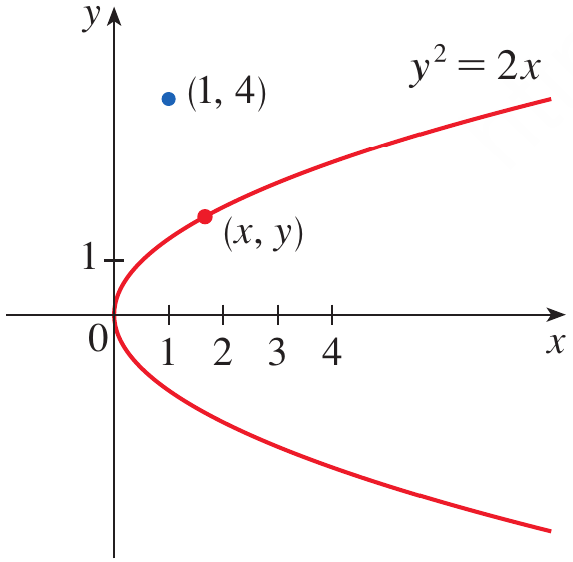

<strong>Figure 6.</strong> The parabola $y^2=2x$, the fixed point $(1,4)$, and a general point $(x,y)$ on the parabola.

## Solution {.green}

Let $(x,y)$ be a point on the parabola. Its distance from $(1,4)$ is

$$
d=\sqrt{(x-1)^2+(y-4)^2}
$$

Since $y^2=2x$, we have $x=y^2/2$. It is easier to minimize the square of the distance because the square-root function is increasing. Define

$$
F(y)=d^2=\left(\frac{y^2}{2}-1\right)^2+(y-4)^2
$$

Differentiating and simplifying gives

$$
F'(y)=y^3-8
$$

Setting $F'(y)=0$ gives $y^3=8$, so $y=2$. The derivative is negative when $y<2$ and positive when $y>2$, so $F$ has an absolute minimum at $y=2$.
The corresponding $x$-coordinate is $x=y^2/2=2$. Therefore, the closest point is $(2,2)$.
The distance is $\sqrt{(2-1)^2+(2-4)^2}=\sqrt5$.

$\blacksquare$

## Example 4 {.green}

A woman launches her boat from point A on a bank of a straight river, 3 km wide, and wants to reach point B, 8 km downstream on the opposite bank, as quickly as possible. She could row her boat directly across the river to point C and then run to B, or she could row directly to B, or she could row to some point D between C and B and then run to B. If she can row 6 km/h and run 8 km/h, where should she land to reach B as soon as possible? Assume that the speed of the water is negligible compared with the speed at which she rows.

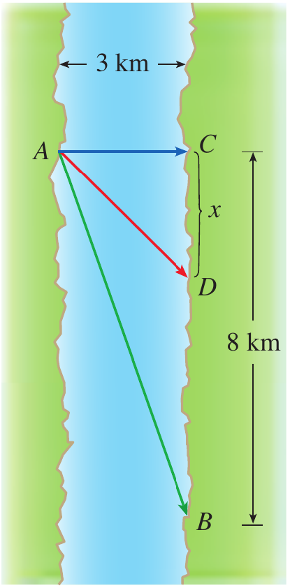

<strong>Figure 7.</strong> A river 3 km wide showing the starting point A, the point C directly across the river, the destination B 8 km downstream, and a possible landing point D.

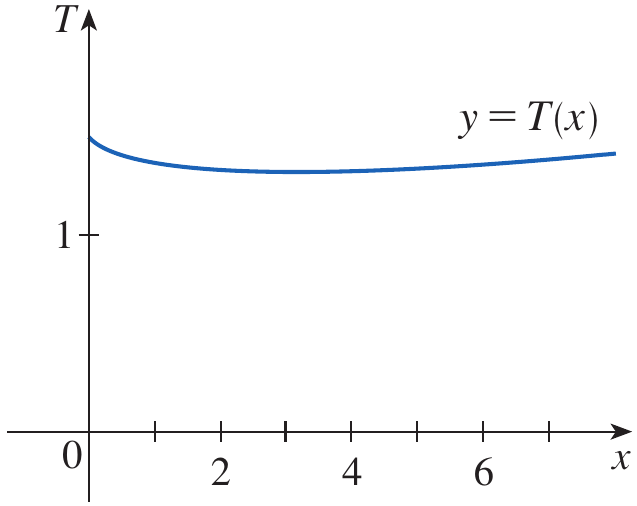

<strong>Figure 8.</strong> The graph of total travel time $T(x)$ over the interval $[0,8]$.

## Solution {.green}

Let $x$ be the distance from $C$ to $D$, measured downstream. The running distance is $8-x$ km. By the Pythagorean Theorem, the rowing distance is $\sqrt{x^2+9}$ km.
Since time equals distance divided by speed, the total travel time is

$$
T(x)=\frac{\sqrt{x^2+9}}{6}+\frac{8-x}{8}
$$

The domain is $0\leq x\leq8$. Differentiating gives

$$
T'(x)=\frac{x}{6\sqrt{x^2+9}}-\frac18
$$

Setting $T'(x)=0$ and solving gives

$$
\frac{x}{6\sqrt{x^2+9}}=\frac18
$$

$$
4x=3\sqrt{x^2+9}
$$

$$
16x^2=9x^2+81
$$

$$
x=\frac{9}{\sqrt7}
$$

To find the absolute minimum, compare the critical value with the endpoint values.

$$
T(0)=1.5 \qquad T\left(\frac{9}{\sqrt7}\right)\approx1.33 \qquad T(8)\approx1.42
$$

The smallest time occurs at $x=9/\sqrt7\approx3.4$ km.

Therefore, she should land approximately **3.4 km downstream from point C** and run the remaining distance to B.

$\blacksquare$

## Example 5 {.green}

Find the area of the largest rectangle that can be inscribed in a semicircle of radius $r$.

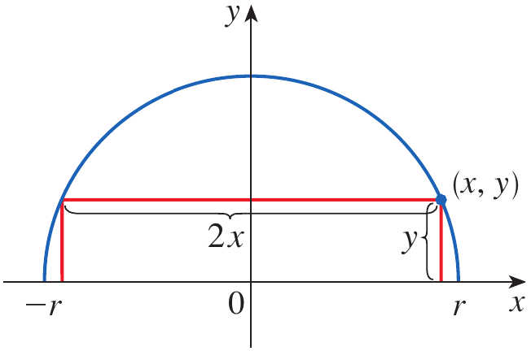

<strong>Figure 9.</strong> A rectangle inscribed in the upper semicircle of radius $r$, with upper-right vertex $(x,y)$.

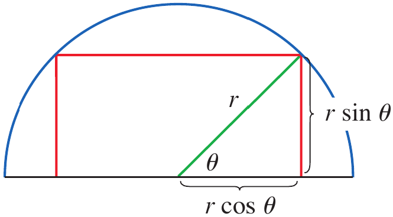

<strong>Figure 10.</strong> The radius of the semicircle and the angle $\theta$ used to express the rectangle's dimensions.

## Solution {.green}

**Solution 1**

Take the semicircle to be the upper half of $x^2+y^2=r^2$. If $(x,y)$ is the upper-right vertex of the rectangle, its width is $2x$ and its height is $y$. Thus, its area is $A=2xy$.
Since $x^2+y^2=r^2$, we have $y=\sqrt{r^2-x^2}$. Therefore,

$$
A(x)=2x\sqrt{r^2-x^2}
$$

The domain is $0\leq x\leq r$. Differentiating gives

$$
A'(x)=\frac{2(r^2-2x^2)}{\sqrt{r^2-x^2}}
$$

The interior critical number satisfies $r^2-2x^2=0$, so $x=r/\sqrt2$. The area is zero at both endpoints, so this critical number gives the maximum.
Substituting $x=r/\sqrt2$ and $y=r/\sqrt2$ gives

$$
A_{\max}=2\left(\frac{r}{\sqrt2}\right)\left(\frac{r}{\sqrt2}\right)=r^2
$$

**Solution 2**

Let $\theta$ be the angle shown in Figure 10. The rectangle has width $2r\cos\theta$ and height $r\sin\theta$. Therefore,

$$
A(\theta)=(2r\cos\theta)(r\sin\theta)=r^2\sin(2\theta)
$$

The maximum value of $\sin(2\theta)$ is $1$, attained when $2\theta=\pi/2$. Hence $\theta=\pi/4$ and the maximum area is $r^2$.

$\blacksquare$

# Quick Check

## Question 1 {.red}

A rectangle borders a river and requires fencing on only three sides. If $2x+y=100$, write its area as a function of $x$.

## Answer {.red}

The area is $A=xy$. Since $y=100-2x$, the objective function is

$$
A(x)=x(100-2x)=100x-2x^2
$$

## Question 2 {.red}

Why is it useful to minimize the square of a distance rather than the distance itself?

## Answer {.red}

For nonnegative distances, squaring preserves their order. Therefore, the distance and its square attain their minimum at the same point, but the squared distance often avoids a square root and is easier to differentiate.

$\blacksquare$

# Applications to Business and Economics

## Cost, Demand, Revenue, and Profit

- If $C(x)$ is the cost of producing $x$ units of a product, then the marginal cost is $C'(x)$, which describes the rate at which cost changes with production.
- If $p(x)$ is the price per unit at which a company can sell $x$ units, then $p(x)$ is the demand or price function. In many models, the price decreases as the number of units sold increases.
- Revenue is the quantity sold multiplied by the price per unit. Therefore,

$$
R(x)=xp(x)
$$

- The marginal revenue is $R'(x)$, which describes the rate of change of revenue with respect to the number of units sold.
- Profit is revenue minus cost. Thus,

$$
P(x)=R(x)-C(x)
$$

- The marginal profit is $P'(x)$. Critical numbers of revenue or profit functions can identify candidate sales levels for maximum revenue or profit, provided that the relevant domain and endpoint behavior are also considered.

## Example 6 {.green}

A store has been selling 200 TV monitors a week at $350 each. A market survey indicates that for each $10 rebate offered to buyers, the number of monitors sold will increase by 20 a week. Find the demand function and the revenue function. How large a rebate should the store offer to maximize revenue?

## Solution {.green}

Let $x$ be the number of monitors sold per week. The price is $350 when $x=200$. For every increase of 20 monitors sold, the price decreases by $10$, so the price decreases by $10/20=0.50$ dollars per additional monitor.
A linear demand function therefore has slope $-0.5$. Using the point $(200,350)$ gives

$$
p(x)=350-0.5(x-200)=450-0.5x
$$

Revenue is quantity multiplied by price, so

$$
R(x)=xp(x)=450x-0.5x^2
$$

Differentiating gives

$$
R'(x)=450-x
$$

Setting the derivative equal to zero gives $x=450$. Since the revenue function is a downward-opening quadratic, this critical number gives the maximum revenue in the model.
The price at this sales level is

$$
p(450)=450-0.5(450)=225
$$

The store currently charges $350, so the required rebate is $350-$225=$125.

Therefore, the store should offer a **$125 rebate** to maximize revenue under the given model.

$\blacksquare$

# Quick Check

## Question 1 {.red}

A company sells $x$ units at a price of $p(x)=80-2x$ dollars per unit. Write its revenue function.

## Answer {.red}

Revenue equals quantity multiplied by price.

$$
R(x)=xp(x)=80x-2x^2
$$

## Question 2 {.red}

If $R(x)$ is revenue and $C(x)$ is cost, how is profit defined, and what does $P'(x)$ represent?

## Answer {.red}

Profit is revenue minus cost, so $P(x)=R(x)-C(x)$. Its derivative $P'(x)$ is the marginal profit, or the rate of change of profit with respect to the number of units produced and sold.

$\blacksquare$

## Scenario Problem {.green}

A mechatronics team is programming a small delivery robot to move equipment across a workshop. The robot can travel along a straight aisle at $2$ m/s and must then travel across a side corridor at $1.5$ m/s. The corridor is $6$ m across, and the destination is $10$ m down the aisle from the point directly opposite the robot's starting position. The robot can travel diagonally across the corridor to a point $x$ metres down the aisle, then travel along the aisle to the destination. Determine the landing point that minimizes the total travel time.

## Solution {.green}

Let $x$ be the distance down the aisle to the point where the robot crosses the corridor. The corridor distance is $\sqrt{x^2+36}$ m, and the remaining aisle distance is $10-x$ m.
The total travel time is

$$
T(x)=\frac{\sqrt{x^2+36}}{1.5}+\frac{10-x}{2}
$$

The feasible domain is $0\leq x\leq10$. Differentiating gives

$$
T'(x)=\frac{x}{1.5\sqrt{x^2+36}}-\frac12
$$

Setting $T'(x)=0$ gives

$$
\frac{x}{1.5\sqrt{x^2+36}}=\frac12
$$

$$
2x=1.5\sqrt{x^2+36}
$$

Squaring both sides gives $4x^2=2.25x^2+81$, so $1.75x^2=81$. Hence,

$$
x=\sqrt{\frac{324}{7}}\approx6.80
$$

The critical value lies in the feasible interval. Comparing the total time there with the endpoint values confirms that it gives the least time.

$$
T(0)=\frac{6}{1.5}+\frac{10}{2}=9\text{ s}
$$

$$
T(10)=\frac{\sqrt{136}}{1.5}\approx7.77\text{ s}
$$

$$
T(6.80)\approx\frac{\sqrt{82.24}}{1.5}+\frac{3.20}{2}\approx7.65\text{ s}
$$

Therefore, the robot should cross the corridor at a point approximately **6.80 m down the aisle** from the point directly opposite its starting position. The minimum travel time is approximately **7.65 seconds** under this simplified model.

# Summary

- Optimization problems ask us to maximize or minimize a measurable quantity subject to given constraints.
- A useful solution begins by understanding the problem, drawing a diagram when appropriate, introducing variables, and writing an objective function.
- Constraints help reduce an objective function with several variables to a function of one variable.
- Critical numbers are candidates for extrema, but the domain and endpoint values must also be considered when determining absolute extrema.
- The surface area of a closed cylindrical can with fixed volume is minimized when its height equals its diameter.
- For distance problems, minimizing the square of a distance often simplifies the calculation without changing the minimizing point.
- Travel-time optimization combines distance formulas with the relationship time = distance/rate.
- Demand functions describe price in relation to quantity sold, while revenue is quantity multiplied by price.
- Profit equals revenue minus cost, and derivatives of cost, revenue, and profit describe their marginal rates of change.
- The final mathematical result must be interpreted in the context of the original engineering or business problem.

# Exercises

## Exercises Set

Solve the odd number exercises from exercise 1 to 88.

* Exercises help transform theoretical concepts into practical understanding.

* Mathematics is learned by doing and solving exercises will train you to analyze problems, select appropriate methods, and construct logical solutions.

* Attempting problems sometimes leads to mistakes which provide opportunities for learning and improvement.

* Regular practice increases speed, accuracy, and confidence.

* Exercises are given in the Exercises file and you are expected to solve them on your own.