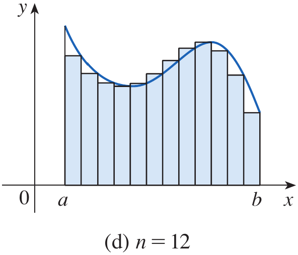
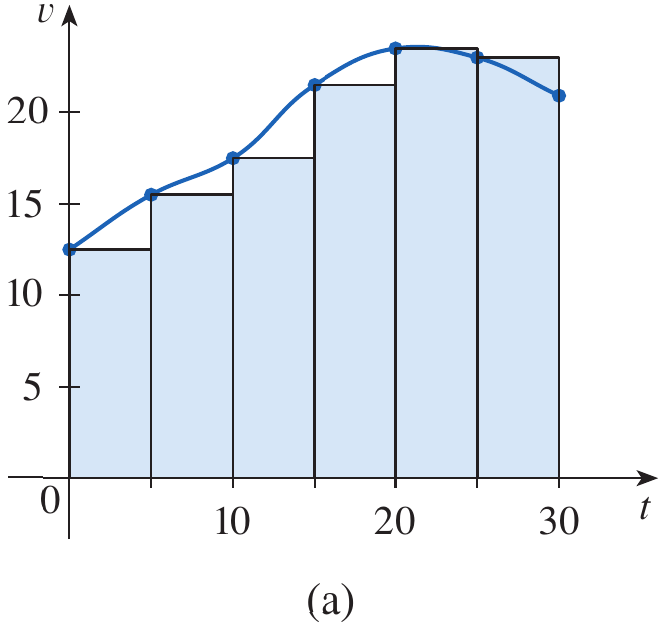
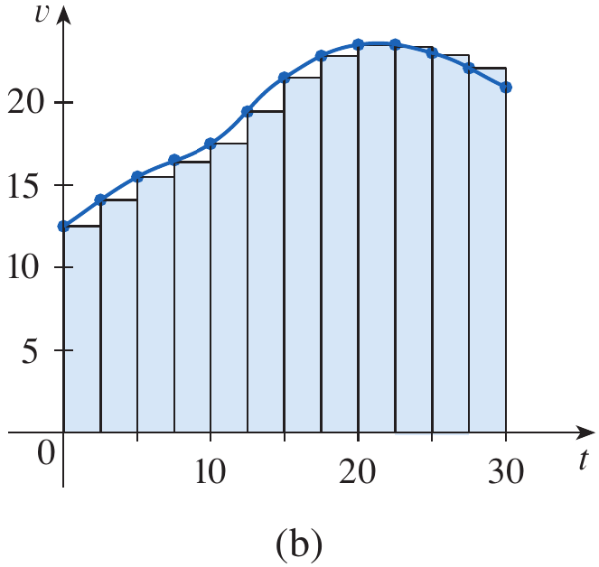
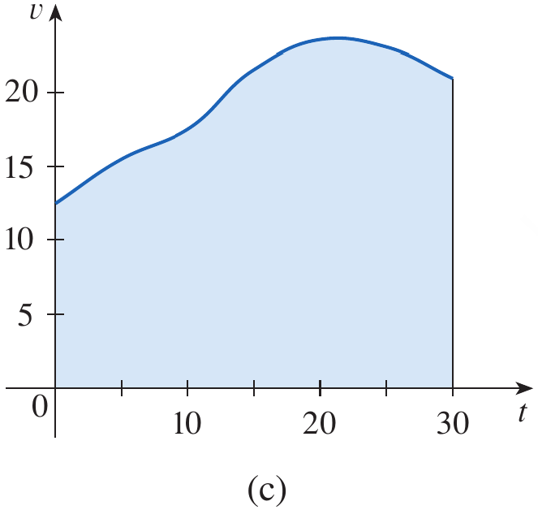

# Calculus and Analytical Geometry

## The Area and Distance Problems

### Dr. Aamir Alaud Din

# Objectives

After preparing this topic, you should be able

1. To explain the area problem and represent the region under a nonnegative continuous function on a closed interval.
2. To approximate the area under a curve by using rectangles constructed from equal-width subintervals and left or right endpoints.
3. To express the limiting area of a region as a limit of Riemann sums and use sigma notation to represent the sums compactly.
4. To estimate the distance traveled by an object from discrete velocity readings using left-endpoint and right-endpoint sums.
5. To explain how increasingly frequent measurements lead to the area under a velocity-time graph and the exact distance traveled.

# The Why Section

* In engineering and computing, many important quantities are accumulated continuously rather than obtained from a single measurement.
* The area problem provides a mathematical method for finding the total amount represented by a varying function, even when the boundary is curved and ordinary geometric formulas are not sufficient.
* The central idea is to divide an interval into small pieces, approximate the contribution from each piece, add these contributions, and improve the estimate by making the pieces narrower.
* For a region under a graph, each rectangular contribution is approximately its height multiplied by its width. The limit of the resulting sums gives the exact area when the function is continuous.
* The same mathematical structure appears in the distance problem. If velocity varies with time, multiplying one velocity reading by a time interval estimates the distance traveled during that interval.
* These ideas are useful in mechanical engineering when estimating the distance traveled by a robot, a moving vehicle, or a machine component whose velocity changes with time.
* They are also useful in computer science and data science when numerical data are sampled at discrete times and a total quantity must be estimated from those samples.
* For example, a mechatronic robot may record its velocity every few seconds. By adding the approximate distances traveled during the successive intervals, we can estimate its total travel distance. Studying the area and distance problems provides the mathematical foundation for solving this type of task.

# The Area Problem

## Understanding the Area Problem

* The area problem is to find the area of the region that lies under the graph of a function $y=f(x)$ from $x=a$ to $x=b$.
* In the standard setting, the function is continuous and nonnegative on $[a,b]$. The region is bounded by the graph, the $x$-axis, and the vertical lines $x=a$ and $x=b$.
* When a region has straight sides, its area can often be calculated using familiar geometric formulas. A curved boundary requires a different approach.
* The basic idea is to approximate the region by rectangles, calculate the sum of their areas, and then improve the approximation by increasing the number of rectangles.


<div style="text-align: center;">


<span><strong>Figure 1.</strong> The region $S$ under the graph of $y=f(x)$ from $x=a$ to $x=b$.</span>
</div>

* For a rectangle, the area is its length multiplied by its width. For a triangle, the area is one-half the base multiplied by the height. A polygon can be divided into triangles, and its area can be found by adding their areas.
* These formulas suggest that a curved region may be approximated by simpler regions whose areas are easy to calculate.


<div style="text-align: center;">


<span><strong>Figure 2.</strong> Areas of a rectangle, a triangle, and a polygon divided into triangles.</span>
</div>

## Approximating Area with Rectangles

* Consider the region under the parabola $y=x^2$ from $x=0$ to $x=1$. The region lies inside a square of side length $1$, so its area is between $0$ and $1$.
* Divide the interval $[0,1]$ into four equal subintervals, each of width $\Delta x=\frac14$.
* On each subinterval, approximate the curved region by a rectangle. The height of a rectangle can be chosen from the function value at the left or right endpoint of its subinterval.
* Since $f(x)=x^2$ is increasing on $[0,1]$, right-endpoint rectangles lie above the curve and give an overestimate, while left-endpoint rectangles lie below the curve and give an underestimate.


<div style="text-align: center;">


<span><strong>Figure 3.</strong> The region under the parabola $y=x^2$ from $x=0$ to $x=1$.</span>
</div>

<div style="text-align: center;">


<span><strong>Figure 4.</strong> Four strips under $y=x^2$ and their right-endpoint rectangular approximations.</span>
</div>

* Using right endpoints $\frac14,\frac12,\frac34,1$, the rectangle heights are $\left(\frac14\right)^2,\left(\frac12\right)^2,\left(\frac34\right)^2,1^2$.
* The right-endpoint sum is therefore

$$
R_4=\frac14\left(\frac14\right)^2+\frac14\left(\frac12\right)^2+\frac14\left(\frac34\right)^2+\frac14(1)^2
=\frac{15}{32}=0.46875
$$

* Thus, the true area $A$ is less than $0.46875$.
* Using left endpoints $0,\frac14,\frac12,\frac34$, the left-endpoint sum is

$$
L_4=\frac14(0)^2+\frac14\left(\frac14\right)^2+\frac14\left(\frac12\right)^2+\frac14\left(\frac34\right)^2
=\frac{7}{32}=0.21875
$$

* Thus, the true area is greater than $0.21875$, giving the bounds

$$
0.21875<A<0.46875
$$

<div style="text-align: center;">


<span><strong>Figure 5.</strong> Left-endpoint rectangles under $y=x^2$.</span>
</div>

* Increasing the number of rectangles generally improves these estimates. With eight equal subintervals, the left- and right-endpoint sums provide the bounds

$$
0.2734375<A<0.3984375
$$

<div style="text-align: center;">


<span><strong>Figure 6.</strong> Approximations to the area under $y=x^2$ using eight rectangles and left or right endpoints.</span>
</div>

* For this example, the left-endpoint sums increase toward the area, while the right-endpoint sums decrease toward it. The two estimates become closer as the number of rectangles increases.
* For example, with $n=1000$ rectangles, the left and right sums are approximately $0.3328335$ and $0.3338335$. The area is therefore approximately $0.3333335$, which is close to $\frac13$.

## Example 1 {.green}

Use rectangles to estimate the area under the parabola $y=x^2$ from $0$ to $1$.

## Solution {.green}

Divide $[0,1]$ into four equal subintervals. The width of each rectangle is

$$
\Delta x=\frac{1-0}{4}=\frac14
$$

Using right endpoints, the sum of the rectangle areas is

$$
R_4=\frac14\left[\left(\frac14\right)^2+\left(\frac12\right)^2+\left(\frac34\right)^2+1^2\right]
=\frac{15}{32}=0.46875
$$

Using left endpoints, the sum is

$$
L_4=\frac14\left[0^2+\left(\frac14\right)^2+\left(\frac12\right)^2+\left(\frac34\right)^2\right]
=\frac{7}{32}=0.21875
$$

Therefore, the area is bounded by these estimates

$$
\boxed{0.21875<A<0.46875}
$$

<div class="example-end">$\blacksquare$</div>

## General Rectangular Sums

* Let $f$ be continuous and nonnegative on $[a,b]$. Divide the interval into $n$ equal subintervals.
* The width of each subinterval is

$$
\Delta x=\frac{b-a}{n}
$$

* Starting with $x_0=a$, the partition points are $x_i=a+i\Delta x$ for $i=0,1,\ldots,n$, and $x_n=b$.
* If the right endpoint is used to determine each rectangle's height, the $i$th rectangle has height $f(x_i)$ and area $f(x_i)\Delta x$.
* The sum of the areas of the right-endpoint rectangles is

$$
R_n=\sum_{i=1}^{n}f(x_i)\Delta x
$$

* The left-endpoint sum is

$$
L_n=\sum_{i=1}^{n}f(x_{i-1})\Delta x
$$

* More generally, a sample point $x_i^*$ can be chosen anywhere in the $i$th subinterval. The resulting sum is called a Riemann sum.

$$
\sum_{i=1}^{n}f(x_i^*)\Delta x
$$

<div style="text-align: center;">


<span><strong>Figure 7.</strong> A region under a continuous function divided into equal-width strips.</span>
</div>

<div style="text-align: center;">


<span><strong>Figure 8.</strong> Rectangles whose heights are determined by right-endpoint function values.</span>
</div>

<div style="text-align: center;">



<span><strong>Figure 9.</strong> Rectangular approximations with increasing numbers of subintervals.</span>
</div>

## Definition: Area as a Limit {.blue}

The area $A$ of the region under the graph of a continuous, nonnegative function $f$ on $[a,b]$ is the limit of the sums of the areas of approximating rectangles as the number of subintervals increases without bound.

$$
A=\lim_{n\to\infty}\sum_{i=1}^{n}f(x_i)\Delta x
$$

The same area is obtained using left endpoints or any choice of sample points when the limit is taken and the function is continuous.

<div class="definition-end">$\blacksquare$</div>

<div style="text-align: center;">


<span><strong>Figure 10.</strong> Riemann-sum rectangles formed using sample points within their subintervals.</span>
</div>

* Lower sums can be formed by choosing the minimum function value on each subinterval, while upper sums use the maximum function value on each subinterval.
* For continuous functions, the lower and upper sums approach the same area as the widths of the subintervals approach zero.

<div style="text-align: center;">


<span><strong>Figure 11.</strong> Lower sums, upper sums, and a comparison of the two approximations.</span>
</div>

## Example 2 {.green}

For the region under $y=x^2$ from $x=0$ to $x=1$, show that the approximating sums $R_n$ approach $\frac13$.

## Solution {.green}

Divide $[0,1]$ into $n$ equal subintervals. Then $\Delta x=\frac1n$ and the right endpoints are $x_i=\frac{i}{n}$.

The right-endpoint sum is

$$
R_n=\sum_{i=1}^{n}f\left(\frac{i}{n}\right)\frac1n
$$

Since $f(x)=x^2$,

$$
\begin{aligned}
R_n
&=\frac1n\sum_{i=1}^{n}\left(\frac{i}{n}\right)^2\\
&=\frac1{n^3}\sum_{i=1}^{n}i^2
\end{aligned}
$$

Using the sum-of-squares formula,

$$
\sum_{i=1}^{n}i^2=\frac{n(n+1)(2n+1)}6
$$

we obtain

$$
R_n=\frac{n(n+1)(2n+1)}{6n^3}
=\frac16\left(1+\frac1n\right)\left(2+\frac1n\right)
$$

As $n\to\infty$, the terms $\frac1n$ approach zero. Therefore,

$$
\lim_{n\to\infty}R_n
=\frac16(1)(2)
=\frac13
$$

Hence, the area under $y=x^2$ from $0$ to $1$ is $\frac13$ square unit.

<div class="example-end">$\blacksquare$</div>

* A Python program to compute the area under the curve is given below.

```python
import numpy as np

def f(x):
    return x**2

a = float(input("Enter the start of domain: "))
b = float(input("Enter the domain end: "))
n = int(input("Enter the number of rectangles: "))

dx = (b - a)/n

width = np.linspace(a, b, n+1)

rsum = 0
lsum = 0

print("S. No.     R_Sum           L_Sum")
print("=======    ============    ============")

for counter in range(len(width)-1):
    rsum += f(width[counter + 1])*dx
    lsum += f(width[counter])*dx
    print(f"{counter + 1:<11d}{rsum:<16.4g}{lsum:<16.4g}")
```

## Estimating Area for Other Functions

* The same process can be used for functions other than $x^2$. For example, the area under $f(x)=e^{-x}$ from $x=0$ to $x=2$ can be approximated using right endpoints or midpoints.
* For $n$ equal subintervals, $\Delta x=\frac2n$. Using right endpoints, the area is represented by the limit

$$
A=\lim_{n\to\infty}\frac2n\sum_{i=1}^{n}e^{-2i/n}
$$

* A finite sum gives an estimate rather than the exact area. With four subintervals and midpoint sample points $0.25,0.75,1.25,1.75$, the midpoint estimate is

$$
M_4=\frac12\left(e^{-0.25}+e^{-0.75}+e^{-1.25}+e^{-1.75}\right)
\approx0.8557
$$

<div style="text-align: center;">


<span><strong>Figure 12.</strong> The graph of $y=e^{-x}$ with rectangular approximations over $[0,2]$.</span>
</div>

<div style="text-align: center;">


<span><strong>Figure 13.</strong> A more detailed rectangular approximation to the area under $y=e^{-x}$.</span>
</div>

* A Python program to determine the area under the curve of $e^{-x}$ in $[0,2]$ is shown below.

```python
import numpy as np

def f(x):
    return np.exp(-x)

a = float(input("Enter the start of domain: "))
b = float(input("Enter the domain end: "))
n = int(input("Enter the number of rectangles: "))

dx = (b - a)/n

width = np.linspace(a, b, n+1)

rsum = 0
lsum = 0

print("S. No.     R_Sum           L_Sum")
print("=======    ============    ============")

for counter in range(len(width)-1):
    rsum += f(width[counter + 1])*dx
    lsum += f(width[counter])*dx
    print(f"{counter + 1:<11d}{rsum:<16.4g}{lsum:<16.4g}")
```

# Quick Check

## Question 1 {.red}

For $f(x)=x^2$ on $[0,1]$, are right-endpoint rectangles an overestimate or an underestimate when the interval is divided into equal subintervals?

## Answer {.red}

The function $f(x)=x^2$ is increasing on $[0,1]$. Each right-endpoint rectangle lies above the curve on its subinterval, so the sum is an overestimate.

## Question 2 {.red}

For $f(x)=x^2$ on $[0,1]$, write the right-endpoint sum $R_n$ using sigma notation.

## Answer {.red}

The width is $\Delta x=\frac1n$ and the right endpoints are $x_i=\frac{i}{n}$. Therefore,

$$
\boxed{R_n=\frac1n\sum_{i=1}^{n}\left(\frac{i}{n}\right)^2}
$$

<div class="question-end">$\blacksquare$</div>

# The Distance Problem

## Estimating Distance from Velocity

* If an object moves at a constant velocity $v$ for a time interval of length $t$, the distance traveled is the product of velocity and time.
* When velocity varies with time, this simple formula cannot be applied to the entire journey using only one velocity value. Instead, the time interval can be divided into smaller intervals over which velocity is approximately constant.
* On each interval, the distance traveled is approximated by multiplying a velocity reading by the length of the time interval. Adding these contributions gives an estimate of the total distance.
* Suppose a car's velocity is recorded every five seconds. The readings in the following example are used to estimate the distance traveled during thirty seconds.

## Example 3 {.green}

Suppose the odometer on our car is broken and we want to estimate the distance driven over a 30-second time interval. We take speedometer readings every five seconds and record them in the following table.

| Time (s) | 0 | 5 | 10 | 15 | 20 | 25 | 30 |
|---|---:|---:|---:|---:|---:|---:|---:|
| Velocity (km/h) | 27 | 34 | 39 | 47 | 51 | 50 | 45 |

## Solution {.green}

First, convert the velocity readings from kilometers per hour to meters per second using $1\text{ km/h}=\frac{1000}{3600}\text{ m/s}$. The approximate readings are $8,9,10,12,13,12,11$ m/s.

* Using the velocity at the beginning of each five-second interval, the estimated distance is

$$
(8)(5)+(9)(5)+(10)(5)+(12)(5)+(13)(5)+(12)(5)=320\text{ m}
$$

* Using the velocity at the end of each interval, the estimate is

$$
(9)(5)+(10)(5)+(12)(5)+(13)(5)+(12)(5)+(11)(5)=335\text{ m}
$$

* The two estimates differ because the velocity changes during the journey. More frequent measurements would generally provide a more accurate estimate.

<div style="text-align: center;">



<span><strong>Figure 14.</strong> Velocity-time data represented by rectangular estimates and the area under a smooth velocity curve.</span>
</div>

<div class="example-end">$\blacksquare$</div>

## Distance as an Area

* A graph of velocity against time provides a visual interpretation of the distance problem. The height of a rectangle represents velocity and its width represents a time interval.
* Since velocity multiplied by time gives distance, the area of each rectangle represents an approximate distance traveled during that interval.
* The sum of the rectangle areas estimates the total distance traveled. When the measurements become more frequent, the rectangular approximation follows the velocity curve more closely.
* Suppose an object moves with velocity $v=f(t)$, where $f(t)\geq0$ on $[a,b]$. Divide the interval into $n$ equal time intervals of width $\Delta t=\frac{b-a}{n}$.
* Using the velocity at the beginning of each interval gives the estimate

$$
d\approx\sum_{i=1}^{n}f(t_{i-1})\Delta t
$$

* Using the velocity at the end of each interval gives the estimate

$$
d\approx\sum_{i=1}^{n}f(t_i)\Delta t
$$

* If the velocity function is continuous, the exact distance traveled in the positive direction is the limit of these sums.

$$
d=\lim_{n\to\infty}\sum_{i=1}^{n}f(t_{i-1})\Delta t
=\lim_{n\to\infty}\sum_{i=1}^{n}f(t_i)\Delta t
$$

* This is the same limiting process used to find area under a curve. The distance traveled is represented by the area under the velocity-time graph when velocity remains nonnegative.
* If velocity can be negative, the signed area represents net displacement; total distance requires accounting for the magnitude of velocity.

# Quick Check

## Question 1 {.red}

A robot moves at an approximately constant velocity of $3$ m/s for $4$ seconds. Estimate the distance traveled during this interval.

## Answer {.red}

Distance is approximately velocity multiplied by time.

$$
\boxed{d\approx3(4)=12\text{ m}}
$$

## Question 2 {.red}

Why does increasing the frequency of velocity measurements generally improve the distance estimate?

## Answer {.red}

More frequent measurements divide the time interval into smaller pieces. Velocity is then approximately constant over each smaller interval, so the sum of the rectangular distance estimates follows the actual velocity curve more closely.

<div class="question-end">$\blacksquare$</div>

# Scenario Problem

## Problem {.green}

A small autonomous robot in a mechatronics laboratory records its forward velocity every two seconds while moving in a straight line. Its velocity readings are shown below.

| Time (s) | 0 | 2 | 4 | 6 | 8 |
|---|---:|---:|---:|---:|---:|
| Velocity (m/s) | 1 | 2 | 3 | 3 | 2 |

Estimate the distance traveled over the eight-second interval using (a) left-endpoint velocities and (b) right-endpoint velocities.

## Solution {.green}

The time interval is divided into four subintervals, each with width

$$
\Delta t=\frac{8-0}{4}=2\text{ s}
$$

Using the velocity at the beginning of each interval gives

$$
\begin{aligned}
L_4&=(1)(2)+(2)(2)+(3)(2)+(3)(2)\\
&=2+4+6+6\\
&=18\text{ m}
\end{aligned}
$$

Using the velocity at the end of each interval gives

$$
\begin{aligned}
R_4&=(2)(2)+(3)(2)+(3)(2)+(2)(2)\\
&=4+6+6+4\\
&=20\text{ m}
\end{aligned}
$$

Therefore, the two estimates are $18$ m and $20$ m. Based on these measurements, the distance traveled is estimated to lie between these values if the velocity changes monotonically within each interval in the appropriate direction; without additional information about the velocity between measurements, the readings alone do not guarantee such bounds.

<div class="example-end">$\blacksquare$</div>

# Summary

* The area problem asks us to find the area under a curve when ordinary geometric formulas are not sufficient.
* Rectangles approximate a curved region, and each rectangle's area is its height multiplied by its width.
* Left-endpoint and right-endpoint sums can provide underestimates or overestimates depending on the behavior of the function.
* Dividing $[a,b]$ into $n$ equal subintervals gives the width $\Delta x=\frac{b-a}{n}$.
* A Riemann sum adds the areas of rectangles whose heights are determined by selected sample points.
* For a continuous, nonnegative function, the limiting value of the rectangular sums gives the area under the graph.
* Sigma notation expresses a long sum compactly, and formulas for sums can sometimes be used to evaluate the limit exactly.
* When velocity varies with time, multiplying sampled velocities by short time intervals and adding the results estimates distance.
* The area under a nonnegative velocity-time graph represents distance traveled, while signed area represents net displacement when velocity may be negative.
* Both the area and distance problems use the same central idea: approximate accumulated quantities with sums and improve the approximation by taking a limit.


# Exercises

## Exercises Set

Solve the odd number exercises from exercise 1 to 30.

* Exercises help transform theoretical concepts into practical understanding.

* Mathematics is learned by doing and solving exercises will train you to analyze problems, select appropriate methods, and construct logical solutions.

* Attempting problems sometimes leads to mistakes which provide opportunities for learning and improvement.

* Regular practice increases speed, accuracy, and confidence.

* Exercises are given in the Exercises file and you are expected to solve them on your own.