# Calculus and Analytical Geometry

## The Area Problem

### Dr. Aamir Alaud Din

# Objectives

1. Explain how areas under curves can be approximated by rectangles and how left-endpoint and right-endpoint sums behave as the number of rectangles increases.
2. Define the area under a continuous, nonnegative function as a limit of rectangle sums, and express the sums using partitions, sample points, and sigma notation.
3. Set up and evaluate or estimate area expressions using limits and midpoint sums, and interpret rectangle sums in an engineering or computing application.
4. To estimate the distance travelled by an object whose velocity varies with time by using velocity measurements, rectangular approximations, and left- and right-endpoint sums, and to generalize these approximations for a velocity function on a time interval.

# The Why Section

A mechatronics engineer may test a mobile robot whose speed changes continuously as it moves along a track. Knowing the speed at every instant is not enough to use the constant-speed formula, distance = speed × time, because the speed is changing. The engineer needs to estimate the distance traveled by dividing time into small intervals and adding the distance covered during each interval; geometrically, these additions resemble the areas of rectangles under a speed-versus-time graph. A computer-science application may similarly need to accumulate a changing signal over time. Studying the area problem teaches us how to construct these approximations and how to define an exact accumulated quantity by taking a limit as the intervals become narrower. We will use this topic to develop the mathematical method needed to solve such problems.

In many mechanical and mechatronic systems, knowing the velocity at every instant does not immediately give us the total distance travelled when the velocity is changing. A robot may accelerate, slow down, and change its speed while moving through a warehouse. If its controller records velocity at regular time intervals, we can estimate how far it has travelled by treating the velocity as approximately constant during each short interval and adding the distances travelled during those intervals.

For constant velocity, the distance travelled is given by

$$
\text{distance}=\text{velocity}\times\text{time}
$$

When velocity changes, however, one velocity value cannot accurately describe the entire journey. We can divide the time period into smaller intervals, estimate the distance travelled during each interval, and add the estimates. The more frequently we record the velocity, the more refined our estimate can become. This is the central idea behind the distance problem.

For example, a mobile robot's sensor may record its speed every few seconds. The method developed in this topic can be used to estimate the distance travelled from those measurements. The same approach is relevant to vehicle tracking, automated guided vehicles, motion analysis, and other systems in which velocity data are available but the total distance must be estimated.

# The Area Problem

## The Geometric Meaning of Area

**Find the area under the curve of $f(x)$ shown in Figure 1.**

<div style="text-align: center;">
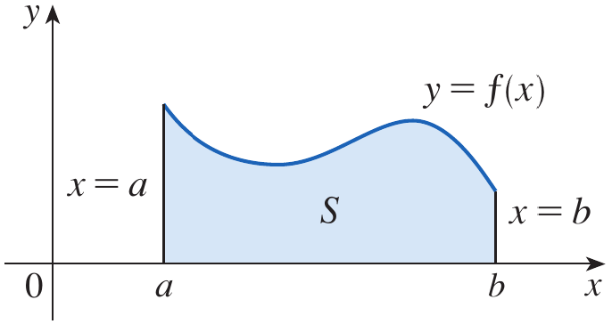

<span><strong>Figure 1.</strong> A continuous curve $y=f(x)$ above the $x$-axis between $x=a$ and $x=b$, with the region $S$ under the curve shaded.</span>
</div>

Area is the part of a plane covered by a two-dimensional region. For familiar regions with straight sides, we already have formulas for area. The area of a rectangle is length times width, $A=lw$. The area of a triangle is one-half the base times the height, $A=\frac12 bh$. A polygon can be divided into triangles, and its area is the sum of the areas of those triangles.

<div style="text-align: center;">
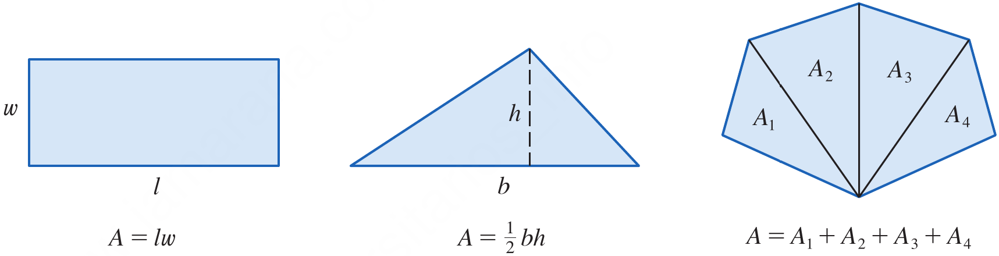

<span><strong>Figure 2.</strong> A rectangle labeled $A=lw$, a triangle labeled $A=\frac12 bh$, and a polygon divided into triangles labeled with the sum of their areas.</span>
</div>

It is not so easy to find the area of a region with a curved boundary. One goal of the area problem is to turn our intuitive idea of area into an exact mathematical definition. We use an idea similar to the one used when defining a tangent line. First, we approximated the tangent slope using secant lines through a fixed point $P$ and a moving point $Q$. We then allowed $Q$ to approach $P$ and took a limit. For area, we first approximate the region with rectangles and then take the limit of the sum of their areas as the number of rectangles increases.

## Example 1 {.green}

Use rectangles to estimate the area under the parabola $y=x^2$ from $0$ to $1$ (the parabolic region $S$ illustrated in Figure 3).

<div style="text-align: center;">
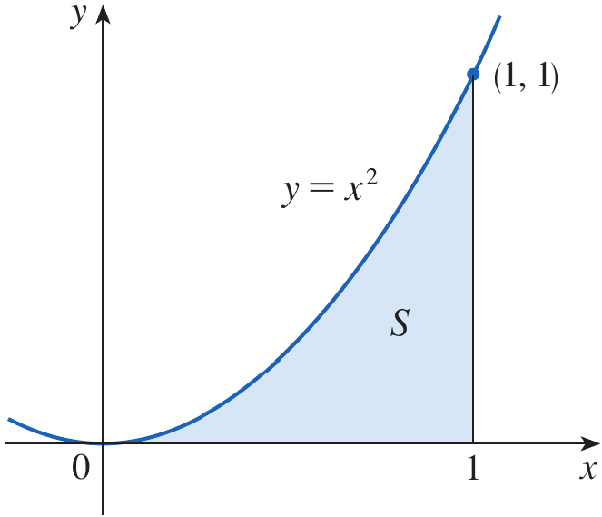

<span><strong>Figure 3.</strong> The parabolic region $S$ under $y=x^2$ from $x=0$ to $x=1$.</span>
</div>

## Solution {.green}

The region $S$ is contained in a square with side length $1$, so its area $A$ is between $0$ and $1$. We can improve this broad estimate by dividing the interval $[0,1]$ into four equal subintervals. Draw vertical lines at $x=\frac14$, $x=\frac12$, and $x=\frac34$, as shown in Figure 4.

The width of each subinterval is

$$
\Delta x=\frac{1-0}{4}=\frac14
$$

The four subintervals are $[0,\frac14]$, $[\frac14,\frac12]$, $[\frac12,\frac34]$, and $[\frac34,1]$.

<div style="text-align: center;">
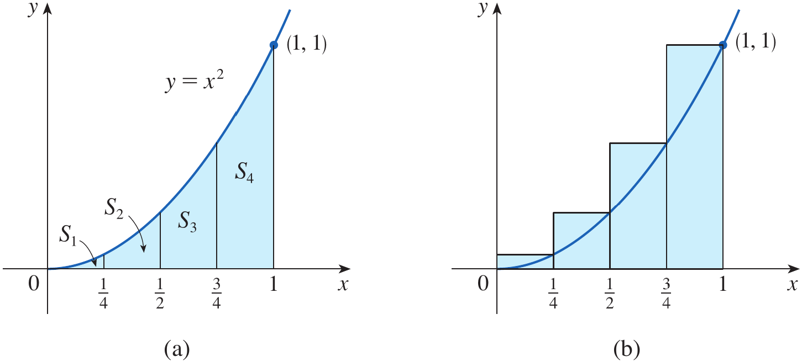

<span><strong>Figure 4.</strong> The region under $y=x^2$ divided into four vertical strips, followed by four rectangles whose heights are determined by the right edges of the strips.</span>
</div>

### Using right endpoints

Approximate each strip by a rectangle with the same width and with height equal to the function value at the right endpoint. The right endpoints are $\frac14$, $\frac12$, $\frac34$, and $1$. Since $f(x)=x^2$, the rectangle heights are

$$
f\left(\frac14\right)=\frac1{16},\quad
f\left(\frac12\right)=\frac14,\quad
f\left(\frac34\right)=\frac9{16},\quad
f(1)=1
$$

Each rectangle has width $\frac14$. If $R_4$ denotes the sum of their areas, then

$$
\begin{aligned}
R_4&=\frac14\left(\frac14\right)^2
+\frac14\left(\frac12\right)^2
+\frac14\left(\frac34\right)^2
+\frac14(1)^2\\
&=\frac14\left(\frac1{16}+\frac4{16}+\frac9{16}+\frac{16}{16}\right)\\
&=\frac{30}{64}\\
&=\frac{15}{32}=0.46875
\end{aligned}
$$

Because $f(x)=x^2$ is increasing on $[0,1]$, the right-endpoint rectangles extend above the curve. Therefore, $R_4$ is an overestimate of the area, and $A<0.46875$.

### Using left endpoints

We can instead use the left endpoint of each subinterval to determine the rectangle height. The left endpoints are $0$, $\frac14$, $\frac12$, and $\frac34$. Their function values are $0$, $\frac1{16}$, $\frac14$, and $\frac9{16}$. The first rectangle has height zero and therefore collapses to the $x$-axis, as shown in Figure 5.

The left-endpoint sum is

$$
\begin{aligned}
L_4&=\frac14(0)^2+\frac14\left(\frac14\right)^2
+\frac14\left(\frac12\right)^2+\frac14\left(\frac34\right)^2\\
&=\frac14\left(0+\frac1{16}+\frac4{16}+\frac9{16}\right)\\
&=\frac{14}{64}\\
&=\frac7{32}=0.21875
\end{aligned}
$$

Since the function is increasing, the left-endpoint rectangles lie below the curve, so $L_4$ is an underestimate. Combining both estimates gives

$$
0.21875<A<0.46875
$$

<div style="text-align: center;">
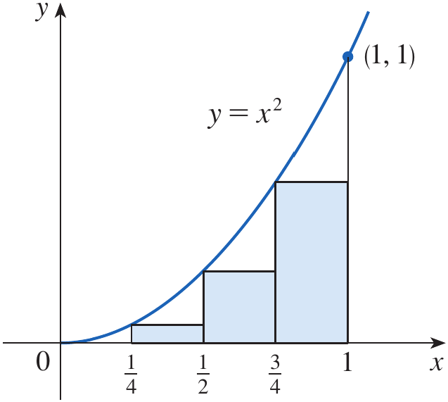

<span><strong>Figure 5.</strong> Four left-endpoint rectangles under $y=x^2$ on $[0,1]$, with the first rectangle having zero height.</span>
</div>

### Increasing the number of rectangles

We can obtain better estimates by dividing the region into eight equal strips. Figure 6 compares the left- and right-endpoint rectangles for $n=8$. The left rectangles give a lower estimate, while the right rectangles give an upper estimate:

$$
0.2734375<A<0.3984375
$$

<div style="text-align: center;">
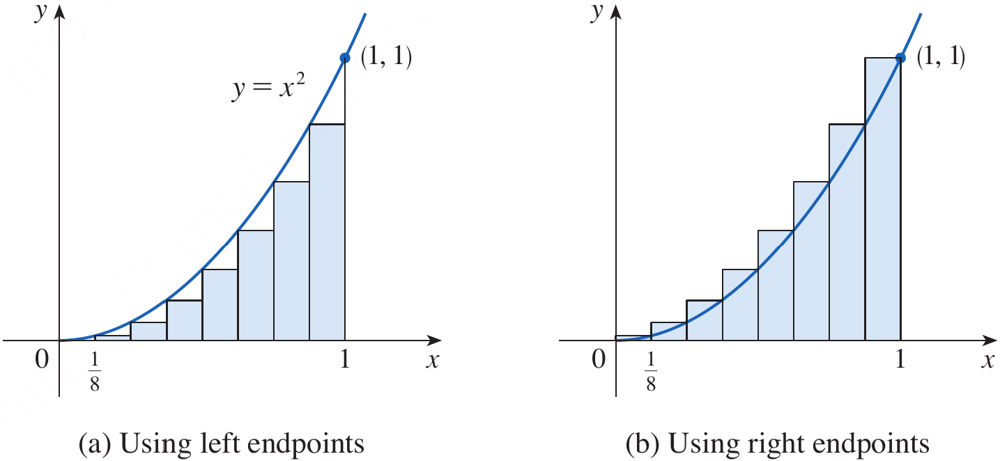

<span><strong>Figure 6.</strong> Two diagrams of the region under $y=x^2$ using eight rectangles, one based on left endpoints and the other on right endpoints.</span>
</div>

The estimates improve as the number of rectangles increases. The following table, calculated using left and right endpoints, shows how the two estimates move closer together.

<div style="text-align: center;">
<span><strong>Table 1.</strong> Left- and right-endpoint estimates for the area under $y=x^2$ on $[0,1]$.</span>
</div>

| Number of rectangles $n$ | Left sum $L_n$ | Right sum $R_n$ |
|---:|---:|---:|
| 10 | 0.2850000 | 0.3850000 |
| 20 | 0.3087500 | 0.3587500 |
| 30 | 0.3168519 | 0.3501852 |
| 50 | 0.3234000 | 0.3434000 |
| 100 | 0.3283500 | 0.3383500 |
| 1000 | 0.3328335 | 0.3338335 |

For this increasing function, the left sums increase and the right sums decrease as $n$ increases. The gap between the estimates becomes smaller. With $1000$ rectangles, the area lies between $0.3328335$ and $0.3338335$. Averaging these bounds gives the estimate $A\approx0.3333335$.

<div class="example-end">$\blacksquare$</div>

A Python program to estimate the area with any domain and number of subintervals is given below.

```python
import numpy as np

def f(x):
    return x**2
    
start = float(input("Enter the starting point: "))
stop = float(input("Enter the stopping point: "))
sub_intervals = int(input("Enter the number of subintervals: "))

delta_x = np.linspace(start, stop, sub_intervals+1)
width = delta_x[1]

areas = width*f(delta_x)

sum_right = np.sum(areas[1:])
print(f"R = {sum_right:.6f}")

sum_left = np.sum(areas[:-1])
print(f"L = {sum_left:.6f}")
```

## From Rectangle Estimates to a Limit

So far, we have used a finite number of rectangles. Their top edges do not generally match the curved boundary exactly, so the sums give approximations rather than the exact area. What if we increase the number of rectangles without bound? As the number $n$ grows, each rectangle becomes narrower. If the left- and right-endpoint sums approach the same number, that common limit gives the exact area. Example 2 establishes this result for $y=x^2$ on $[0,1]$.

## Example 2 {.green}

For the region $S$ in Example 1, show that the approximating sums $R_n$ approach $\frac13$, that is,

$$
\lim_{n\to\infty}R_n=\frac13
$$

## Solution {.green}

Divide $[0,1]$ into $n$ equal subintervals. Each rectangle has width $\Delta x=\frac1n$. The right endpoints are

$$
x_i=\frac{i}{n},\qquad i=1,2,\ldots,n
$$

The height of the $i$th rectangle is $f(x_i)=x_i^2=(\frac{i}{n})^2$. Therefore, the right-endpoint sum is

$$
\begin{aligned}
R_n&=\sum_{i=1}^{n}f(x_i)\Delta x\\
&=\sum_{i=1}^{n}\left(\frac{i}{n}\right)^2\frac1n\\
&=\frac1{n^3}\sum_{i=1}^{n}i^2
\end{aligned}
$$

Use the sum-of-squares formula

$$
1^2+2^2+\cdots+n^2=\frac{n(n+1)(2n+1)}6
$$

Substituting this formula gives

$$
\begin{aligned}
R_n&=\frac1{n^3}\cdot\frac{n(n+1)(2n+1)}6\\
&=\frac{n(n+1)(2n+1)}{6n^3}\\
&=\frac16\left(1+\frac1n\right)\left(2+\frac1n\right)
\end{aligned}
$$

As $n\to\infty$, $\frac1n\to0$. Hence,

$$
\begin{aligned}
\lim_{n\to\infty}R_n
&=\frac16(1+0)(2+0)\\
&=\frac13
\end{aligned}
$$

Therefore, the right-endpoint sums approach $\frac13$.

<div style="text-align: center;">
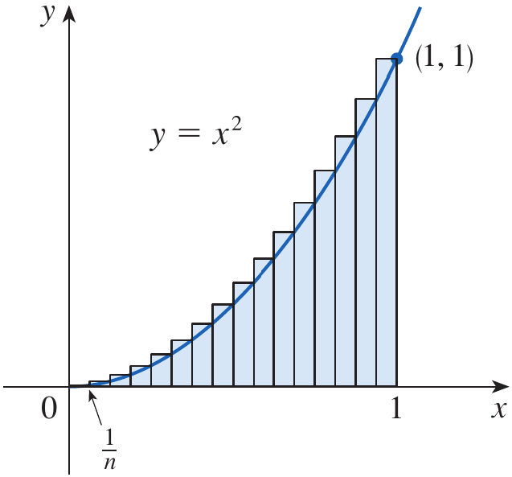

<span><strong>Figure 7.</strong> The region under $y=x^2$ on $[0,1]$ approximated by $n$ right-endpoint rectangles of width $\frac1n$.</span>
</div>

The left-endpoint sum is

$$
\begin{aligned}
L_n&=\frac1n\sum_{i=0}^{n-1}\left(\frac{i}{n}\right)^2\\
&=\frac1{n^3}\sum_{i=0}^{n-1}i^2\\
&=\frac{(n-1)n(2n-1)}{6n^3}
\end{aligned}
$$

Taking the limit also gives

$$
\lim_{n\to\infty}L_n=\frac13
$$

Thus, both left- and right-endpoint sums approach the same area, $\frac13$.

The diagrams in Figures 8 and 9 compare approximations for $n=10$, $30$, and $50$. In Figure 8, the right-endpoint sums are $R_{10}=0.385$, $R_{30}\approx0.3502$, and $R_{50}=0.3434$. These are overestimates that decrease toward $\frac13$. In Figure 9, the left-endpoint sums are $L_{10}=0.285$, $L_{30}\approx0.3169$, and $L_{50}=0.3234$. These are underestimates that increase toward $\frac13$. As $n$ increases, both types of estimates converge to the exact area.

<div style="text-align: center;">
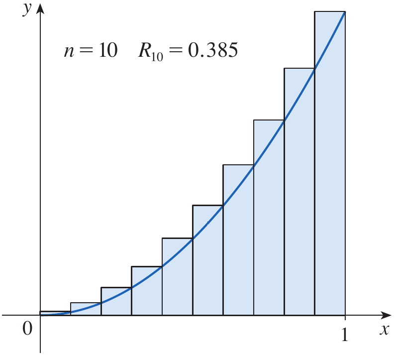
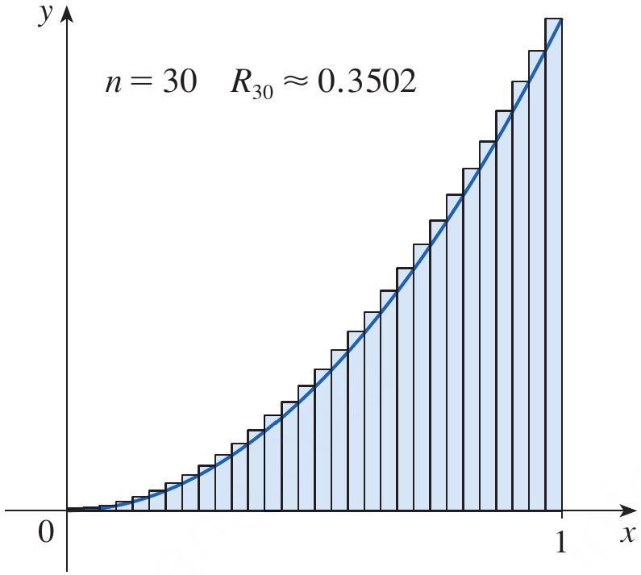
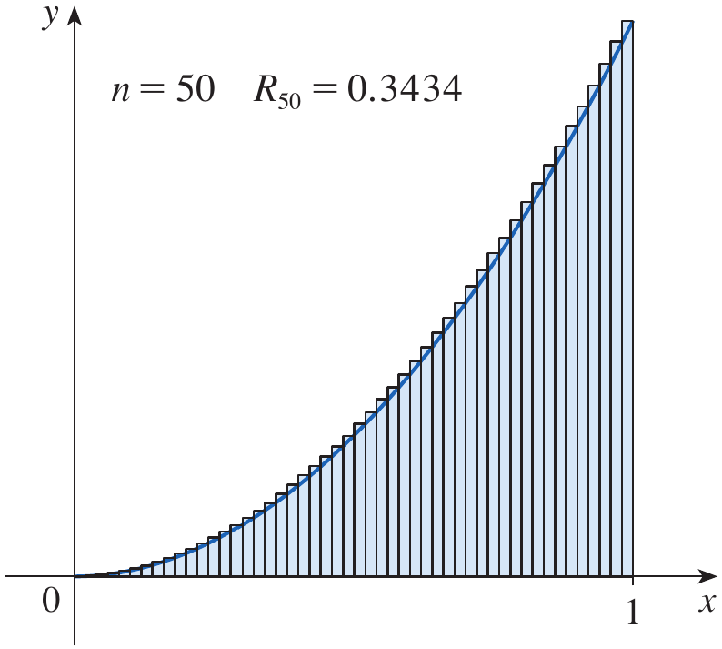
<span><strong>Figure 8.</strong> Right-endpoint rectangle approximations for $y=x^2$ with $n=10$, $n=30$, and $n=50$, showing decreasing upper estimates.</span>
</div>

<div style="text-align: center;">
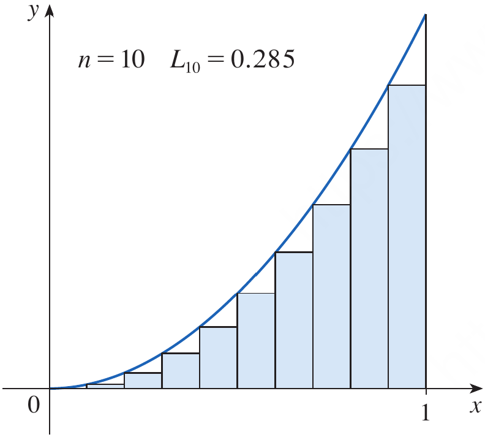
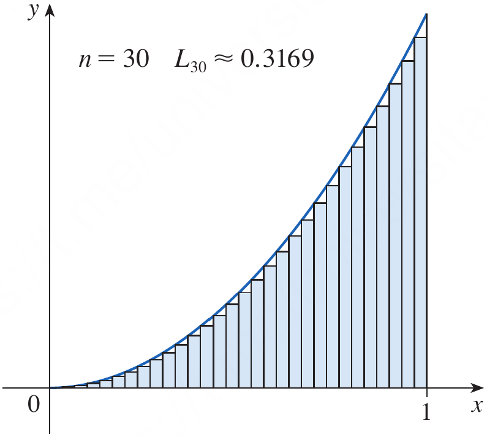
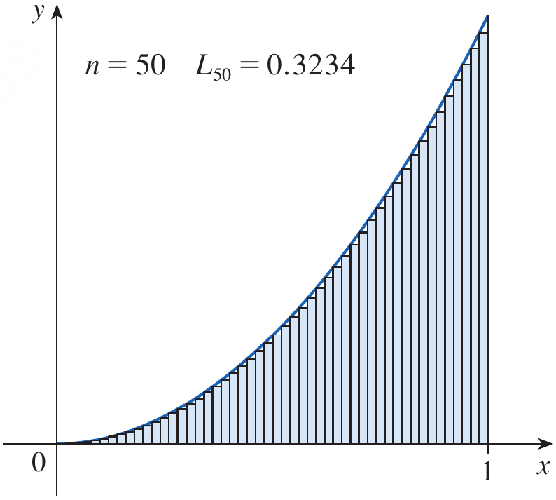
<span><strong>Figure 9.</strong> Left-endpoint rectangle approximations for $y=x^2$ with $n=10$, $n=30$, and $n=50$, showing increasing lower estimates.</span>
</div>

## Generalizing the Rectangle Method

Now consider a continuous function $y=f(x)$ that is nonnegative on $[a,b]$. Divide the region under the graph into $n$ vertical strips of equal width, as illustrated in Figure 10. The interval length is $b-a$, so the width of each strip is

$$
\Delta x=\frac{b-a}{n}
$$

The partition points are

$$
x_0=a,\quad x_1=a+\Delta x,\quad x_2=a+2\Delta x,\quad\ldots,\quad x_n=b
$$

In general,

$$
x_i=a+i\Delta x=a+i\frac{b-a}{n}
$$

The interval is divided into subintervals $[x_0,x_1]$, $[x_1,x_2]$, and so on, through $[x_{n-1},x_n]$. Each has width $x_i-x_{i-1}=\Delta x$.

<div style="text-align: center;">
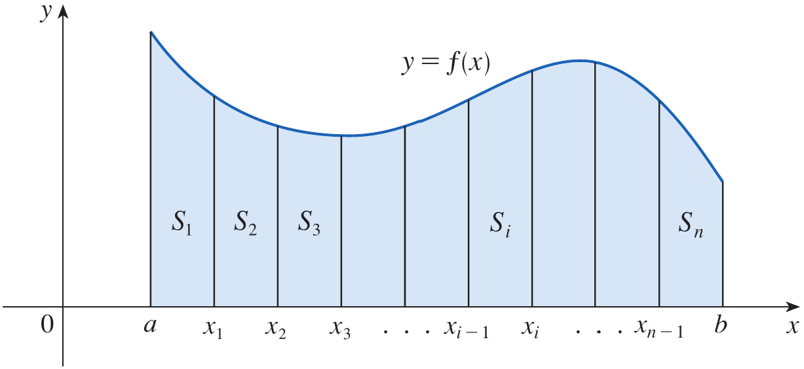

<span><strong>Figure 10.</strong> A general nonnegative continuous curve $y=f(x)$ on $[a,b]$, divided into $n$ vertical strips with partition points labeled along the $x$-axis.</span>
</div>

Approximate the $i$th strip by a rectangle whose width is $\Delta x$ and whose height is the value of $f$ at the right endpoint, $f(x_i)$, as shown in Figure 11. Its area is $f(x_i)\Delta x$. Adding the areas of all $n$ rectangles gives

$$
R_n=f(x_1)\Delta x+f(x_2)\Delta x+\cdots+f(x_n)\Delta x
$$

<div style="text-align: center;">
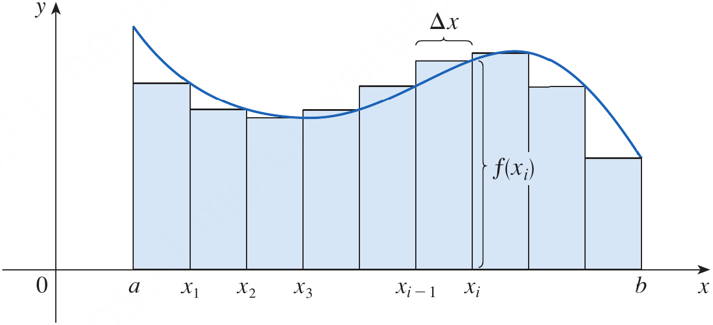

<span><strong>Figure 11.</strong> A general region divided into rectangles, with one representative rectangle labeled with width $\Delta x$ and height $f(x_i)$.</span>
</div>

The right-endpoint sum $R_n$ approximates the area. Figure 12 shows rectangle approximations using $n=2$, $4$, $8$, and $12$. With only two rectangles, the approximation may differ substantially from the curved region. Increasing the number to four, eight, and twelve makes the rectangles narrower and typically improves the fit. As $n\to\infty$, the width $\Delta x$ approaches zero, and the sums approach the exact area for a continuous function.

<div style="text-align: center;">
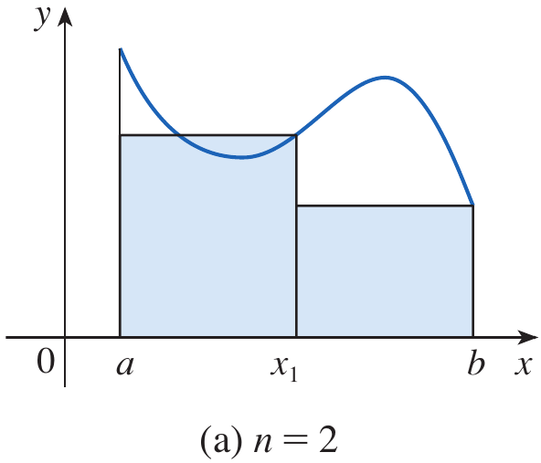
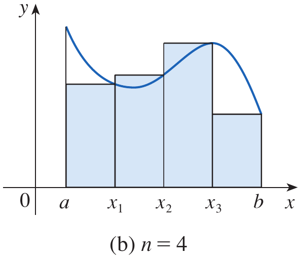
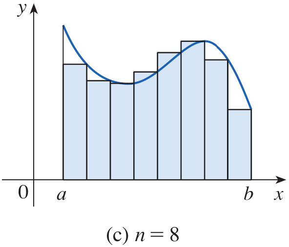
<span><strong>Figure 12.</strong> Four approximations to a general region under $y=f(x)$ using $n=2$, $n=4$, $n=8$, and $n=12$ rectangles.</span>
</div>

## Definition: Area of a Region Bounded by $f(x)$ and $y=0$ between $[a,b]$ {.blue}

The area $A$ of the region $S$ that lies under the graph of a continuous, nonnegative function $f$ on $[a,b]$ is the limit of the sums of the areas of the approximating rectangles:

$$
A=\lim_{n\to\infty}R_n
=\lim_{n\to\infty}\left[f(x_1)\Delta x+f(x_2)\Delta x+\cdots+f(x_n)\Delta x\right]
$$

where $\Delta x=\frac{b-a}{n}$ and $x_i=a+i\Delta x$. Because $f$ is continuous, this limit exists. The same area is obtained by using left endpoints:

$$
A=\lim_{n\to\infty}L_n
=\lim_{n\to\infty}\left[f(x_0)\Delta x+f(x_1)\Delta x+\cdots+f(x_{n-1})\Delta x\right]
$$

Thus, left-endpoint and right-endpoint sums may differ for a finite number of rectangles, but they approach the same area as $n$ tends to infinity.

<div class="definition-end">$\blacksquare$</div>

## Sample Points, Lower Sums, and Upper Sums

Instead of using a left or right endpoint to determine a rectangle's height, choose any sample point $x_i^*$ in the $i$th subinterval $[x_{i-1},x_i]$. The height is $f(x_i^*)$, and the rectangle area is $f(x_i^*)\Delta x$. Figure 13 illustrates rectangles whose sample points are chosen within the subintervals rather than necessarily at endpoints.

The corresponding sum is

$$
S_n=\sum_{i=1}^{n}f(x_i^*)\Delta x
$$

For a continuous function, these sums approach the same area as the subinterval widths approach zero:

$$
A=\lim_{n\to\infty}\sum_{i=1}^{n}f(x_i^*)\Delta x
$$

<div style="text-align: center;">
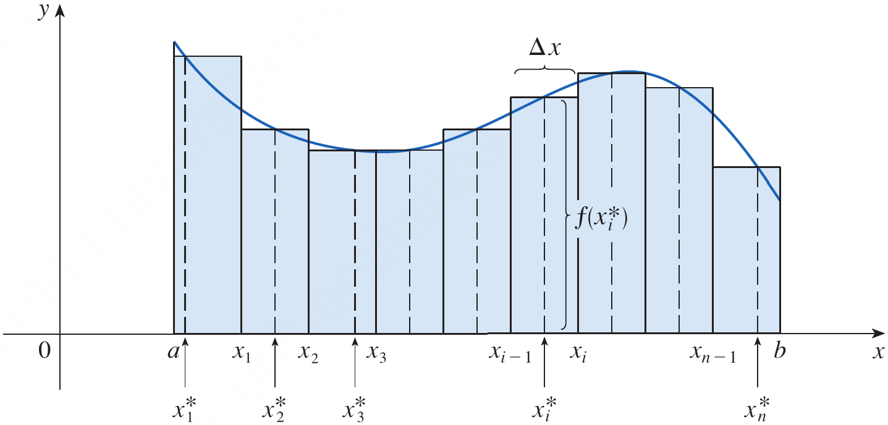

<span><strong>Figure 13.</strong> Rectangle approximations under a general curve using sample points $x_1^*,x_2^*,\ldots,x_n^*$ selected within their respective subintervals.</span>
</div>

On each subinterval, choose the minimum value of $f$ to obtain a rectangle that lies at or below the curve. The sum of these areas is called a **lower sum**. Choosing the maximum value of $f$ on each subinterval gives rectangles that cover the curve on those subintervals; the sum is called an **upper sum**. Since a continuous function attains its minimum and maximum on each closed subinterval, these sums are well-defined. Figure 14 shows lower sums, upper sums, and both types together. The area is greater than or equal to every lower sum and less than or equal to every upper sum. The area is the unique number lying between all lower and upper sums.

<div style="text-align: center;">
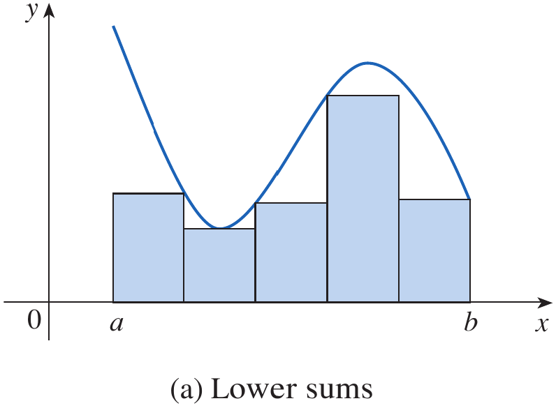
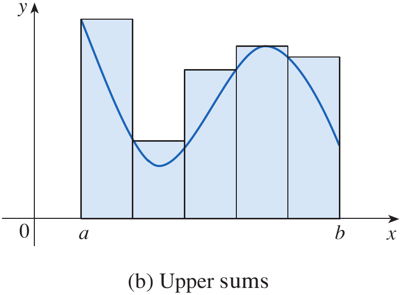
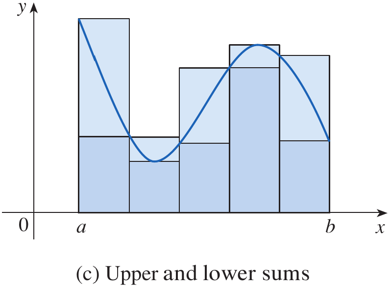
<span><strong>Figure 14.</strong> Three diagrams illustrating lower sums, upper sums, and lower and upper rectangles together.</span>
</div>

For $f(x)=x^2$ on $[0,1]$, the left-endpoint sum is a lower sum and the right-endpoint sum is an upper sum because the function is increasing. With $\Delta x=\frac1n$, these sums are

$$
L_n=\frac1n\sum_{i=0}^{n-1}\left(\frac{i}{n}\right)^2
$$

$$
R_n=\frac1n\sum_{i=1}^{n}\left(\frac{i}{n}\right)^2
$$

A sample-point sum for this same function is

$$
S_n=\frac1n\sum_{i=1}^{n}(x_i^*)^2
$$

where $x_i^*\in[\frac{i-1}{n},\frac{i}{n}]$. All three sums approach $\frac13$ as $n\to\infty$. Notice that left endpoints are not always lower endpoints, nor are right endpoints always upper endpoints; that relationship depends on the function's behavior.

Sigma notation is a compact way to write sums with many terms. The expression $\sum_{i=1}^{n}f(x_i)\Delta x$ means to add $f(x_i)\Delta x$ for $i=1,2,\ldots,n$. The lower index indicates where the sum begins, and the upper index indicates where it ends. The three area formulas can therefore be written as

$$
A=\lim_{n\to\infty}\sum_{i=1}^{n}f(x_i)\Delta x
$$

$$
A=\lim_{n\to\infty}\sum_{i=1}^{n}f(x_{i-1})\Delta x
$$

$$
A=\lim_{n\to\infty}\sum_{i=1}^{n}f(x_i^*)\Delta x
$$

## Example 3 {.green}

Let $A$ be the area of the region that lies under the graph of $f(x)=e^{-x}$ between $x=0$ and $x=2$.

**(a)** Using right endpoints, find an expression for $A$ as a limit. Do not evaluate the limit.

**(b)** Estimate the area by taking the sample points to be midpoints and using four subintervals and then ten subintervals.

## Solution {.green}

### Part (a): Expressing the area as a limit

Here $a=0$, $b=2$, and $f(x)=e^{-x}$. Divide $[0,2]$ into $n$ equal subintervals. The width of each subinterval is

$$
\Delta x=\frac{2-0}{n}=\frac2n
$$

The right endpoints are

$$
x_i=a+i\Delta x=\frac{2i}{n}
$$

The height of the $i$th rectangle is $f(x_i)=e^{-2i/n}$. Therefore, the sum of the rectangle areas is

$$
\begin{aligned}
R_n&=\sum_{i=1}^{n}f(x_i)\Delta x\\
&=\sum_{i=1}^{n}e^{-2i/n}\frac2n\\
&=\frac2n\sum_{i=1}^{n}e^{-2i/n}
\end{aligned}
$$

By the definition of area, the exact area is expressed as

$$
A=\lim_{n\to\infty}\frac2n\sum_{i=1}^{n}e^{-2i/n}
$$

The problem asks us to set up this limit, not evaluate it.

### Part (b): Midpoint estimate using four subintervals

For $n=4$, the width is $\Delta x=\frac24=0.5$. The subintervals are $[0,0.5]$, $[0.5,1]$, $[1,1.5]$, and $[1.5,2]$. Their midpoints are $0.25$, $0.75$, $1.25$, and $1.75$, as shown in Figure 15.

The midpoint sum is

$$
\begin{aligned}
M_4&=\sum_{i=1}^{4}f(x_i^*)\Delta x\\
&=0.5\left(e^{-0.25}+e^{-0.75}+e^{-1.25}+e^{-1.75}\right)\\
&\approx0.8557
\end{aligned}
$$

Thus, the midpoint estimate of the area is $M_4\approx0.8557$.

<div style="text-align: center;">
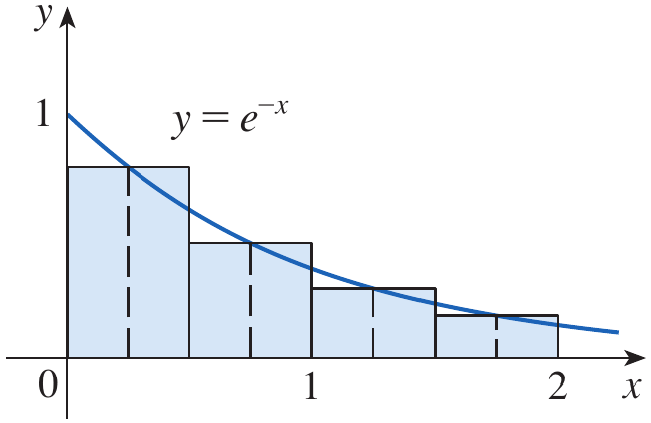

<span><strong>Figure 15.</strong> The graph $y=e^{-x}$ from $x=0$ to $x=2$, with four midpoint rectangles of width $0.5$.</span>
</div>

### Midpoint estimate using ten subintervals

For $n=10$, the width is $\Delta x=\frac2{10}=0.2$. The subintervals are $[0,0.2]$, $[0.2,0.4]$, and so on, through $[1.8,2]$. The midpoints are $0.1$, $0.3$, $0.5$, and so on, through $1.9$, as shown in Figure 16.

The midpoint sum is

$$
\begin{aligned}
M_{10}&=\sum_{i=1}^{10}f(x_i^*)\Delta x\\
&=0.2\left(e^{-0.1}+e^{-0.3}+e^{-0.5}+\cdots+e^{-1.9}\right)\\
&\approx0.8632
\end{aligned}
$$

Thus, the midpoint estimate is $M_{10}\approx0.8632$. This estimate is closer to the area than the four-subinterval estimate, illustrating how a finer partition can improve an approximation.

<div style="text-align: center;">
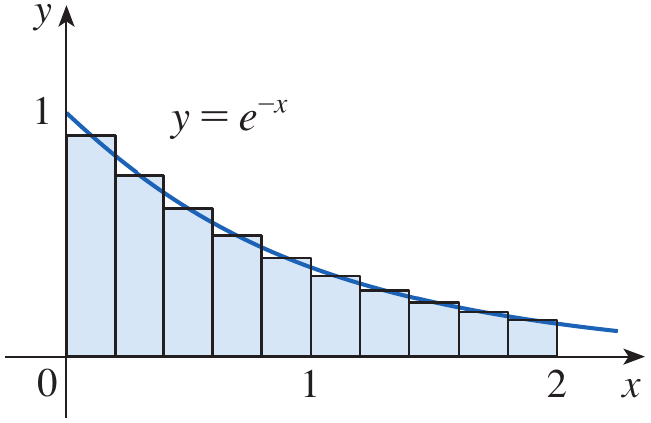

<span><strong>Figure 16.</strong> The graph $y=e^{-x}$ from $x=0$ to $x=2$, with ten midpoint rectangles of width $0.2$.</span>
</div>

<div class="example-end">$\blacksquare$</div>

A Python program to estimate the area under the curve of $e^{-x}$ in any defined domain and number of subintervals is given below.

```python
import numpy as np

def f(x):
    return np.exp(-x)
    
start = float(input("Enter the starting point: "))
stop = float(input("Enter the stopping point: "))
sub_intervals = int(input("Enter the number of subintervals: "))

delta_x = np.linspace(start, stop, sub_intervals+1)
width = delta_x[1]

areas = width*f(delta_x)

sum_right = np.sum(areas[1:])
print(f"R = {sum_right:.6f}")

sum_left = np.sum(areas[:-1])
print(f"L = {sum_left:.6f}")
```

# Quick Check

## Question 1 {.red}

For $f(x)=x^2$ on $[0,1]$, calculate the right-endpoint sum $R_2$ using two equal subintervals.

## Answer {.red}

The width is $\Delta x=\frac12$ and the right endpoints are $\frac12$ and $1$. Therefore,

$$
R_2=\frac12\left[f\left(\frac12\right)+f(1)\right]
=\frac12\left(\frac14+1\right)
=\frac58=0.625
$$

## Question 2 {.red}

If a function is increasing on $[a,b]$, do left-endpoint rectangles give an overestimate or an underestimate of the area under its graph?

## Answer {.red}

They give an underestimate because the left-endpoint height is no greater than the function values to its right on each subinterval. Right-endpoint rectangles give an overestimate.

<div class="question-end">$\blacksquare$</div>

# The Distance Problem

## From Constant Velocity to Variable Velocity

If an object moves at a constant velocity $v$ for a time interval of length $t$, the distance travelled in the direction of motion is

$$
d=vt
$$

This formula works directly when the velocity is constant. If velocity varies with time, we cannot generally multiply one velocity reading by the entire time interval. Instead, we estimate the distance over short intervals during which the velocity does not change very much.

Suppose the velocity is positive and is represented by $v=f(t)$ over the interval $a\leq t\leq b$. Divide the time interval into smaller subintervals. On each subinterval, approximate the velocity by a selected velocity reading. The estimated distance over that subinterval is the selected velocity multiplied by the length of the subinterval. Adding these estimated distances gives an approximation to the total distance.

Geometrically, each product is the area of a rectangle under or near the velocity graph. Thus, the sum of the rectangle areas estimates the area under the velocity curve, and that area estimates the distance travelled.

## Example 4 {.green}

Suppose the odometer on our car is broken and we want to estimate the distance driven over a 30-second time interval. We take speedometer readings every five seconds and record them in the following table.

<div style="text-align: center;">

<span><strong>Table 1.</strong> Recorded time and speedometer readings.</span>

</div>

| Time (s) | 0 | 5 | 10 | 15 | 20 | 25 | 30 |
|:--|--:|--:|--:|--:|--:|--:|--:|
| Velocity (km/h) | 27 | 34 | 39 | 47 | 51 | 50 | 45 |

## Solution {.green}

### Step 1: Convert the velocity readings to metres per second

Time is measured in seconds, so we should express velocity in metres per second. We use

$$
1\text{ km/h}=\frac{1000}{3600}\text{ m/s}=\frac{1}{3.6}\text{ m/s}
$$

Using the approximate converted readings listed in the textbook gives the following table. These are approximate values used for the distance estimates.

<div style="text-align: center;">

<span><strong>Table 2.</strong> Velocity readings converted to metres per second.</span>

</div>

| Time (s) | 0 | 5 | 10 | 15 | 20 | 25 | 30 |
|:--|--:|--:|--:|--:|--:|--:|--:|
| Velocity (m/s) | 8 | 9 | 10 | 12 | 13 | 12 | 11 |

For example, the first reading is

$$
27\text{ km/h}=\frac{27}{3.6}\text{ m/s}=7.5\text{ m/s}\approx8\text{ m/s}
$$

The time readings divide the 30-second period into six intervals, each of width

$$
\Delta t=5\text{ s}
$$

### Step 2: Estimate distance during the first two intervals

During the first interval, from $t=0$ to $t=5$ seconds, the velocity is approximately $8$ m/s if we use the reading at the beginning of the interval. The estimated distance is

$$
d_1\approx(8\text{ m/s})(5\text{ s})=40\text{ m}
$$

During the second interval, from $t=5$ to $t=10$ seconds, we use the initial velocity reading of $9$ m/s. Thus,

$$
d_2\approx(9\text{ m/s})(5\text{ s})=45\text{ m}
$$

We continue in the same way for the remaining intervals. This is a left-endpoint estimate because the velocity at the left endpoint of each interval is used.

### Step 3: Estimate the complete distance using left endpoints

Using the velocity at the beginning of each interval, the six estimates are

$$
\begin{aligned}
d_1&\approx8(5)=40\text{ m}\\
d_2&\approx9(5)=45\text{ m}\\
d_3&\approx10(5)=50\text{ m}\\
d_4&\approx12(5)=60\text{ m}\\
d_5&\approx13(5)=65\text{ m}\\
d_6&\approx12(5)=60\text{ m}
\end{aligned}
$$

Adding the estimates gives

$$
\begin{aligned}
L&=(8+9+10+12+13+12)(5)\\
&=64(5)\\
&=320\text{ m}
\end{aligned}
$$

Therefore, the left-endpoint estimate of the distance travelled is

$$
\boxed{L=320\text{ m}}
$$

### Step 4: Estimate the complete distance using right endpoints

We can instead use the velocity at the end of each interval. The six velocity readings are now $9,10,12,13,12,$ and $11$ m/s. The estimated distances for the first two intervals are

$$
d_1\approx(9\text{ m/s})(5\text{ s})=45\text{ m}
$$

$$
d_2\approx(10\text{ m/s})(5\text{ s})=50\text{ m}
$$

For all six intervals, the right-endpoint estimate is

$$
\begin{aligned}
R&=(9+10+12+13+12+11)(5)\\
&=67(5)\\
&=335\text{ m}
\end{aligned}
$$

Thus, the right-endpoint estimate of the distance travelled is

$$
\boxed{R=335\text{ m}}
$$

The two estimates differ because the velocity changes during the 30-second period and the two methods use different readings on each interval. The estimates are not expected to be exactly equal. They provide two approximations to the distance travelled.

Location of Figure 17: Velocity graph with rectangular approximations using left-endpoint velocities, more frequent velocity readings, and a refined approximation to the area under the velocity curve.

Figure 17 illustrates the idea geometrically. In panel (a), the rectangles use velocities at the beginning of the intervals. In panel (b), more intervals give a finer approximation. In panel (c), the rectangles fit the area under the velocity curve more closely. Each rectangle's height represents velocity and its width represents elapsed time, so its area represents an estimated distance.

<div class="example-end">$\blacksquare$</div>

## Generalizing the Distance Estimate

Suppose an object moves in the positive direction with velocity

$$
v=f(t),\qquad a\leq t\leq b
$$

We want to estimate the distance travelled from time $t=a$ to time $t=b$.

### Step 1: Divide the time interval

Divide $[a,b]$ into $n$ equal subintervals. The width of each interval is

$$
\Delta t=\frac{b-a}{n}
$$

The partition points are

$$
t_i=a+i\Delta t,\qquad i=0,1,\ldots,n
$$

Thus, $t_0=a$ and $t_n=b$. Each interval is $[t_{i-1},t_i]$ and has width $\Delta t$.

### Step 2: Use left endpoints

On the first interval, $[t_0,t_1]$, approximate the velocity by $f(t_0)$. The estimated distance is

$$
f(t_0)\Delta t
$$

On the second interval, $[t_1,t_2]$, use $f(t_1)$, giving the estimate

$$
f(t_1)\Delta t
$$

Continuing in this way, the left-endpoint estimate for the whole time interval is

$$
L_n=f(t_0)\Delta t+f(t_1)\Delta t+\cdots+f(t_{n-1})\Delta t
$$

Equivalently,

$$
\boxed{L_n=\sum_{i=1}^{n}f(t_{i-1})\Delta t}
$$

This sum is called a left-endpoint sum. Each term is the area of a rectangle whose height is the velocity at the left endpoint and whose width is $\Delta t$.

### Step 3: Use right endpoints

We can instead use the velocity at the right endpoint of each subinterval. For the first interval, use $f(t_1)$; for the second, use $f(t_2)$; and so on. The estimate becomes

$$
R_n=f(t_1)\Delta t+f(t_2)\Delta t+\cdots+f(t_n)\Delta t
$$

Equivalently,

$$
\boxed{R_n=\sum_{i=1}^{n}f(t_i)\Delta t}
$$

This is called a right-endpoint sum. Again, each term represents a rectangle area and the sum estimates the distance travelled.

### Step 4: Increase the number of subintervals

When $n$ increases, the width $\Delta t=(b-a)/n$ decreases. The velocity usually varies less over each shorter interval, so the constant-velocity approximation on each interval becomes more representative of the actual motion. Consequently, the rectangular estimates generally improve as the intervals become finer.

For a sufficiently well-behaved velocity function, the left- and right-endpoint sums approach the same limit as the number of subintervals increases without bound. The exact distance is therefore represented by

$$
\boxed{
d=\lim_{n\to\infty}\sum_{i=1}^{n}f(t_{i-1})\Delta t
=\lim_{n\to\infty}\sum_{i=1}^{n}f(t_i)\Delta t
}
$$

The equality does **not** mean that the left- and right-endpoint estimates are equal for every finite value of $n$. In general, $L_n$ and $R_n$ can differ, as they did in Example 4. The statement means that, as the intervals become arbitrarily small, both sums approach the same exact distance.

Geometrically, the sums are areas of rectangles under or near the graph of velocity against time. In the limit, the approximation becomes the area under the velocity curve. This gives the central connection between the distance problem and the area problem.

# Quick Check

## Question 1 {.red}

A robot moves at an approximately constant velocity of $3$ m/s for $4$ seconds. Estimate the distance travelled.

## Answer {.red}

Using distance = velocity $\times$ time,

$$
d=3(4)=12\text{ m}
$$

$$
\boxed{12\text{ m}}
$$

## Question 2 {.red}

For a time interval divided into $n$ equal subintervals, which velocity readings are used in a left-endpoint sum and which are used in a right-endpoint sum?

## Answer {.red}

A left-endpoint sum uses the velocity at the beginning of each subinterval:

$$
L_n=\sum_{i=1}^{n}f(t_{i-1})\Delta t
$$

A right-endpoint sum uses the velocity at the end of each subinterval:

$$
R_n=\sum_{i=1}^{n}f(t_i)\Delta t
$$

<div class="question-end">$\blacksquare$</div>

# Scenario Problem

## Problem {.green}

A mechatronics team tests a mobile robot moving along a straight track. Its speed is modeled by $v(t)=0.5t+1$ meters per second for $0\leq t\leq4$, where $t$ is measured in seconds. Estimate the distance traveled using four right-endpoint rectangles.

## Solution {.green}

Divide the interval $[0,4]$ into four equal subintervals. The width is

$$
\Delta t=\frac{4-0}{4}=1\text{ second}
$$

The right endpoints are $t=1,2,3,4$. The corresponding speeds are $v(1)=1.5$, $v(2)=2$, $v(3)=2.5$, and $v(4)=3$ meters per second. The right-endpoint estimate for distance is

$$
\begin{aligned}
R_4&=[v(1)+v(2)+v(3)+v(4)]\Delta t\\
&=(1.5+2+2.5+3)(1)\\
&=9\text{ m}
\end{aligned}
$$

The estimated distance is $9$ meters. Since the speed is increasing, right-endpoint rectangles overestimate the distance on each subinterval. Using more, narrower time intervals would improve the estimate and, in the limit, the rectangle sums would approach the exact accumulated distance.

<div class="example-end">$\blacksquare$</div>

## Problem {.green}

A mobile robot travels along a straight warehouse aisle. Its controller records the robot's forward velocity at five-second intervals over a 20-second period. The readings, expressed in metres per second, are shown below.

<div style="text-align: center;">

<span><strong>Table 3.</strong> Recorded velocity of a mobile robot.</span>

</div>

| Time (s) | 0 | 5 | 10 | 15 | 20 |
|:--|--:|--:|--:|--:|--:|
| Velocity (m/s) | 1 | 2 | 3 | 4 | 4 |

Estimate the distance travelled over the 20-second period using (a) left endpoints and (b) right endpoints.

## Solution {.green}

The interval width is $\Delta t=5$ seconds. There are four subintervals.

**(a) Left-endpoint estimate**

Use the velocities at $t=0,5,10,15$ seconds: $1,2,3,4$ m/s.

$$
\begin{aligned}
L&=(1+2+3+4)(5)\\
&=10(5)\\
&=50\text{ m}
\end{aligned}
$$

Therefore, the left-endpoint estimate is

$$
\boxed{L=50\text{ m}}
$$

**(b) Right-endpoint estimate**

Use the velocities at $t=5,10,15,20$ seconds: $2,3,4,4$ m/s.

$$
\begin{aligned}
R&=(2+3+4+4)(5)\\
&=13(5)\\
&=65\text{ m}
\end{aligned}
$$

Therefore, the right-endpoint estimate is

$$
\boxed{R=65\text{ m}}
$$

The estimates differ because the velocity readings selected for each interval differ. Both approximate the distance travelled; more frequent readings would allow the motion to be represented using narrower intervals and could improve the estimates.

<div class="example-end">$\blacksquare$</div>

# Summary

The area problem is solved by approximating the region under a continuous, nonnegative function with rectangles. Dividing $[a,b]$ into $n$ equal subintervals gives $\Delta x=(b-a)/n$, and rectangle heights can be selected from left endpoints, right endpoints, or sample points. For the increasing function $f(x)=x^2$ on $[0,1]$, left-endpoint sums underestimate the area and right-endpoint sums overestimate it. As the number of rectangles increases, both sums approach the exact area, which is $\frac13$.

In general, the area is defined as the limit of the rectangle sums as $n\to\infty$. Lower sums use the minimum function value on each subinterval, while upper sums use the maximum; sample-point sums provide a more general formulation. These ideas also help estimate accumulated quantities such as distance from a changing speed. The rectangle method is the foundation for the integral concepts developed later in calculus.
When velocity is constant, distance is velocity multiplied by time. When velocity varies, we estimate the distance on short time intervals by assuming the velocity is approximately constant on each interval, then add the resulting distances. Geometrically, each product is the area of a rectangle on a velocity-time graph. In Example 4, after converting the recorded speeds to metres per second, the left-endpoint estimate is $320$ m and the right-endpoint estimate is $335$ m.

For a velocity function $v=f(t)$ on $[a,b]$, divide the interval into $n$ equal parts of width $\Delta t=(b-a)/n$. The left-endpoint estimate is $L_n=\sum_{i=1}^{n}f(t_{i-1})\Delta t$, while the right-endpoint estimate is $R_n=\sum_{i=1}^{n}f(t_i)\Delta t$. For a sufficiently well-behaved velocity function, both sums approach the same limit as $n\to\infty$. The limiting value represents the exact distance travelled and connects the distance problem to the area under a velocity curve.

# Exercises

Exercises help in transforming theoretical concepts into practical understanding. Mathematics is learned by doing and solving exercises which train you to analyze problems, select appropriate methods, and construct logical solutions. Attempting problems sometimes leads to mistakes which provide opportunities for learning and improvement. Regular practice increases speed, accuracy, and confidence. Exercises are given in the recommended book which has also been provided to you and you are expected to solve them on your own.

## Exercises

Solve the odd number exercises from exercise 1 to 50.
