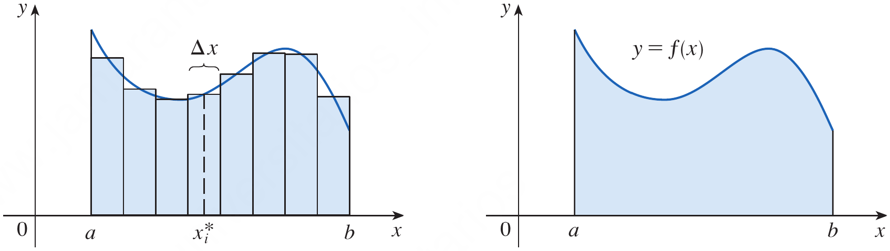
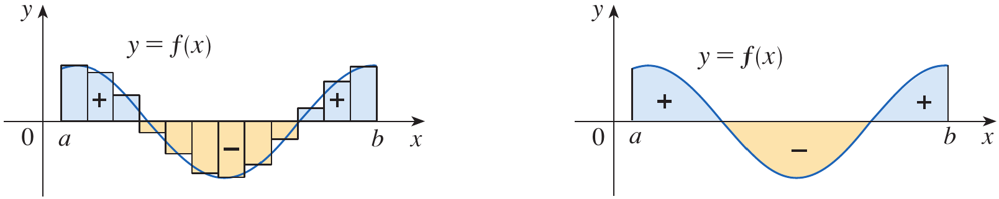
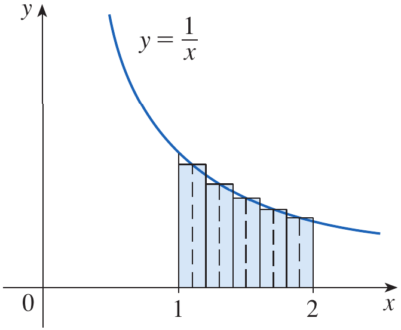

# Calculus and Analytical Geometry

## The Definite Integral

### Dr. Aamir Alaud Din

# Objectives

After preparing this topic, you should be able to:

1. Define the definite integral as the limit of Riemann sums and interpret it as signed area between a curve and the $x$-axis.
2. Evaluate definite integrals by expressing them as limits of Riemann sums and by using standard summation formulas.
3. Apply the Midpoint Rule to approximate definite integrals numerically and explain how the choice of subintervals affects the approximation.
4. Use the properties of the definite integral to simplify integrals, compare their values, and combine integrals over adjacent intervals.

# The Why Section

* In engineering and computer science, many important quantities are not measured at a single instant or position but accumulate over an interval.

* For example, the velocity of a moving mechanical component may vary with time, so its total displacement cannot generally be found by multiplying one velocity value by the elapsed time.

* Similarly, a robot may experience a changing force as it moves, a sensor may record a changing signal, and a computer system may process a continuously varying rate of data.

* The definite integral provides a mathematical way to combine the contributions of a changing quantity over an interval.

* Geometrically, it can be understood through the areas of thin rectangles that approximate the region between a graph and the horizontal axis. As the rectangles become narrower, their total signed area approaches the definite integral.

* The definite integral is defined using a limit of Riemann sums. This definition explains the meaning of integration and provides a foundation for evaluating integrals.

* In practical computations, a limit of sums may be lengthy. Summation formulas make such calculations manageable, while numerical methods such as the Midpoint Rule estimate integrals when an exact calculation is unavailable or inconvenient.

* The properties of definite integrals allow us to split an interval, reverse its direction, combine functions, and compare accumulated quantities without returning to the definition each time.

* Consider a mechatronic positioning system whose controller measures the power consumed by a motor as the motor moves a robotic arm. Since power changes during operation, the total energy consumed can be determined by integrating power over time. This type of problem can be solved by studying the definite integral, methods of evaluating it, numerical approximation, and its properties.

# Objective 1: The Definite Integral

## Riemann Sums

* Suppose that $f$ is a nonnegative function defined on the interval $[a,b]$. We want to estimate the area of the region bounded by the graph of $f$, the $x$-axis, and the vertical lines $x=a$ and $x=b$.

* We divide the interval $[a,b]$ into $n$ subintervals of equal width.

$$
\Delta x=\frac{b-a}{n}
$$

* The partition points are

$$
x_0=a,\quad x_1=a+\Delta x,\quad \ldots,\quad x_n=b
$$

* In each subinterval, we choose a sample point $x_i^*$ and construct a rectangle whose height is $f(x_i^*)$ and whose width is $\Delta x$.

* The area of the $i$th rectangle is $f(x_i^*)\Delta x$, so the sum of the areas of all rectangles is

$$
\sum_{i=1}^{n}f(x_i^*)\Delta x
$$

* This sum is called a **Riemann sum**. It approximates the area under the curve, and the approximation generally improves as the widths of the rectangles decrease.

<strong>Figure 1.</strong> A region under a curve approximated by rectangles forming a Riemann sum vs the exact area under the curve using integral.

* When $f$ is continuous on $[a,b]$, the limit of these sums exists as the largest subinterval width approaches zero. The limit gives the exact accumulated signed area.

## Definition: The Definite Integral {.blue}

If $f$ is defined on $[a,b]$, the definite integral of $f$ from $a$ to $b$ is

$$
\int_a^b f(x)\,dx
=
\lim_{n\to\infty}
\sum_{i=1}^{n}f(x_i^*)\Delta x
$$

provided that the limit exists, where $\Delta x=(b-a)/n$ and $x_i^*$ is a sample point in the $i$th subinterval.

$\blacksquare$

* The symbol $\int$ is an elongated letter S, reminding us of a sum. The expression $f(x)$ is called the integrand, $a$ is the lower limit of integration, and $b$ is the upper limit of integration.

* The variable $x$ is a variable of integration. It is a dummy variable, so the value of the integral does not change if $x$ is replaced consistently by another variable.

$$
\int_a^b f(x)\,dx=\int_a^b f(t)\,dt
$$

* A continuous function on a closed interval is integrable. More generally, a bounded function with only finitely many discontinuities on the interval is also integrable.

## Signed Area

* If $f(x)\geq 0$ on $[a,b]$, then $\int_a^b f(x)\,dx$ represents the area under the graph and above the $x$-axis.

* If the graph lies below the $x$-axis, the definite integral is negative. Therefore, a definite integral represents **signed area**, not always ordinary geometric area.

* If a graph lies above the axis over one part of an interval and below it over another part, the integral is the area above the axis minus the area below the axis.

<strong>Figure 2.</strong> A graph crossing the $x$-axis, showing positive and negative contributions to a definite integral.

* If $A_1$ is the area above the $x$-axis and $A_2$ is the area below the $x$-axis, then

$$
\int_a^b f(x)\,dx=A_1-A_2
$$

* The total geometric area, in contrast, is $A_1+A_2$. This distinction is important whenever a function changes sign.

## Example 1 {.green}

Evaluate the Riemann sum for $f(x)=x^2-6x$, $0\leq x\leq3$, using $n=6$ subintervals and the right endpoints.

## Solution {.green}

The interval is $[0,3]$ and the number of subintervals is $n=6$.

$$
\Delta x=\frac{3-0}{6}=\frac12
$$

Using right endpoints, the sample points are

$$
x_i=\frac{i}{2},\qquad i=1,2,\ldots,6
$$

Thus, the right-endpoint Riemann sum is

$$
R_6=\sum_{i=1}^{6}f\left(\frac{i}{2}\right)\frac12
$$

Substituting the sample points into $f(x)=x^2-6x$ gives

$$
\begin{aligned}
R_6
&=\frac12\left[f\left(\frac12\right)+f(1)+f\left(\frac32\right)\right.\\
&\qquad\left.+f(2)+f\left(\frac52\right)+f(3)\right]\\
&=\frac12\left[-\frac{11}{4}-5-\frac{27}{4}-8-\frac{35}{4}-9\right]\\
&=-\frac{161}{8}\\
&=-20.125
\end{aligned}
$$

The Riemann sum is an approximation to the signed area. Because the function is mostly below the $x$-axis on this interval, a negative value is reasonable.

$\blacksquare$

# Quick Check

## Question 1 {.red}

What does the expression $f(x_i^*)\Delta x$ represent in a Riemann sum?

## Answer {.red}

It represents the signed area of the rectangle with width $\Delta x$ and height $f(x_i^*)$.

## Question 2 {.red}

If a graph lies entirely below the $x$-axis on $[a,b]$, what is the sign of $\int_a^b f(x)\,dx$?

## Answer {.red}

The integral is negative because the function values are negative throughout the interval.

$\blacksquare$

# Objective 2: Evaluating Definite Integrals

## Evaluating an Integral from Its Definition

* The definition of the definite integral expresses it as a limit of Riemann sums. To evaluate an integral directly from the definition, we write the sum, substitute the function and sample points, simplify the expression, and then evaluate the limit as $n$ approaches infinity.

* For equal subintervals on $[a,b]$, the width is $\Delta x=(b-a)/n$. If right endpoints are used, the sample points are $x_i=a+i\Delta x$.

* The resulting sum is

$$
\int_a^b f(x)\,dx
=
\lim_{n\to\infty}
\sum_{i=1}^{n}f(a+i\Delta x)\Delta x
$$

* The following summation formulas are useful when simplifying Riemann sums.

$$
\sum_{i=1}^{n}1=n
$$

$$
\sum_{i=1}^{n}i=\frac{n(n+1)}{2}
$$

$$
\sum_{i=1}^{n}i^2=\frac{n(n+1)(2n+1)}{6}
$$

$$
\sum_{i=1}^{n}i^3=\left[\frac{n(n+1)}{2}\right]^2
$$

* We also use the properties of sums, such as separating a sum of terms and taking a constant outside the summation.

$$
\sum_{i=1}^{n}(a_i+b_i)
=
\sum_{i=1}^{n}a_i+\sum_{i=1}^{n}b_i
$$

$$
\sum_{i=1}^{n}c\,a_i=c\sum_{i=1}^{n}a_i
$$

## Example 2 {.green}

Evaluate $\int_0^3 (x^2-6x)\,dx$ by expressing it as a limit of Riemann sums.

## Solution {.green}

Divide $[0,3]$ into $n$ equal subintervals. The width is

$$
\Delta x=\frac{3}{n}
$$

Using right endpoints, the sample points are

$$
x_i=\frac{3i}{n}
$$

By the definition of the definite integral,

$$
\int_0^3(x^2-6x)\,dx
=
\lim_{n\to\infty}
\sum_{i=1}^{n}
\left[\left(\frac{3i}{n}\right)^2-6\left(\frac{3i}{n}\right)\right]\frac{3}{n}
$$

Simplifying the terms gives

$$
\begin{aligned}
\int_0^3(x^2-6x)\,dx
&=\lim_{n\to\infty}
\sum_{i=1}^{n}\left(\frac{27i^2}{n^3}-\frac{54i}{n^2}\right)\\
&=\lim_{n\to\infty}
\left[\frac{27}{n^3}\sum_{i=1}^{n}i^2
-\frac{54}{n^2}\sum_{i=1}^{n}i\right]\\
&=\lim_{n\to\infty}
\left[\frac{27}{n^3}\frac{n(n+1)(2n+1)}{6}
-\frac{54}{n^2}\frac{n(n+1)}{2}\right]\\
&=\lim_{n\to\infty}
\left[\frac{9(n+1)(2n+1)}{2n^2}
-\frac{27(n+1)}{n}\right]\\
&=9-27\\
&=-18
\end{aligned}
$$

Therefore,

$$
\boxed{\int_0^3(x^2-6x)\,dx=-18}
$$

$\blacksquare$

## Numerical Evaluation and the Meaning of the Integral

* The definition is fundamental, but evaluating a limit of sums can require substantial algebra. Numerical approximations are useful when the function is known only from measurements, when an exact antiderivative is unavailable, or when an approximate answer is sufficient.

* The Midpoint Rule, introduced in the next objective, is one such method. Before applying it, it is important to remember that the definite integral measures signed accumulation, so numerical estimates may be negative when the function is mostly below the horizontal axis.

# Quick Check

## Question 1 {.red}

Write the width $\Delta x$ and the right-endpoint sample points for $[1,5]$ divided into $n$ equal subintervals.

## Answer {.red}

The width and right endpoints are

$$
\Delta x=\frac{4}{n}
\qquad
x_i=1+\frac{4i}{n}
$$

## Question 2 {.red}

Which summation formula is needed when evaluating a Riemann sum for a quadratic function?

## Answer {.red}

The sum of squares formula is needed.

$$
\sum_{i=1}^{n}i^2=\frac{n(n+1)(2n+1)}{6}
$$

$\blacksquare$

# Objective 3: The Midpoint Rule

## The Midpoint Rule

* To approximate a definite integral, we can divide $[a,b]$ into $n$ subintervals of equal width and use the midpoint of each subinterval as the sample point.

* The width of each subinterval is

$$
\Delta x=\frac{b-a}{n}
$$

* The midpoint of the $i$th subinterval is

$$
\bar{x}_i=\frac{x_{i-1}+x_i}{2}
$$

* The Midpoint Rule approximates the definite integral by adding the areas of rectangles whose heights are the function values at the midpoints.

## Definition: Midpoint Rule {.blue}

For a function $f$ on $[a,b]$, the Midpoint Rule with $n$ equal subintervals is

$$
\int_a^b f(x)\,dx
\approx
M_n=\Delta x\sum_{i=1}^{n}f(\bar{x}_i)
$$

where $\Delta x=(b-a)/n$ and $\bar{x}_i$ is the midpoint of the $i$th subinterval.

$\blacksquare$

<strong>Figure 3.</strong> Rectangles used in the Midpoint Rule, with each rectangle's height determined by the function value at the midpoint of its subinterval.

* The Midpoint Rule is an approximation, not usually an exact equality. Using more subintervals often improves the approximation for a well-behaved function, although the error depends on the function's curvature as well as the number of subintervals.

## Example 3 {.green}

Use the Midpoint Rule with $n=5$ to approximate $\int_1^2 \frac{1}{x}\,dx$.

## Solution {.green}

The interval is $[1,2]$ and $n=5$, so

$$
\Delta x=\frac{2-1}{5}=0.2
$$

The subintervals have midpoints

$$
1.1,\quad1.3,\quad1.5,\quad1.7,\quad1.9
$$

Since $f(x)=1/x$, the Midpoint Rule gives

$$
\begin{aligned}
M_5
&=0.2\left[f(1.1)+f(1.3)+f(1.5)+f(1.7)+f(1.9)\right]\\
&=0.2\left(\frac{1}{1.1}+\frac{1}{1.3}+\frac{1}{1.5}
+\frac{1}{1.7}+\frac{1}{1.9}\right)\\
&\approx0.6919
\end{aligned}
$$

Therefore, the integral is approximately $0.6919$ using five midpoint rectangles.

$\blacksquare$

## Choosing the Number of Subintervals

* Increasing the number of subintervals makes each rectangle narrower and usually gives a better representation of the curve.

* A numerical method is especially valuable when the function comes from sensor data or a computer simulation and an exact integral is difficult to obtain.

* The approximation should be reported with a suitable number of decimal places, because additional digits do not necessarily imply additional accuracy.

# Quick Check

## Question 1 {.red}

Use the Midpoint Rule with $n=2$ to approximate $\int_0^2 x^2\,dx$.

## Answer {.red}

The width is $\Delta x=1$ and the midpoints are $0.5$ and $1.5$.

$$
M_2=1\left[(0.5)^2+(1.5)^2\right]=2.5
$$

## Question 2 {.red}

For a fixed interval, what happens to the width of each subinterval when $n$ increases?

## Answer {.red}

The width $\Delta x=(b-a)/n$ decreases, so the rectangles become narrower.

$\blacksquare$

# Objective 4: Properties of the Definite Integral

## Reversing the Limits and Integrating over a Zero-Length Interval

* Reversing the limits of integration changes the sign of the definite integral. This reflects the fact that the direction of accumulation is reversed.

$$
\int_a^b f(x)\,dx=-\int_b^a f(x)\,dx
$$

* When the upper and lower limits are equal, the interval has zero width and the integral is zero.

$$
\int_a^a f(x)\,dx=0
$$

## Constant Multiples and Sums

* A constant factor can be taken outside a definite integral.

$$
\int_a^b c f(x)\,dx=c\int_a^b f(x)\,dx
$$

* The integral of a sum is the sum of the integrals, provided the functions are integrable on the interval.

$$
\int_a^b[f(x)+g(x)]\,dx
=
\int_a^b f(x)\,dx+\int_a^b g(x)\,dx
$$

* Similarly, the integral of a difference is the difference of the integrals.

$$
\int_a^b[f(x)-g(x)]\,dx
=
\int_a^b f(x)\,dx-\int_a^b g(x)\,dx
$$

## Additivity over Adjacent Intervals

* If $a<c<b$, the integral over $[a,b]$ can be divided at $c$. The total accumulation is the sum of the accumulations over the two smaller intervals.

$$
\int_a^b f(x)\,dx
=
\int_a^c f(x)\,dx+\int_c^b f(x)\,dx
$$

* This property is useful when a function changes formula or sign at a particular point, or when measured data are recorded over separate time intervals.

## Comparison Properties

* If $f(x)\geq0$ on $[a,b]$, then its definite integral is nonnegative.

$$
\int_a^b f(x)\,dx\geq0
$$

* If $f(x)\geq g(x)$ on $[a,b]$, then the integral of $f$ is at least as large as the integral of $g$.

$$
\int_a^b f(x)\,dx\geq\int_a^b g(x)\,dx
$$

* If $m\leq f(x)\leq M$ on $[a,b]$, then the integral is bounded by the areas of rectangles of heights $m$ and $M$.

$$
m(b-a)\leq\int_a^b f(x)\,dx\leq M(b-a)
$$

* These properties can be used to estimate the size of an integral without calculating its exact value.

## Example 4 {.green}

Suppose that $\int_1^4 f(x)\,dx=7$ and $\int_4^6 f(x)\,dx=-2$. Find $\int_1^6 f(x)\,dx$ and $\int_6^4 f(x)\,dx$.

## Solution {.green}

By additivity over adjacent intervals,

$$
\begin{aligned}
\int_1^6 f(x)\,dx
&=\int_1^4 f(x)\,dx+\int_4^6 f(x)\,dx\\
&=7+(-2)\\
&=5
\end{aligned}
$$

Reversing the limits changes the sign of the integral.

$$
\int_6^4 f(x)\,dx=-\int_4^6 f(x)\,dx=2
$$

$\blacksquare$

## Example 5 {.green}

Use the properties of definite integrals to evaluate $\int_0^1(4+3x^2)\,dx$, given that $\int_0^1x^2\,dx=\frac13$.

## Solution {.green}

Using the sum rule and constant multiple rule,

$$
\begin{aligned}
\int_0^1(4+3x^2)\,dx
&=\int_0^1 4\,dx+3\int_0^1x^2\,dx\\
&=4(1-0)+3\left(\frac13\right)\\
&=4+1\\
&=5
\end{aligned}
$$

$\blacksquare$

# Quick Check

## Question 1 {.red}

If $\int_2^5 f(x)\,dx=8$, find $\int_5^2 f(x)\,dx$.

## Answer {.red}

Reversing the limits changes the sign.

$$
\boxed{\int_5^2 f(x)\,dx=-8}
$$

## Question 2 {.red}

If $\int_0^2 f(x)\,dx=3$ and $\int_2^5 f(x)\,dx=4$, find $\int_0^5 f(x)\,dx$.

## Answer {.red}

By additivity over adjacent intervals,

$$
\boxed{\int_0^5 f(x)\,dx=3+4=7}
$$

$\blacksquare$

# Scenario Problem

## Problem {.green}

A mechatronic robotic arm uses a motor whose electrical power consumption during a short movement is modeled by

$$
P(t)=20+4t
$$

where $P(t)$ is measured in watts and $t$ is measured in seconds for $0\leq t\leq5$. Estimate the total energy consumed during the movement using the Midpoint Rule with $n=5$ equal subintervals, and then calculate the exact energy using the definite integral.

## Solution {.green}

Energy consumed is the integral of power over time.

$$
E=\int_0^5 P(t)\,dt
$$

First, apply the Midpoint Rule. The subinterval width is

$$
\Delta t=\frac{5-0}{5}=1
$$

The midpoints are $0.5$, $1.5$, $2.5$, $3.5$, and $4.5$. The corresponding power values are

$$
P(0.5)=22,\quad P(1.5)=26,\quad P(2.5)=30
$$

$$
P(3.5)=34,\quad P(4.5)=38
$$

Therefore, the approximate energy is

$$
\begin{aligned}
M_5
&=\Delta t\left[P(0.5)+P(1.5)+P(2.5)+P(3.5)+P(4.5)\right]\\
&=1(22+26+30+34+38)\\
&=150\text{ J}
\end{aligned}
$$

Now evaluate the integral exactly.

$$
\begin{aligned}
E
&=\int_0^5(20+4t)\,dt\\
&=20(5-0)+4\left[\frac{t^2}{2}\right]_0^5\\
&=100+2(25)\\
&=150\text{ J}
\end{aligned}
$$

The Midpoint Rule gives the exact answer in this case because the power function is linear and the midpoint rectangles balance the variation over each subinterval.

$\blacksquare$

# Summary

* The definite integral is defined as the limit of Riemann sums and represents signed accumulation over an interval.
* A Riemann sum approximates the integral by adding the signed areas of rectangles.
* When a graph is above the $x$-axis, it contributes positively to the integral, while a graph below the axis contributes negatively.
* Summation formulas allow definite integrals to be evaluated directly from their Riemann-sum definition.
* The Midpoint Rule approximates an integral by using the function values at the midpoints of equal subintervals.
* Increasing the number of subintervals generally improves a numerical approximation for a well-behaved function.
* Reversing the limits of integration changes the sign, and an integral with equal limits is zero.
* Definite integrals are linear, so constants can be factored out and sums or differences can be integrated term by term.
* Additivity allows an integral to be split across adjacent intervals and recombined.
* Comparison properties provide useful bounds for definite integrals without requiring an exact evaluation.

# Exercises

## Exercises Set

Solve the odd number exercises from exercise 1 to 84.

* Exercises help transform theoretical concepts into practical understanding.

* Mathematics is learned by doing and solving exercises will train you to analyze problems, select appropriate methods, and construct logical solutions.

* Attempting problems sometimes leads to mistakes which provide opportunities for learning and improvement.

* Regular practice increases speed, accuracy, and confidence.

* Exercises are given in the Exercises file and you are expected to solve them on your own.