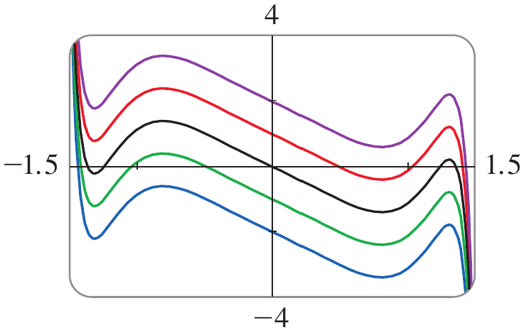
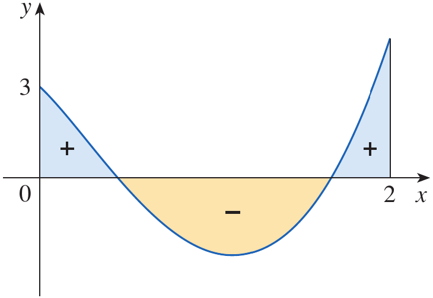
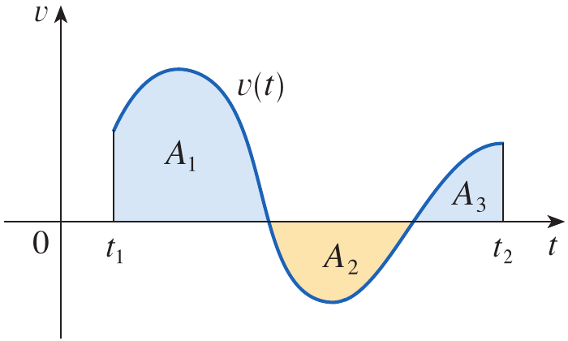
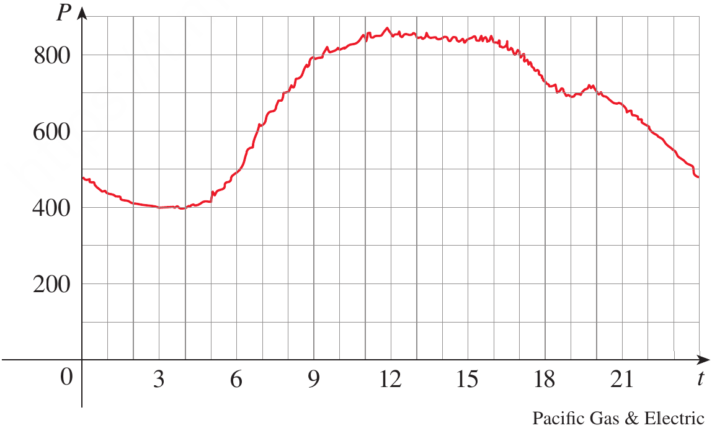

# Calculus and Analytical Geometry

## Indefinite Integrals and the Net Change Theorem

### Dr. Aamir Alaud Din

# Objectives

After preparing this topic you should be able to

1. Understand indefinite integrals as families of antiderivatives, use the Fundamental Theorem of Calculus and standard integration formulas to evaluate indefinite and definite integrals, and interpret definite integrals as net change.
2. Apply the Net Change Theorem to determine the net change in a quantity over an interval by integrating its rate of change, and interpret the result in applications involving accumulation, motion, and other changing quantities.

# The Why Section

## Why Study Indefinite Integrals?

In mechanical engineering, many quantities describe rates of change. For example, velocity describes the rate at which position changes, acceleration describes the rate at which velocity changes, and the rate of heat transfer describes how thermal energy changes with time. In computer science and mechatronics, sensors and control systems frequently provide rate information. A controller may measure the velocity of a robotic actuator, while the system requires its position. Similarly, a program may know the rate at which data is being generated but need the total amount generated over a period. Differentiation moves from a quantity to its rate of change. **Integration reverses this process:** it allows us to recover a function from its derivative, subject to an unknown constant. The Fundamental Theorem of Calculus connects derivatives and definite integrals. It explains why finding an antiderivative provides an efficient way to evaluate a definite integral. The notation for an indefinite integral represents a family of functions rather than a single number. The constant of integration is essential because functions that differ by a constant have the same derivative. Standard antiderivative formulas make integration systematic. They allow us to integrate powers, exponential functions, trigonometric functions, and other commonly occurring expressions. 

Many quantities in engineering and computer science change continuously with time, position, or another independent variable. In practical problems, we are often given the **rate at which a quantity changes**, rather than the quantity itself. For example, a water tank may be filled and drained at different rates. Knowing the inflow rate over a time interval allows us to determine the net change in the amount of water stored in the tank. Similarly, the concentration of a chemical product changes as a reaction proceeds. If the rate of change of concentration is known, integration determines the overall change in concentration during a specified time interval. The same principle applies to population growth, production cost, the mass of a nonuniform rod, and energy consumption.

In mechanical engineering and mechatronics, the velocity of a moving component is the rate of change of its position. Integrating velocity gives its displacement. If the component changes direction, however, displacement and total distance travelled are different quantities. A related situation occurs in a computer-controlled robotic actuator. Its controller may record the actuator's velocity throughout a movement. We may need to determine its final position relative to its starting point, or the total distance travelled by the actuator. These questions can be answered by integrating the velocity and, when necessary, its absolute value.

The Net Change Theorem gives one general mathematical method for solving all these problems: **the integral of a rate of change over an interval gives the net change in the original quantity over that interval.**

# Indefinite Integrals

## The Fundamental Theorem of Calculus and Antiderivatives

The Fundamental Theorem of Calculus (FTC) establishes a connection between differentiation and integration. Recall that the theorem has two parts, commonly called FTC1 and FTC2.

### FTC1: The First Part of the Fundamental Theorem of Calculus

Suppose that $f$ is continuous on $[a,b]$ and define

$$
g(x)=\int_a^x f(t)\,dt
$$

FTC1 states that $g$ is differentiable on $(a,b)$ and

$$
g'(x)=f(x)
$$

In other words, differentiating an accumulation function defined by an integral recovers the original integrand. The variable $t$ is a **dummy variable of integration**. The variable $x$ is the upper limit and determines the value of the function $g$.

### FTC2: The Second Part of the Fundamental Theorem of Calculus

Suppose that $f$ is continuous on $[a,b]$ and $F$ is any antiderivative of $f$ on this interval. Then

$$
\int_a^b f(x)\,dx=F(b)-F(a)
$$

FTC2 tells us that a definite integral can be evaluated by finding an antiderivative and subtracting its value at the lower limit from its value at the upper limit. Thus, FTC1 shows that differentiation reverses the accumulation process, while FTC2 provides a method for evaluating definite integrals using antiderivatives.

## Antiderivatives

A function $F$ is called an **antiderivative** of a function $f$ on an interval if

$$
F'(x)=f(x)
$$

For example, consider

$$
f(x)=x^2
$$

Since

$$
\frac{d}{dx}\left(\frac{x^3}{3}\right)=x^2
$$

The function $F(x)=x^3/3$ is an antiderivative of $f(x)=x^2$. However, it is not the only antiderivative. For any constant $C$,

$$
\frac{d}{dx}\left(\frac{x^3}{3}+C\right)=x^2
$$

Therefore, all functions of the form

$$
F(x)=\frac{x^3}{3}+C
$$

are antiderivatives of $x^2$.

## Indefinite Integral Notation

The Fundamental Theorem of Calculus establishes a connection between antiderivatives and definite integrals. To work conveniently with antiderivatives, we use the notation

$$
\int f(x)\,dx=F(x)+C
$$

This is read as the **indefinite integral of $f(x)$ with respect to $x$**. The notation means that $F'(x)=f(x)$. For example,

$$
\int x^2\,dx=\frac{x^3}{3}+C
$$

because

$$
\frac{d}{dx}\left(\frac{x^3}{3}+C\right)=x^2
$$

An indefinite integral represents a **family of functions**: one antiderivative for each value of the constant $C$. In contrast, a definite integral such as $\int_a^b f(x)\,dx$ represents a number, provided the integral exists.

## Why Is the Constant of Integration Necessary?

The derivative of a constant is zero.

$$
\frac{d}{dx}(C)=0
$$

Consequently, adding a constant to an antiderivative does not change its derivative. For example, the functions

$$
F_1(x)=\frac{x^3}{3}
\qquad
F_2(x)=\frac{x^3}{3}+5
$$

have the same derivative:

$$
F_1'(x)=F_2'(x)=x^2
$$

In fact, every function of the form $x^3/3+C$ has derivative $x^2$. Therefore, when we write a general indefinite integral, we must include the arbitrary constant $C$. Omitting $C$ would give only one antiderivative instead of the complete family of antiderivatives. The constant can be determined if an additional condition is supplied. For example, if $F(0)=4$ and $F'(x)=x^2$, then

$$
F(x)=\frac{x^3}{3}+C
$$

Using $F(0)=4$ gives $C=4$, so the particular antiderivative is

$$
F(x)=\frac{x^3}{3}+4
$$

## Basic Properties of Indefinite Integrals

A constant factor can be taken outside an integral.

$$
\int c f(x)\,dx=c\int f(x)\,dx
$$

The integral of a sum is the sum of the integrals.

$$
\int [f(x)+g(x)]\,dx
=
\int f(x)\,dx+\int g(x)\,dx
$$

Similarly, the integral of a difference is the difference of the integrals.

$$
\int [f(x)-g(x)]\,dx
=
\int f(x)\,dx-\int g(x)\,dx
$$

These properties allow us to integrate complicated expressions by separating them into simpler terms.

## Table of Indefinite Integrals

The following formulas are standard antiderivatives. They can be verified by differentiating the expression on the right-hand side.

<strong>Table 1.</strong> Basic formulas for indefinite integrals.

| Function | Indefinite integral |
|:--|:--|
| Constant multiple | $\displaystyle \int c f(x)\,dx=c\int f(x)\,dx$ |
| Constant | $\displaystyle \int k\,dx=kx+C$ |
| Power, $n\neq -1$ | $\displaystyle \int x^n\,dx=\frac{x^{n+1}}{n+1}+C$ |
| Reciprocal | $\displaystyle \int \frac{1}{x}\,dx=\ln|x|+C$ |
| Exponential | $\displaystyle \int e^x\,dx=e^x+C$ |
| Exponential, $b>0$ | $\displaystyle \int b^x\,dx=\frac{b^x}{\ln b}+C$ |
| Sine | $\displaystyle \int \sin x\,dx=-\cos x+C$ |
| Cosine | $\displaystyle \int \cos x\,dx=\sin x+C$ |
| Secant squared | $\displaystyle \int \sec^2 x\,dx=\tan x+C$ |
| Cosecant squared | $\displaystyle \int \csc^2 x\,dx=-\cot x+C$ |
| Secant–tangent | $\displaystyle \int \sec x\tan x\,dx=\sec x+C$ |
| Cosecant–cotangent | $\displaystyle \int \csc x\cot x\,dx=-\csc x+C$ |
| Inverse tangent form | $\displaystyle \int \frac{1}{x^2+1}\,dx=\tan^{-1}x+C$ |
| Inverse sine form | $\displaystyle \int \frac{1}{\sqrt{1-x^2}}\,dx=\sin^{-1}x+C$ |
| Hyperbolic sine | $\displaystyle \int \sinh x\,dx=\cosh x+C$ |
| Hyperbolic cosine | $\displaystyle \int \cosh x\,dx=\sinh x+C$ |

The power rule is valid for $n\neq -1$. The case $n=-1$ is treated separately by the logarithmic formula. The formula for $\int 1/x\,dx$ is written with an absolute value because the antiderivative is $\ln|x|$ on any interval that does not contain zero. The formula for $\int b^x\,dx$ assumes $b>0$ and $b\neq1$. The most general antiderivative is understood on an interval where the integrand is defined. If the domain has separate intervals, the constants on those intervals may be different. For example,

$$
\int \frac{1}{x^2}\,dx=-\frac{1}{x}+C
$$

is valid on an interval contained in $(0,\infty)$ or on an interval contained in $(-\infty,0)$. The domain excludes $x=0$, so a single constant need not describe antiderivatives on both disconnected intervals.

## Example 1 {.green}

Find the general indefinite integral

$$
\int (10x^4-2\sec^2 x)\,dx
$$

## Solution {.green}

We use the sum and constant multiple properties to separate the integral.

$$
\begin{aligned}
\int (10x^4-2\sec^2 x)\,dx
&=10\int x^4\,dx-2\int\sec^2 x\,dx
\end{aligned}
$$

Using the power rule,

$$
\int x^4\,dx=\frac{x^5}{5}+C
$$

and using the standard trigonometric integral,

$$
\int\sec^2 x\,dx=\tan x+C
$$

we obtain

$$
\begin{aligned}
\int (10x^4-2\sec^2 x)\,dx
&=10\left(\frac{x^5}{5}\right)-2\tan x+C\\
&=2x^5-2\tan x+C
\end{aligned}
$$

Therefore,

$$
\boxed{\int (10x^4-2\sec^2 x)\,dx=2x^5-2\tan x+C}
$$

<strong>Figure 1.</strong> Family of curves representing the indefinite integral in Example 1.

The curves have the same shape but are shifted vertically because changing $C$ adds a constant to the antiderivative. Differentiating any one of these functions gives the same integrand, $10x^4-2\sec^2x$.

$\blacksquare$

## Example 2 {.green}

Evaluate

$$
\int \frac{\cos\theta}{\sin^2\theta}\,d\theta
$$

## Solution {.green}

The integrand is not immediately listed in the table in its present form. We rewrite it as a product.

$$
\begin{aligned}
\int \frac{\cos\theta}{\sin^2\theta}\,d\theta
&=\int \left(\frac{1}{\sin\theta}\right)
\left(\frac{\cos\theta}{\sin\theta}\right)\,d\theta\\
&=\int \csc\theta\cot\theta\,d\theta
\end{aligned}
$$

From the table of indefinite integrals,

$$
\int \csc\theta\cot\theta\,d\theta=-\csc\theta+C
$$

Therefore,

$$
\boxed{\int \frac{\cos\theta}{\sin^2\theta}\,d\theta=-\csc\theta+C}
$$

We can verify the result by differentiation.

$$
\begin{aligned}
\frac{d}{d\theta}(-\csc\theta+C)
&=\csc\theta\cot\theta\\
&=\frac{\cos\theta}{\sin^2\theta}
\end{aligned}
$$

$\blacksquare$

## Evaluating Definite Integrals Using Antiderivatives

FTC2 provides a direct method for evaluating definite integrals. If $f$ is continuous on $[a,b]$ and $F$ is an antiderivative of $f$, then

$$
\int_a^b f(x)\,dx=F(b)-F(a)
$$

We use the notation

$$
\left[F(x)\right]_a^b=F(b)-F(a)
$$

Thus, we first find an antiderivative, substitute the upper limit, substitute the lower limit, and subtract. Notice that the arbitrary constant is not needed when evaluating a definite integral because it cancels:

$$
[F(b)+C]-[F(a)+C]=F(b)-F(a)
$$

## Example 3 {.green}

Evaluate

$$
\int_0^3 (x^3-6x)\,dx
$$

## Solution {.green}

We first find an antiderivative of the integrand.

$$
\begin{aligned}
\int (x^3-6x)\,dx
&=\int x^3\,dx-6\int x\,dx\\
&=\frac{x^4}{4}-6\frac{x^2}{2}+C\\
&=\frac{x^4}{4}-3x^2+C
\end{aligned}
$$

Using FTC2,

$$
\begin{aligned}
\int_0^3 (x^3-6x)\,dx
&=\left[\frac{x^4}{4}-3x^2\right]_0^3\\
&=\left(\frac{3^4}{4}-3(3^2)\right)
-\left(\frac{0^4}{4}-3(0^2)\right)\\
&=\frac{81}{4}-27\\
&=\frac{81-108}{4}\\
&=-\frac{27}{4}\\
&=-6.75
\end{aligned}
$$

Therefore,

$$
\boxed{\int_0^3 (x^3-6x)\,dx=-\frac{27}{4}=-6.75}
$$

$\blacksquare$

## Example 4 {.green}

Find

$$
\int_0^2 \left(2x^3-6x+\frac{3}{x^2+1}\right)\,dx
$$

and interpret the result in terms of areas.

## Solution {.green}

We first integrate each term separately.

$$
\begin{aligned}
\int \left(2x^3-6x+\frac{3}{x^2+1}\right)\,dx
&=2\int x^3\,dx-6\int x\,dx
+3\int\frac{1}{x^2+1}\,dx\\
&=2\left(\frac{x^4}{4}\right)-6\left(\frac{x^2}{2}\right)
+3\tan^{-1}x+C\\
&=\frac{x^4}{2}-3x^2+3\tan^{-1}x+C
\end{aligned}
$$

Applying FTC2,

$$
\begin{aligned}
&\int_0^2 \left(2x^3-6x+\frac{3}{x^2+1}\right)\,dx\\
&=\left[\frac{x^4}{2}-3x^2+3\tan^{-1}x\right]_0^2\\
&=\left(\frac{2^4}{2}-3(2^2)+3\tan^{-1}2\right)
-\left(0-0+3\tan^{-1}0\right)\\
&=8-12+3\tan^{-1}2\\
&=-4+3\tan^{-1}2
\end{aligned}
$$

Therefore, the exact value is

$$
\boxed{-4+3\tan^{-1}2}
$$

Using a calculator,

$$
\boxed{\int_0^2 \left(2x^3-6x+\frac{3}{x^2+1}\right)\,dx\approx -0.67855}
$$

<strong>Figure 2.</strong> Graph of the integrand in Example 4, showing the positive and negative regions between $x=0$ and $x=2$.

A definite integral represents **net signed area**, not necessarily the total geometric area between the curve and the $x$-axis. The regions above the $x$-axis contribute positively, while the region below the $x$-axis contributes negatively. In this example, the negative contribution is larger than the combined positive contributions. This is why the value of the integral is negative.

$\blacksquare$

## Example 5 {.green}

Evaluate

$$
\int_1^9 \frac{2t^2+t^2\sqrt{t}-1}{t^2}\,dt
$$

## Solution {.green}

We first simplify the integrand by dividing each term in the numerator by $t^2$.

$$
\begin{aligned}
\frac{2t^2+t^2\sqrt{t}-1}{t^2}
&=\frac{2t^2}{t^2}+\frac{t^2\sqrt{t}}{t^2}-\frac{1}{t^2}\\
&=2+\sqrt{t}-\frac{1}{t^2}\\
&=2+t^{1/2}-t^{-2}
\end{aligned}
$$

Therefore,

$$
\int_1^9 \frac{2t^2+t^2\sqrt{t}-1}{t^2}\,dt
=
\int_1^9 (2+t^{1/2}-t^{-2})\,dt
$$

Integrating term by term,

$$
\begin{aligned}
\int (2+t^{1/2}-t^{-2})\,dt
&=2t+\frac{t^{3/2}}{3/2}-\frac{t^{-1}}{-1}+C\\
&=2t+\frac{2}{3}t^{3/2}+\frac{1}{t}+C
\end{aligned}
$$

Applying FTC2,

$$
\begin{aligned}
&\int_1^9 (2+t^{1/2}-t^{-2})\,dt\\
&=\left[2t+\frac{2}{3}t^{3/2}+\frac{1}{t}\right]_1^9\\
&=\left(2(9)+\frac{2}{3}(9)^{3/2}+\frac{1}{9}\right)
-\left(2(1)+\frac{2}{3}(1)^{3/2}+1\right)\\
&=\left(18+18+\frac{1}{9}\right)
-\left(2+\frac{2}{3}+1\right)\\
&=\frac{325}{9}-\frac{33}{9}\\
&=\frac{292}{9}\\
&=32\frac{4}{9}
\end{aligned}
$$

Therefore,

$$
\boxed{\int_1^9 \frac{2t^2+t^2\sqrt{t}-1}{t^2}\,dt
=32\frac{4}{9}}
$$

$\blacksquare$

# Quick Check

## Question 1 {.red}

Find the general indefinite integral

$$
\int (6x^2-4\cos x)\,dx
$$

## Answer {.red}

Integrating term by term,

$$
\begin{aligned}
\int (6x^2-4\cos x)\,dx
&=6\frac{x^3}{3}-4\sin x+C\\
&=2x^3-4\sin x+C
\end{aligned}
$$

$$
\boxed{2x^3-4\sin x+C}
$$

## Question 2 {.red}

A particle has position $s(t)$ and velocity $v(t)=s'(t)$. What does

$$
\int_1^4 v(t)\,dt
$$

represent?

## Answer {.red}

By the Net Change Theorem,

$$
\int_1^4 v(t)\,dt=s(4)-s(1)
$$

It represents the particle's **net displacement** from time $t=1$ to time $t=4$.

$\blacksquare$

# Scenario Problem

## Problem {.green}

A mechatronic positioning system uses a motor to move a robotic actuator along a straight guide. A sensor and controller provide the actuator's velocity as a function of time:

$$
v(t)=3t^2-6t+2
$$

where $v(t)$ is measured in metres per second and $t$ is measured in seconds.

At time $t=0$, the actuator is at position $s(0)=1$ metre.

Determine the position function $s(t)$ and the net displacement of the actuator during the first three seconds.

## Solution {.green}

We know that velocity is the derivative of position:

$$
v(t)=s'(t)
$$

Therefore,

$$
s'(t)=3t^2-6t+2
$$

To determine the position function, we integrate the velocity.

$$
\begin{aligned}
s(t)
&=\int (3t^2-6t+2)\,dt\\
&=3\frac{t^3}{3}-6\frac{t^2}{2}+2t+C\\
&=t^3-3t^2+2t+C
\end{aligned}
$$

We are given the initial condition $s(0)=1$. Substituting $t=0$,

$$
\begin{aligned}
1&=0^3-3(0)^2+2(0)+C\\
C&=1
\end{aligned}
$$

Thus, the position function is

$$
\boxed{s(t)=t^3-3t^2+2t+1}
$$

Now we determine the net displacement during the first three seconds using the Net Change Theorem.

$$
\begin{aligned}
\text{Net displacement}
&=\int_0^3 v(t)\,dt\\
&=\int_0^3(3t^2-6t+2)\,dt\\
&=\left[t^3-3t^2+2t\right]_0^3\\
&=(27-27+6)-0\\
&=6
\end{aligned}
$$

Therefore,

$$
\boxed{\text{Net displacement}=6\text{ m}}
$$

The final position is

$$
s(3)=3^3-3(3)^2+2(3)+1=7\text{ m}
$$

Since the initial position was $1$ metre, the final position is $7$ metres and the net displacement is $7-1=6$ metres.

$\blacksquare$

# The Net Change Theorem

## The Fundamental Theorem of Calculus: Part 2

Recall the second part of the Fundamental Theorem of Calculus. If $f$ is continuous on $[a,b]$ and $F$ is an antiderivative of $f$, then

$$
\int_a^b f(x)\,dx=F(b)-F(a)
$$

Since $F'(x)=f(x)$, the same result can be written as

$$
\int_a^b F'(x)\,dx=F(b)-F(a)
$$

These equations connect integration with the evaluation of an antiderivative at the endpoints of an interval. The expression $F(b)-F(a)$ represents the change in the value of $F$ as its independent variable changes from $a$ to $b$. Therefore, when the integrand is the rate of change of a quantity, its definite integral gives the change in that quantity over the interval.

## Definition: Net Change Theorem {#definition-net-change-theorem .blue}

The **Net Change Theorem** states that the definite integral of a rate
of change over an interval is equal to the net change in the quantity
over that interval.

If $F'(x)$ is the rate of change of a quantity $F(x)$, then

$$
\boxed{\int_a^b F'(x)\,dx=F(b)-F(a)}
$$

The left-hand side represents the accumulated rate of change from $a$ to $b$. The right-hand side represents the final value minus the initial value. The word **net** is important. It means that increases and decreases are both taken into account. An increase contributes positively, while a decrease contributes negatively. Consequently, the net change is not necessarily the same as the total amount of change. For example, an object may move forward and then backward. Its displacement is the net change in position, whereas its total distance travelled counts movement in both directions as positive.

::: definition-end
$\blacksquare$
:::

## Applications of the Net Change Theorem

The Net Change Theorem can be applied whenever the rate of change of a
quantity is known.

### Volume of Water in a Reservoir

Let $V(t)$ represent the volume of water in a reservoir at time $t$. Its derivative $V'(t)$ represents the rate at which the volume of water changes. If water flows into the reservoir at a greater rate than it flows out, then $V'(t)$ is positive. If water flows out at a greater rate than it flows in, then $V'(t)$ is negative. By the Net Change Theorem,

$$
\int_{t_1}^{t_2}V'(t)\,dt=V(t_2)-V(t_1)
$$

Thus, the integral gives the net change in the volume of water between times $t_1$ and $t_2$.

### Concentration in a Chemical Reaction

Let $C(t)$ represent the concentration of a product in a chemical reaction at time $t$. The rate of change of concentration is $C'(t)=\dfrac{dC}{dt}$. Applying the Net Change Theorem gives

$$
\int_{t_1}^{t_2}\frac{dC}{dt}\,dt=C(t_2)-C(t_1)
$$

This integral gives the change in the concentration of the product from time $t_1$ to time $t_2$.

### Mass of a Nonuniform Rod

Suppose a rod is measured from its left endpoint, and let $m(x)$ represent the mass of the portion of the rod from the left endpoint to position $x$. The linear density of the rod is the rate at which its mass changes with respect to position:

$$
\rho(x)=m'(x)
$$

Therefore, the mass of the part of the rod between positions $a$ and $b$ is

$$
\int_a^b\rho(x)\,dx=m(b)-m(a)
$$

Thus, integrating the linear density gives the mass of the segment of the rod between $x=a$ and $x=b$.

### Population Growth

Let $n(t)$ represent the population of a region at time $t$. The rate of population growth is $\dfrac{dn}{dt}$. The Net Change Theorem gives

$$
\int_{t_1}^{t_2}\frac{dn}{dt}\,dt=n(t_2)-n(t_1)
$$

This is the net change in population during the time interval from $t_1$ to $t_2$. Births increase the population, while deaths decrease it. The net change accounts for both.

### Cost of Production

Let $C(x)$ represent the total cost of producing $x$ units of a commodity. The derivative $C'(x)$ is the marginal cost, which describes the rate at which the total cost changes as production increases. The Net Change Theorem gives

$$
\int_{x_1}^{x_2}C'(x)\,dx=C(x_2)-C(x_1)
$$

This integral gives the increase in production cost when the number of units produced changes from $x_1$ to $x_2$.

### Displacement and Distance from Velocity

Suppose an object moves along a straight line and its position at time $t$ is $s(t)$. Its velocity is the derivative of its position:

$$
v(t)=s'(t)
$$

By the Net Change Theorem,

$$
\boxed{\int_{t_1}^{t_2}v(t)\,dt=s(t_2)-s(t_1)}
$$

The integral of velocity gives the **net change in position**, which is called displacement. Velocity can be positive or negative. Positive velocity indicates motion in the positive direction, while negative velocity indicates motion in the negative direction. Therefore, displacement takes direction into account. If we want the **total distance travelled**, movement in either direction must contribute positively. We therefore integrate the speed, which is the absolute value of velocity:

$$
\boxed{\int_{t_1}^{t_2}|v(t)|\,dt=\text{total distance travelled}}
$$

If velocity changes sign during the interval, we split the integral at the times when the object changes direction.

<strong>Figure 3.</strong> Displacement and total distance travelled
represented by signed and unsigned areas under a velocity curve.

In the figure, the areas above the time axis contribute positively to displacement, while the area below the time axis contributes negatively. For total distance, all three areas contribute positively. Thus, if the three regions have areas $A_1$, $A_2$, and $A_3$, respectively, then

$$
\text{Displacement}=A_1-A_2+A_3
$$

$$
\text{Total distance}=A_1+A_2+A_3
$$

### Acceleration and Change in Velocity

Acceleration is the rate of change of velocity. If $v(t)$ is the velocity of an object, then

$$
a(t)=v'(t)
$$

Applying the Net Change Theorem gives

$$
\boxed{\int_{t_1}^{t_2}a(t)\,dt=v(t_2)-v(t_1)}
$$

Therefore, integrating acceleration over a time interval gives the change in velocity during that interval.

## Example 6 {#example-6 .green}

A particle moves along a straight line with velocity

$$
v(t)=t^2-t-6
$$

where velocity is measured in meters per second. For the time interval
$1\leq t\leq4$, find:

**(a)** the displacement of the particle;

**(b)** the total distance travelled by the particle.

## Solution {#solution .green}

**(a) Displacement**

By the Net Change Theorem, displacement is the integral of velocity over
the given time interval:

$$
\begin{aligned}
\text{Displacement}
&=\int_1^4v(t)\,dt\\
&=\int_1^4(t^2-t-6)\,dt
\end{aligned}
$$

An antiderivative of $t^2-t-6$ is

$$
\frac{t^3}{3}-\frac{t^2}{2}-6t
$$

Therefore,

$$
\begin{aligned}
\text{Displacement}
&=\left[\frac{t^3}{3}-\frac{t^2}{2}-6t\right]_1^4\\
&=\left(\frac{64}{3}-8-24\right)
-\left(\frac13-\frac12-6\right)\\
&=-\frac92
\end{aligned}
$$

Hence,

$$
\boxed{\text{Displacement}=-\frac92\text{ m}}
$$

The negative sign indicates that the particle's final position is $4.5$
m to the left of its initial position.

**(b) Total distance travelled**

To calculate total distance, we must integrate the speed $|v(t)|$.

First, factor the velocity function:

$$
v(t)=t^2-t-6=(t-3)(t+2)
$$

The velocity is negative for $1\leq t<3$ and positive for $3<t\leq4$.
Thus, the particle changes direction at $t=3$.

We split the distance integral at $t=3$:

$$
\begin{aligned}
\text{Distance}
&=\int_1^4|v(t)|\,dt\\
&=\int_1^3[-v(t)]\,dt+\int_3^4v(t)\,dt\\
&=\int_1^3(-t^2+t+6)\,dt\\
&\quad+\int_3^4(t^2-t-6)\,dt
\end{aligned}
$$

For the first integral,

$$
\begin{aligned}
\int_1^3(-t^2+t+6)\,dt
&=\left[-\frac{t^3}{3}+\frac{t^2}{2}+6t\right]_1^3\\
&=\frac{22}{3}
\end{aligned}
$$

For the second integral,

$$
\begin{aligned}
\int_3^4(t^2-t-6)\,dt
&=\left[\frac{t^3}{3}-\frac{t^2}{2}-6t\right]_3^4\\
&=\frac{17}{6}
\end{aligned}
$$

Adding the two positive distances,

$$
\begin{aligned}
\text{Distance}
&=\frac{26}{3}+\frac32\\
&=\frac{52+9}{6}\\
&=\frac{61}{6}
\end{aligned}
$$

Therefore,

$$
\boxed{\text{Total distance}=\frac{61}{6}\text{ m}\approx10.17\text{ m}}
$$

The displacement is negative because the particle finishes to the left
of its starting point. The total distance is positive because it
measures the entire length of the path travelled.

::: example-end
$\blacksquare$
:::

## Example 7 {#example-7 .green}

The graph in Figure 4 shows the power consumption of the city of San Francisco during one day in September. Power $P$ is measured in megawatts, and time $t$ is measured in hours after midnight. Estimate the total energy used during that day.

<strong>Figure 4.</strong> Graph of power consumption in San Francisco over a
24-hour day in September.

## Solution {#solution-1 .green}

Power is the rate of change of energy. If $E(t)$ represents the energy
used by time $t$, then

$$
P(t)=E'(t)
$$

By the Net Change Theorem,

$$
\int_0^{24}P(t)\,dt=E(24)-E(0)
$$

Thus, the integral of power over the 24-hour interval gives the total
energy used during the day.

The graph does not provide an algebraic formula for $P(t)$, so we
estimate the integral numerically. We use the **Midpoint Rule** with 12
equal subintervals.

The interval is $[0,24]$, so

$$
n=12
$$

and the width of each subinterval is

$$
\Delta t=\frac{24-0}{12}=2
$$

The midpoints are

$$
1,3,5,7,9,11,13,15,17,19,21,23
$$

Reading the approximate power values from Figure 4 at these midpoints
gives

$$
\begin{aligned}
&P(1)\approx440,\quad P(3)\approx400,\quad P(5)\approx420\\
&P(7)\approx620,\quad P(9)\approx790,\quad P(11)\approx840\\
&P(13)\approx850,\quad P(15)\approx840,\quad P(17)\approx810\\
&P(19)\approx690,\quad P(21)\approx670,\quad P(23)\approx550
\end{aligned}
$$

Using the Midpoint Rule,

$$
\begin{aligned}
\int_0^{24}P(t)\,dt
&\approx [P(1)+P(3)+P(5)+\cdots+P(23)]\Delta t\\
&\approx (440+400+420+620+790+840\\
&\qquad+850+840+810+690+670+550)(2)\\
&=15,840
\end{aligned}
$$

Since power is measured in megawatts and time in hours, the resulting
unit is megawatt-hours.

Therefore, the estimated energy used during the day is

$$
\boxed{15,840\text{ megawatt-hours}}
$$

::: example-end
$\blacksquare$
:::

# Quick Check

## Question 1 {#question-1 .red}

The rate of change of the volume of water in a tank is $V'(t)=3t^2+2$
liters per minute. Find the net change in volume from $t=0$ to $t=2$
minutes.

## Answer {#answer .red}

By the Net Change Theorem,

$$
\begin{aligned}
\Delta V
&=\int_0^2(3t^2+2)\,dt\\
&=[t^3+2t]_0^2\\
&=8+4\\
&=12
\end{aligned}
$$

$$
\boxed{\Delta V=12\text{ liters}}
$$

## Question 2 {#question-2 .red}

An object's velocity is negative over a time interval. Is its
displacement over that interval necessarily negative, and is its total
distance travelled negative?

## Answer {#answer-1 .red}

If velocity is negative throughout the interval, displacement is
negative because the object moves in the negative direction. Total
distance is never negative because it is calculated by integrating the
nonnegative speed $|v(t)|$.

$$
\boxed{\text{Displacement: negative; total distance: nonnegative}}
$$

::: question-end
$\blacksquare$
:::

# Scenario Problem

## Problem {#problem .green}

A computer-controlled linear actuator in a mechatronic positioning
system moves a component along a straight guide. Its velocity during a
four-second operating cycle is modeled by

$$
v(t)=t^2-4t+3
$$

where $v(t)$ is measured in meters per second and $t$ is measured in
seconds.

Using the Net Change Theorem, determine:

**(a)** the net displacement of the actuator during the four-second
cycle;

**(b)** the total distance travelled by the actuator during the cycle;

**(c)** the times at which the actuator changes direction.

## Solution {#solution-2 .green}

**(a) Net displacement**

The displacement is the integral of velocity over the interval
$0\leq t\leq4$:

$$
\begin{aligned}
\Delta s
&=\int_0^4(t^2-4t+3)\,dt\\
&=\left[\frac{t^3}{3}-2t^2+3t\right]_0^4\\
&=\frac{64}{3}-32+12\\
&=\frac43
\end{aligned}
$$

Therefore,

$$
\boxed{\Delta s=\frac43\text{ m}}
$$

The positive result indicates that the actuator finishes $\frac43$ m in
the positive direction relative to its starting position.

**(b) Total distance travelled**

To find the total distance, we integrate the absolute value of velocity.

First, factor the velocity function:

$$
v(t)=t^2-4t+3=(t-1)(t-3)
$$

The velocity is positive on $[0,1)$, negative on $(1,3)$, and positive
on $(3,4]$. Therefore,

$$
\begin{aligned}
D
&=\int_0^4|v(t)|\,dt\\
&=\int_0^1v(t)\,dt-\int_1^3v(t)\,dt
+\int_3^4v(t)\,dt
\end{aligned}
$$

An antiderivative is

$$
F(t)=\frac{t^3}{3}-2t^2+3t
$$

Evaluating the three parts,

$$
\int_0^1v(t)\,dt=F(1)-F(0)=\frac43
$$

$$
-\int_1^3v(t)\,dt=-(F(3)-F(1))=\frac43
$$

$$
\int_3^4v(t)\,dt=F(4)-F(3)=\frac43
$$

Hence,

$$
\begin{aligned}
D&=\frac43+\frac43+\frac43\\
&=4
\end{aligned}
$$

Therefore,

$$
\boxed{D=4\text{ m}}
$$

**(c) Direction changes**

The actuator changes direction when its velocity is zero:

$$
(t-1)(t-3)=0
$$

Thus,

$$
\boxed{t=1\text{ s}\quad\text{and}\quad t=3\text{ s}}
$$

The actuator moves in the positive direction from $0$ to $1$ second, in
the negative direction from $1$ to $3$ seconds, and in the positive
direction from $3$ to $4$ seconds.

This example illustrates why displacement and total distance must be
distinguished. The displacement records the net change in position,
while total distance accounts for all movement regardless of direction.

::: example-end
$\blacksquare$
:::

# Summary

An antiderivative of a function $f$ is a function $F$ whose derivative is $f$, and the indefinite integral $\int f(x)\,dx=F(x)+C$ represents the complete family of antiderivatives. The constant of integration is necessary because the derivative of a constant is zero. The Fundamental Theorem of Calculus connects differentiation and integration: FTC1 states that the derivative of an accumulation function $\int_a^x f(t)\,dt$ is $f(x)$, while FTC2 states that a definite integral can be evaluated by subtracting the value of an antiderivative at the lower limit from its value at the upper limit. Standard formulas, together with the sum, difference, and constant multiple properties, provide methods for finding antiderivatives. The five examples illustrate the use of these formulas, including trigonometric integrals, power-rule integration, and definite integrals.

The Net Change Theorem states that the integral of a rate of change over an interval equals the net change in the corresponding quantity: $\int_a^b F'(x)\,dx=F(b)-F(a)$. A definite integral gives signed or net accumulation, so increases and decreases contribute with their respective signs. This principle is useful in applications involving position and velocity, volume and flow rate, charge and electric current, and other quantities whose rates of change are known.

The **Net Change Theorem** states that the definite integral of a rate of change over an interval equals the net change in the original quantity over that interval: $\int_a^b F'(x)\,dx=F(b)-F(a)$. It is the interpretation of the second part of the Fundamental Theorem of Calculus in terms of changing quantities. The theorem applies to the volume of water in a reservoir, concentration in a chemical reaction, the mass of a nonuniform rod, population growth, production cost, displacement, and change in velocity. In each case, integration accumulates the rate of change over the specified interval to obtain the difference between the final and initial values.

For motion along a straight line, integrating velocity gives displacement, whereas integrating speed $|v(t)|$ gives total distance travelled. When velocity changes sign, the distance integral must be split at the points where the direction changes. The theorem also connects power with energy: integrating power over time gives the energy used. When a rate is available only from a graph or measured data, numerical methods such as the Midpoint Rule can be used to estimate the accumulated change.

# Exercises

Exercises help in transforming theoretical concepts into practical understanding. Mathematics is learned by doing and solving exercises which train you to analyze problems, select appropriate methods, and construct logical solutions. Attempting problems sometimes leads to mistakes which provide opportunities for learning and improvement. Regular practice increases speed, accuracy, and confidence. Exercises are given in the recommended book which has also been provided to you and you are expected to solve them on your own.

## Exercises

Solve the odd number exercises from exercise 1 to 83.
