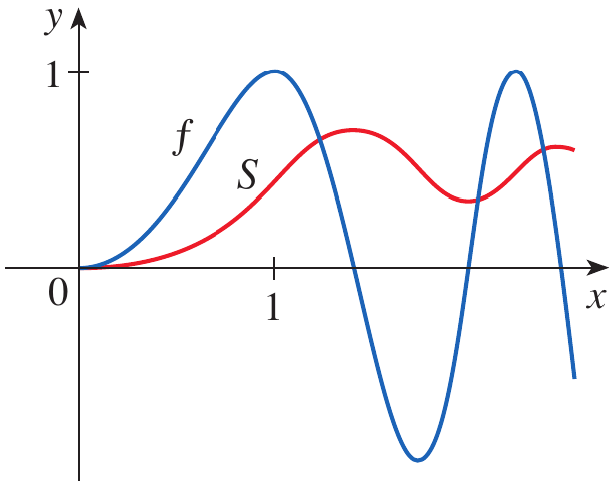
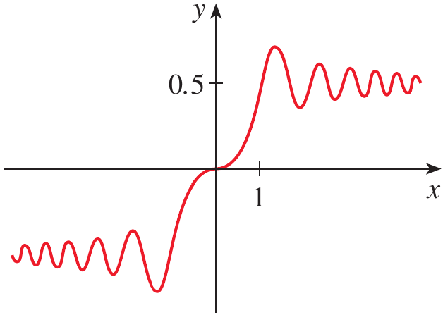
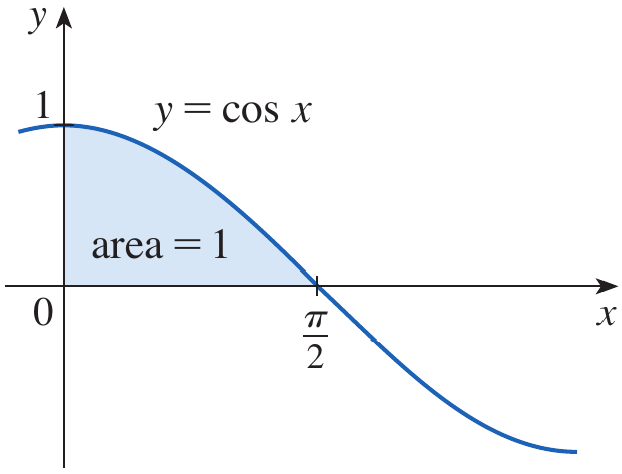

# Calculus and Analytical Geometry

## The Fundamental Theorem of Calculus

### Dr. Aamir Alaud Din

# Objectives

1. To explain and apply the Fundamental Theorem of Calculus, Part 1, by interpreting an integral with a variable upper limit as an accumulation function, differentiating that function, understanding the theorem's proof, and using the result to differentiate functions defined by integrals.
2. To apply the second part of the Fundamental Theorem of Calculus to evaluate definite integrals using antiderivatives, interpret definite integrals as net changes in quantities such as position, and understand how differentiation and integration are inverse processes.

# The Why Section

Differential calculus studies rates of change, while integral calculus studies accumulation, such as area, displacement, and total quantity accumulated over an interval. At first, these may seem to be separate subjects. The Fundamental Theorem of Calculus connects them: under suitable continuity conditions, differentiating an accumulation function recovers the original function.

This connection is useful in mechanical engineering and mechatronics. Suppose a robot's velocity at time $t$ is $v(t)$. Its displacement accumulated from a fixed starting time $a$ to time $x$ can be represented by an integral. The theorem explains how the rate of change of this accumulated displacement relates to the instantaneous velocity. Similarly, a computer program may calculate the cumulative amount of data, energy, or sensor output collected up to a variable time. The theorem allows us to find the rate at which that accumulated quantity changes without repeatedly evaluating the entire integral.

A scenario involving a robot arm whose velocity varies continuously can therefore be analyzed using this topic: if its displacement is represented by an integral of velocity, we can determine the instantaneous rate of change of displacement by differentiating the accumulation function.

A definite integral can represent accumulated change. For example, if the velocity of a robot arm is known throughout a time interval, repeatedly adding tiny displacements would be a lengthy way to calculate its total change in position. The second part of the Fundamental Theorem of Calculus provides a much simpler method: find an antiderivative of the velocity and evaluate it at the endpoints.

The theorem is useful in mechanical engineering when calculating displacement from velocity, work-related accumulation, or the area under a curve. It is also useful in computer science and mechatronics, where software integrates sensor measurements or a modeled rate of change to estimate a system's accumulated output. Instead of approximating the accumulation with many small pieces, the theorem can give an exact result when a suitable antiderivative is available.

Consider a mechatronic positioning system whose velocity is described by a continuous function $v(t)$. If the system is at position $s(a)$ at time $a$, we want to determine its position at time $b$. Studying the second part of the Fundamental Theorem of Calculus will show how the accumulated velocity determines the change in position and how the final position can be calculated.

# The Fundamental Theorem of Calculus, Part 1

## The connection between differentiation and integration

Differentiation and integration arose from different kinds of problems. Differential calculus developed from the problem of finding tangent lines and instantaneous rates of change. Integral calculus developed from problems such as finding areas and accumulated quantities. Isaac Newton and Gottfried Wilhelm Leibniz independently developed calculus and recognized the close relationship between these processes. Newton's mentor Isaac Barrow had earlier identified an important connection between tangent and area problems.

The Fundamental Theorem of Calculus makes this relationship precise. In the setting of Part 1, integration creates a new function by accumulating the values of a continuous function, and differentiation of that new function returns the original function.

## An integral with a variable upper limit

Let $f$ be continuous on $[a,b]$. Define a new function $g$ by

$$
g(x)=\int_a^x f(t)\,dt \qquad a\leq x\leq b
$$

Here, $a$ is a fixed lower limit, while $x$ is a variable upper limit. The letter $t$ is the integration variable; it is a dummy variable and can be replaced by another suitable letter without changing the integral.

For each value of $x$, the integral accumulates the signed area under $y=f(t)$ from $t=a$ to $t=x$. If $f$ is positive on the interval, this accumulation is ordinary area. If $f$ is negative over part of the interval, that part contributes negatively. Consequently, $g(x)$ can increase or decrease as $x$ changes.

<strong>Figure 1.</strong> An area-under-the-curve diagram showing $y=f(t)$, the fixed lower limit $a$, the variable upper limit $x$, and the accumulated area $g(x)=\int_a^x f(t)\,dt$.

## Example 1 {.green}

Let $f$ be the function represented by the graph in Figure 2, and define

$$
g(x)=\int_0^x f(t)\,dt
$$

Find $g(0), g(1), g(2), g(3), g(4)$, and $g(5)$, and sketch a rough graph of $g$.

<strong>Figure 2.</strong> The graph of $y=f(t)$ used in Example 1, showing the line segment, horizontal portion, and curved portion that crosses below the horizontal axis.

## Solution {.green}

At $x=0$, the interval of accumulation has zero width, so

$$
g(0)=\int_0^0 f(t)\,dt=0
$$

At $x=1$, the accumulated area is the triangle under the graph from $0$ to $1$. Its base and height are both $1$, so

$$
g(1)=\int_0^1 f(t)\,dt=\frac12(1)(2)=1
$$

At $x=2$, add the area accumulated from $0$ to $1$ and the rectangular area from $1$ to $2$. The rectangle has width $1$ and height $2$:

$$
\begin{aligned}
g(2)&=\int_0^2 f(t)\,dt\\
&=\int_0^1 f(t)\,dt+\int_1^2 f(t)\,dt\\
&=1+(1)(2)\\
&=3
\end{aligned}
$$

At $x=3$, the graph remains above the axis. The additional curved area from $2$ to $3$ is estimated from the figure as approximately $1.3$. Thus,

$$
g(3)=g(2)+\int_2^3 f(t)\,dt\approx3+1.3=4.3
$$

For $x=4$, the graph is below the axis on the interval from $3$ to $4$. The signed area is approximately $-1.3$, so

$$
g(4)=g(3)+\int_3^4 f(t)\,dt\approx4.3-1.3=3.0
$$

Similarly, the signed area from $4$ to $5$ is approximately $-1.3$, giving

$$
g(5)=g(4)+\int_4^5 f(t)\,dt\approx3.0-1.3=1.7
$$

The approximate values are therefore

$$
g(0)=0,\quad g(1)=1,\quad g(2)=3,\quad
g(3)\approx4.3,\quad g(4)\approx3,\quad g(5)\approx1.7
$$

The graph of $g$ begins at zero. It rises while $f$ is positive, reaches a maximum where $f$ changes from positive to negative, and falls while $f$ is negative. This illustrates how the sign of $f$ controls whether the accumulation function $g$ increases or decreases.

<strong>Figure 3.</strong> A sequence of shaded-area diagrams illustrating the accumulated values $g(1)$, $g(2)$, $g(3)$, $g(4)$, and $g(5)$, with positive area above the axis and negative signed area below it.

<strong>Figure 4.</strong> A rough graph of $g(x)=\int_0^x f(t)\,dt$, rising to a maximum near $x=3$ and then decreasing as $f$ becomes negative.

$\blacksquare$

## Why the derivative of the accumulation function is the original function

Consider the accumulation function

$$
g(x)=\int_a^x f(t)\,dt
$$

If $f$ is positive near $x$, increasing the upper limit from $x$ to $x+h$ adds a thin strip of area. For small $h$, the added area is approximately a rectangle with width $h$ and height $f(x)$. Therefore,

$$
g(x+h)-g(x)\approx f(x)h
$$

Dividing by $h$, for $h\neq0$, gives

$$
\frac{g(x+h)-g(x)}{h}\approx f(x)
$$

Taking the limit as $h\to0$ suggests that

$$
g'(x)=\lim_{h\to0}\frac{g(x+h)-g(x)}{h}=f(x)
$$

This is the central result of the theorem. The derivative of the accumulated signed area is the value of the original function at the moving upper limit.

The same conclusion holds even when $f$ is not always positive. In that case, the signed area added by a small change in the upper limit may be negative, and $g$ decreases accordingly.

<strong>Figure 5.</strong> A curve $y=f(t)$ with a narrow strip between $x$ and $x+h$, illustrating that the added area $g(x+h)-g(x)$ is approximately $f(x)h$.

## Theorem: The Fundamental Theorem of Calculus, Part 1 {.orange}

If $f$ is continuous on $[a,b]$, then the function

$$
g(x)=\int_a^x f(t)\,dt \qquad a\leq x\leq b
$$

is continuous on $[a,b]$, differentiable on $(a,b)$, and

$$
g'(x)=f(x)
$$

Thus, if a function is defined as the integral of a continuous function from a fixed lower limit to a variable upper limit, its derivative is the integrand evaluated at that upper limit.

## Proof {.orange}

Let $x$ and $x+h$ lie in $(a,b)$. By the definition of $g$,

$$
g(x+h)=\int_a^{x+h}f(t)\,dt
$$

and

$$
g(x)=\int_a^x f(t)\,dt
$$

Subtract the two equations:

$$
g(x+h)-g(x)
=\int_a^{x+h}f(t)\,dt-\int_a^x f(t)\,dt
$$

Using the additive property of definite integrals, split the first integral at $x$:

$$
\int_a^{x+h}f(t)\,dt
=\int_a^x f(t)\,dt+\int_x^{x+h}f(t)\,dt
$$

Substitute this into the difference. The two integrals from $a$ to $x$ cancel:

$$
g(x+h)-g(x)=\int_x^{x+h}f(t)\,dt
$$

For $h\neq0$, divide by $h$:

$$
\frac{g(x+h)-g(x)}{h}
=\frac1h\int_x^{x+h}f(t)\,dt
$$

First suppose $h>0$. Since $f$ is continuous, it has an absolute minimum $m$ and an absolute maximum $M$ on the interval $[x,x+h]$. Hence,

$$
m\leq f(t)\leq M
$$

Integrating over $[x,x+h]$ gives

$$
mh\leq\int_x^{x+h}f(t)\,dt\leq Mh
$$

Divide by $h>0$:

$$
m\leq\frac1h\int_x^{x+h}f(t)\,dt\leq M
$$

By the mean value theorem for integrals, there are points $u$ and $v$ in $[x,x+h]$ for which the bounding values can be written as $f(u)$ and $f(v)$. Thus,

$$
f(u)\leq\frac{g(x+h)-g(x)}h\leq f(v)
$$

As $h\to0$, both $u$ and $v$ approach $x$. Since $f$ is continuous at $x$,

$$
\lim_{h\to0}f(u)=f(x)
\qquad
\text{and}
\qquad
\lim_{h\to0}f(v)=f(x)
$$

The Squeeze Theorem therefore gives

$$
\lim_{h\to0}\frac{g(x+h)-g(x)}h=f(x)
$$

The same argument applies for $h<0$, with the corresponding inequalities handled by the sign of $h$. Consequently, the two-sided derivative exists and

$$
g'(x)=\lim_{h\to0}\frac{g(x+h)-g(x)}h=f(x)
$$

Because $f$ is continuous on $[a,b]$, the accumulation function is continuous on $[a,b]$; at the endpoints the corresponding one-sided interpretation applies. This proves Part 1 of the Fundamental Theorem of Calculus.

<strong>Figure 6.</strong> A continuous curve on the interval from $x$ to $x+h$, with the minimum and maximum values of the function bounding the average value of the function over the interval.

$\blacksquare$

## Leibniz notation

Since $g(x)=\int_a^x f(t)\,dt$ and $g'(x)=f(x)$, the theorem can be written in Leibniz notation as

$$
\frac{d}{dx}\int_a^x f(t)\,dt=f(x)
$$

This formula requires $f$ to be continuous on the interval under consideration. Notice that the integration variable $t$ becomes the input $x$ when the integrand is evaluated after differentiation.

## Example 2 {.green}

Find the derivative of the function

$$
g(x)=\int_0^x \sqrt{1+t^2}\,dt
$$

## Solution {.green}

The integrand is

$$
f(t)=\sqrt{1+t^2}
$$

It is continuous for every real number $t$. The Fundamental Theorem of Calculus, Part 1, therefore applies directly. Differentiate the integral with respect to its variable upper limit and evaluate the integrand at $t=x$:

$$
g'(x)=\sqrt{1+x^2}
$$

No antiderivative needs to be found first. The theorem directly gives the derivative of the function defined by the integral.

$\blacksquare$

## Example 3 {.green}

The Fresnel function is defined by

$$
S(x)=\int_0^x \sin\left(\frac{\pi t^2}{2}\right)\,dt
$$

Find $S'(x)$ and explain how the graphs of the integrand and the accumulation function are related.

## Solution {.green}

The integrand is

$$
f(t)=\sin\left(\frac{\pi t^2}{2}\right)
$$

This function is continuous for all real $t$. By the Fundamental Theorem of Calculus, Part 1,

$$
S'(x)=\sin\left(\frac{\pi x^2}{2}\right)
$$

The theorem says that the slope of the graph of $S$ at $x$ equals the value of the integrand at $x$. When the integrand is positive, $S$ increases; when the integrand is negative, $S$ decreases; and where the integrand is zero, the slope of $S$ is zero. The accumulation function smooths the signed contributions of the oscillating integrand into a new curve.

<strong>Figure 7.</strong> The graph of the oscillating integrand $f(x)=\sin(\pi x^2/2)$ alongside the graph of its integral $S(x)=\int_0^x \sin(\pi t^2/2)\,dt$.

<strong>Figure 8.</strong> The graph of the Fresnel accumulation function, illustrating its changing slope and the way its behavior reflects the sign of the integrand.

$\blacksquare$

## Example 4 {.green}

Find

$$
\frac{d}{dx}\int_1^{x^4}\sec t\,dt
$$

## Solution {.green}

The upper limit is $x^4$, not $x$. We must therefore apply the Chain Rule along with the Fundamental Theorem of Calculus.

Let

$$
u=x^4
$$

Then the expression can be viewed as

$$
\frac{d}{dx}\left[\int_1^u\sec t\,dt\right]
$$

By the Chain Rule,

$$
\frac{d}{dx}\left[\int_1^u\sec t\,dt\right]
=
\frac{d}{du}\left[\int_1^u\sec t\,dt\right]\frac{du}{dx}
$$

The Fundamental Theorem gives

$$
\frac{d}{du}\int_1^u\sec t\,dt=\sec u
$$

and

$$
\frac{du}{dx}=4x^3
$$

Combining these results and substituting $u=x^4$, we obtain

$$
\boxed{\frac{d}{dx}\int_1^{x^4}\sec t\,dt=4x^3\sec(x^4)}
$$

$\blacksquare$

# Quick Check

## Question 1 {.red}

If

$$
G(x)=\int_2^x (3t^2+1)\,dt
$$

find $G'(x)$.

## Answer {.red}

By the Fundamental Theorem of Calculus, Part 1, evaluate the integrand at the upper limit:

$$
\boxed{G'(x)=3x^2+1}
$$

## Question 2 {.red}

If

$$
H(x)=\int_0^{2x} \cos t\,dt
$$

find $H'(x)$.

## Answer {.red}

The upper limit is $2x$, so apply the Chain Rule:

$$
H'(x)=\cos(2x)\frac{d}{dx}(2x)
$$

$$
\boxed{H'(x)=2\cos(2x)}
$$

$\blacksquare$

# Scenario Problem

## Problem {.green}

A mechatronics system uses a motor to move a robot arm. Its velocity at time $t$, measured in metres per second, is modelled by the continuous function

$$
v(t)=3t^2+2t
$$

The displacement accumulated between time $0$ and time $x$ is

$$
s(x)=\int_0^x (3t^2+2t)\,dt
$$

Use the Fundamental Theorem of Calculus, Part 1, to find the instantaneous rate of change of the accumulated displacement. Then evaluate this rate at $x=2$.

## Solution {.green}

The displacement is defined as the integral of the continuous velocity function. By the Fundamental Theorem of Calculus, Part 1,

$$
s'(x)=3x^2+2x
$$

Thus, the rate of change of displacement is exactly the velocity function evaluated at the current time. At $x=2$,

$$
s'(2)=3(2)^2+2(2)=12+4=16
$$

Therefore, the instantaneous rate of change of the accumulated displacement at $x=2$ is

$$
\boxed{s'(2)=16\text{ m/s}}
$$

This illustrates the central connection: when displacement is defined by integrating velocity from a fixed starting time to a variable time, differentiating the displacement function recovers the velocity.

$\blacksquare$

# The Fundamental Theorem of Calculus, Part 2

## Why Is the Second Part Important?

The first part of the Fundamental Theorem of Calculus connects accumulation and differentiation: if a function is defined by an integral with a variable upper limit, differentiating it recovers the integrand under the theorem's continuity condition. The second part gives a practical method for evaluating a definite integral.

Earlier, a definite integral was interpreted as the limit of Riemann sums. Although this definition is fundamental, calculating a limit of sums can be long and difficult. The second part of the theorem replaces that procedure with a simpler calculation: find an antiderivative and subtract its values at the endpoints.

## Theorem {.orange}

**The Fundamental Theorem of Calculus, Part 2.** If $f$ is continuous on $[a,b]$, then

$$
\int_a^b f(x)\,dx=F(b)-F(a)
$$

where $F$ is any antiderivative of $f$, that is, a function satisfying $F'(x)=f(x)$.

## Proof {.orange}

Define

$$
g(x)=\int_a^x f(t)\,dt
$$

Since $f$ is continuous on $[a,b]$, the first part of the Fundamental Theorem of Calculus gives

$$
g'(x)=f(x)
$$

Thus, $g$ is an antiderivative of $f$ on the interval.

Let $F$ be any other antiderivative of $f$. Then

$$
F'(x)=f(x)
$$

and

$$
g'(x)=f(x)
$$

Therefore,

$$
F'(x)=g'(x)
$$

It follows that the derivative of $F-g$ is zero:

$$
\frac{d}{dx}[F(x)-g(x)]=0
$$

A function whose derivative is zero on an interval is constant there. Hence, for some constant $C$,

$$
F(x)-g(x)=C
$$

or

$$
F(x)=g(x)+C
$$

This equality holds throughout the interval, including its endpoints by continuity.

Now set $x=a$. From the definition of $g$,

$$
g(a)=\int_a^a f(t)\,dt=0
$$

Consequently,

$$
F(a)=g(a)+C=C
$$

Next, set $x=b$:

$$
F(b)=g(b)+C
$$

Subtracting $F(a)=C$ from $F(b)=g(b)+C$ gives

$$
F(b)-F(a)=g(b)
$$

Using the definition of $g$, we obtain

$$
F(b)-F(a)=\int_a^b f(t)\,dt
$$

Therefore,

$$
\boxed{\int_a^b f(x)\,dx=F(b)-F(a)}
$$

This proves the second part of the Fundamental Theorem of Calculus.

$\blacksquare$

## Interpreting the Theorem as Net Change

Suppose $s(t)$ denotes the position of a moving object and $v(t)$ its velocity. Since velocity is the derivative of position,

$$
s'(t)=v(t)
$$

Therefore, $s$ is an antiderivative of $v$. Applying the theorem gives

$$
\int_a^b v(t)\,dt=s(b)-s(a)
$$

The integral of velocity over a time interval is the **net change in position**, or displacement, over that interval. It is not necessarily the total distance travelled: if the object reverses direction, positive and negative parts of velocity can cancel in the integral.

The same reasoning applies to other rates of change. If $Q'(t)=r(t)$, then

$$
\int_a^b r(t)\,dt=Q(b)-Q(a)
$$

Thus, integrating a rate over an interval gives the net change in the quantity whose derivative is that rate.

## Example 5 {.green}

Evaluate the integral

$$
\int_1^3 e^x\,dx
$$

## Solution {.green}

The integrand is $f(x)=e^x$. An antiderivative is

$$
F(x)=e^x
$$

because $F'(x)=e^x$. By the second part of the Fundamental Theorem of Calculus,

$$
\begin{aligned}
\int_1^3 e^x\,dx
&=F(3)-F(1)\\
&=e^3-e
\end{aligned}
$$

Therefore,

$$
\boxed{\int_1^3 e^x\,dx=e^3-e}
$$

Notice that any antiderivative $e^x+C$ would give the same result, because the constant cancels when the endpoint values are subtracted. It is therefore convenient to use the simplest antiderivative, $F(x)=e^x$.

$\blacksquare$

## Another Notation for the Theorem

The endpoint evaluation is often written using bracket notation:

$$
\left.F(x)\right|_a^b=F(b)-F(a)
$$

Therefore, the theorem can also be written as

$$
\int_a^b f(x)\,dx=\left.F(x)\right|_a^b
$$

where $F'=f$. The notation means: evaluate $F$ at the upper endpoint $b$, evaluate it at the lower endpoint $a$, and subtract the second value from the first.

## Example 6 {.green}

Find the area under the parabola $y=x^2$ from $0$ to $1$.

## Solution {.green}

The required area is

$$
A=\int_0^1 x^2\,dx
$$

An antiderivative of $x^2$ is

$$
F(x)=\frac{x^3}{3}
$$

Applying the Fundamental Theorem of Calculus gives

$$
\begin{aligned}
A
&=\left.\frac{x^3}{3}\right|_0^1\\
&=\frac{1^3}{3}-\frac{0^3}{3}\\
&=\frac13
\end{aligned}
$$

Therefore, the area is

$$
\boxed{A=\frac13}
$$

This calculation is much shorter than evaluating the area by taking a limit of Riemann sums.

$\blacksquare$

## Example 7 {.green}

Evaluate

$$
\int_3^6 \frac{dx}{x}
$$

## Solution {.green}

We can write the integral as

$$
\int_3^6 \frac{1}{x}\,dx
$$

An antiderivative of $1/x$, for $x>0$, is $\ln x$. Since the interval $[3,6]$ lies entirely in the positive real numbers, we can use $F(x)=\ln x$.

By the Fundamental Theorem of Calculus,

$$
\begin{aligned}
\int_3^6 \frac{1}{x}\,dx
&=\left.\ln x\right|_3^6\\
&=\ln 6-\ln 3\\
&=\ln\left(\frac63\right)\\
&=\ln 2
\end{aligned}
$$

Hence,

$$
\boxed{\int_3^6 \frac{1}{x}\,dx=\ln 2}
$$

$\blacksquare$

## Example 8 {.green}

Find the area under the cosine curve from $0$ to $b$, where $0\leq b\leq \pi/2$.

## Solution {.green}

On the interval $0\leq x\leq b\leq\pi/2$, the cosine function is nonnegative. Therefore, the area under the curve $y=\cos x$ from $x=0$ to $x=b$ is

$$
A=\int_0^b \cos x\,dx
$$

An antiderivative of $\cos x$ is $\sin x$. Applying the Fundamental Theorem of Calculus,

$$
\begin{aligned}
A
&=\left.\sin x\right|_0^b\\
&=\sin b-\sin 0\\
&=\sin b
\end{aligned}
$$

Thus,

$$
\boxed{A=\sin b}
$$

In particular, if $b=\pi/2$, then

$$
A=\sin\frac{\pi}{2}=1
$$

So the area under the cosine curve from $0$ to $\pi/2$ is $1$.

<strong>Figure 9.</strong> The area under the curve $y=\cos x$ from $x=0$ to $x=b$, with $0\leq b\leq\pi/2$.

$\blacksquare$

## Example 9 {.green}

What is wrong with the following calculation?

$$
\int_{-1}^{3}\frac{1}{x^2}\,dx
=\left.-\frac{1}{x}\right|_{-1}^{3}
=-\frac13-1
=-\frac43
$$

## Solution {.green}

The calculation is incorrect because the Fundamental Theorem of Calculus, Part 2, requires the integrand to be continuous on the entire closed interval $[a,b]$. Here,

$$
f(x)=\frac{1}{x^2}
$$

is not defined at $x=0$, which lies inside $[-1,3]$. Therefore, $f$ is not continuous on the interval, and the theorem cannot be applied directly.

There is also a useful reason to question the result: $1/x^2$ is positive wherever it is defined, so an integral representing its accumulated area cannot give a negative value.

The improper integral must be split at the discontinuity and treated using limits:

$$
\int_{-1}^{3}\frac{1}{x^2}\,dx
=
\int_{-1}^{0}\frac{1}{x^2}\,dx
+
\int_{0}^{3}\frac{1}{x^2}\,dx
$$

Each part is defined as a one-sided limit. For the left part,

$$
\begin{aligned}
\int_{-1}^{0}\frac{1}{x^2}\,dx
&=\lim_{c\to0^-}\int_{-1}^{c}x^{-2}\,dx\\
&=\lim_{c\to0^-}\left[-\frac1x\right]_{-1}^{c}\\
&=\lim_{c\to0^-}\left(-\frac1c-1\right)\\
&=+\infty
\end{aligned}
$$

For the right part,

$$
\begin{aligned}
\int_{0}^{3}\frac{1}{x^2}\,dx
&=\lim_{d\to0^+}\int_d^3x^{-2}\,dx\\
&=\lim_{d\to0^+}\left[-\frac1x\right]_d^3\\
&=\lim_{d\to0^+}\left(-\frac13+\frac1d\right)\\
&=+\infty
\end{aligned}
$$

Both parts diverge. Therefore, the improper integral does not exist as a finite value:

$$
\boxed{\int_{-1}^{3}\frac{1}{x^2}\,dx\text{ diverges}}
$$

The error was applying the theorem across a point where the integrand is discontinuous.

$\blacksquare$

## Differentiation and Integration as Inverse Processes

The two parts of the Fundamental Theorem of Calculus express the close relationship between differentiation and integration.

### Part 1: Differentiating an Accumulation Function

If $f$ is continuous and

$$
g(x)=\int_a^x f(t)\,dt
$$

then

$$
g'(x)=f(x)
$$

In words, differentiating an accumulation function recovers the original integrand.

### Part 2: Evaluating a Definite Integral

If $f$ is continuous on $[a,b]$ and $F'=f$, then

$$
\int_a^b f(x)\,dx=F(b)-F(a)
$$

In words, a definite integral can be evaluated by finding an antiderivative and subtracting its values at the endpoints.

Together, these results show that differentiation and integration are inverse processes, with the endpoint difference in Part 2 accounting for the net accumulation over an interval. Part 1 differentiates an integral with a variable upper limit; Part 2 evaluates a definite integral using an antiderivative.

# Quick Check

## Question 1 {.red}

Evaluate

$$
\int_0^2 3x^2\,dx
$$

## Answer {.red}

An antiderivative of $3x^2$ is $x^3$. Hence,

$$
\begin{aligned}
\int_0^2 3x^2\,dx
&=\left.x^3\right|_0^2\\
&=2^3-0^3\\
&=8
\end{aligned}
$$

$$
\boxed{8}
$$

## Question 2 {.red}

Can the Fundamental Theorem of Calculus, Part 2, be applied directly to $\int_{-1}^{1}1/x^2\,dx$? Explain briefly.

## Answer {.red}

No. The function $1/x^2$ is not continuous on $[-1,1]$, because it is undefined at $x=0$. The integral is improper and diverges.

$\blacksquare$

# Scenario Problem

## Problem {.green}

A mechatronic actuator moves along a straight guide. Its velocity at time $t$, measured in metres per second, is modelled by

$$
v(t)=3t^2+2t
$$

for $0\leq t\leq2$. If the actuator is at position $s(0)=0.5$ metres at $t=0$, determine its displacement over the two seconds and its final position at $t=2$.

## Solution {.green}

The displacement is the integral of velocity over the time interval:

$$
\Delta s=\int_0^2 v(t)\,dt
$$

Substitute the given velocity function:

$$
\Delta s=\int_0^2(3t^2+2t)\,dt
$$

An antiderivative is

$$
F(t)=t^3+t^2
$$

By the Fundamental Theorem of Calculus, Part 2,

$$
\begin{aligned}
\Delta s
&=\left.(t^3+t^2)\right|_0^2\\
&=(2^3+2^2)-(0^3+0^2)\\
&=8+4\\
&=12\text{ m}
\end{aligned}
$$

Thus, the actuator's displacement is

$$
\boxed{\Delta s=12\text{ m}}
$$

Final position equals initial position plus displacement:

$$
s(2)=s(0)+\Delta s
$$

$$
s(2)=0.5+12=12.5\text{ m}
$$

Therefore, the actuator is at position

$$
\boxed{s(2)=12.5\text{ m}}
$$

The theorem has converted the accumulated velocity into a net change in position by evaluating an antiderivative at the two endpoints.

$\blacksquare$

# Summary

The Fundamental Theorem of Calculus, Part 1, connects integration and differentiation. If $f$ is continuous on $[a,b]$ and $g(x)=\int_a^x f(t)\,dt$, then $g$ is continuous on $[a,b]$, differentiable on $(a,b)$, and $g'(x)=f(x)$. Geometrically, $g(x)$ accumulates signed area under $f$ from a fixed lower limit to a variable upper limit. The accumulation increases where $f$ is positive and decreases where $f$ is negative; the derivative of the accumulation function gives the value of the original function.

In Leibniz notation, $\frac{d}{dx}\int_a^x f(t)\,dt=f(x)$. If the upper limit is a function of $x$, the Chain Rule is also required: for a differentiable $u(x)$, $\frac{d}{dx}\int_a^{u(x)}f(t)\,dt=f(u(x))u'(x)$, where the continuity conditions for the integrand hold. This result makes it possible to differentiate many integral-defined functions without first evaluating their integrals.

The second part of the Fundamental Theorem of Calculus states that if \(f\) is continuous on \([a,b]\) and \(F'=f\), then \(\int_a^b f(x)\,dx=F(b)-F(a)\). It provides a short and exact method for evaluating definite integrals using antiderivatives rather than limits of Riemann sums. The result is often written as \(\left.F(x)\right|_a^b=F(b)-F(a)\). In applications, integrating a rate of change gives the net change in the corresponding quantity; in particular, \(\int_a^b v(t)\,dt=s(b)-s(a)\). The continuity condition matters: the theorem cannot be applied directly across an interior discontinuity, as shown by the divergent integral of \(1/x^2\) across zero.

The two parts of the Fundamental Theorem describe differentiation and integration as inverse processes. Part 1 says that differentiating an accumulation function \(\int_a^x f(t)\,dt\) recovers \(f(x)\), while Part 2 says that a definite integral can be evaluated by subtracting endpoint values of an antiderivative. Together, these results connect rates, accumulated quantities, and areas under curves.

# Exercises

Exercises help in transforming theoretical concepts into practical understanding. Mathematics is learned by doing and solving exercises which train you to analyze problems, select appropriate methods, and construct logical solutions. Attempting problems sometimes leads to mistakes which provide opportunities for learning and improvement. Regular practice increases speed, accuracy, and confidence. Exercises are given in the recommended book which has also been provided to you and you are expected to solve them on your own.

## Exercises Set 1

Solve the odd number exercises from exercise 1 to 80.

## Exercises Set 2

Solve the odd number exercises from exercise 83 to 95.
