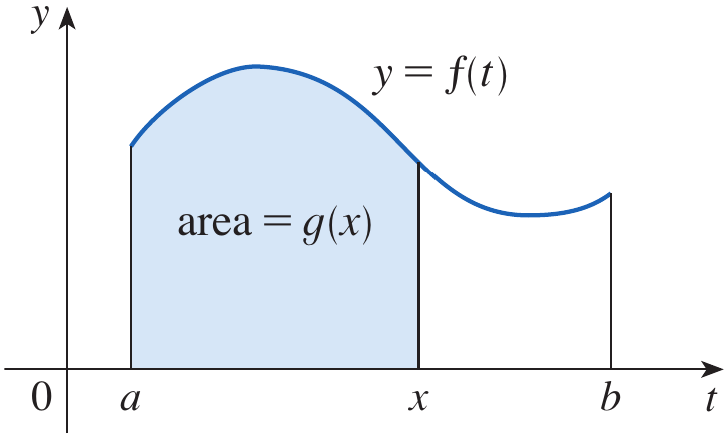
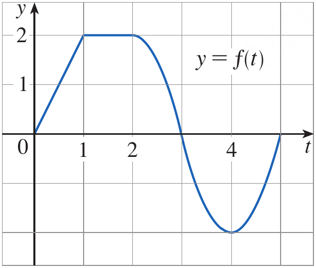
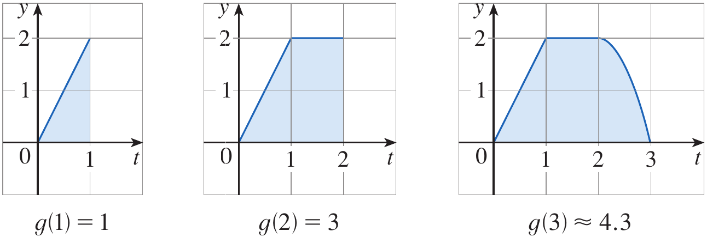
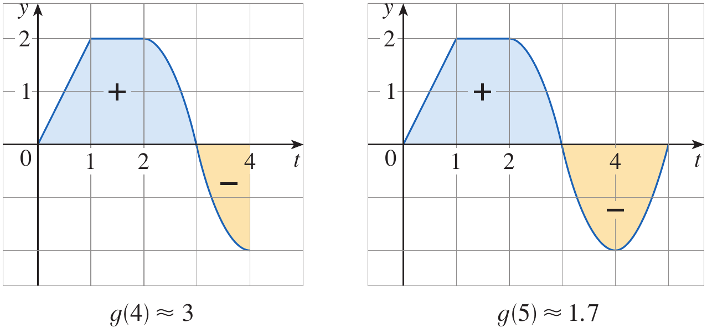
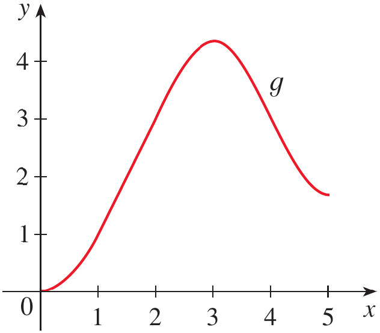
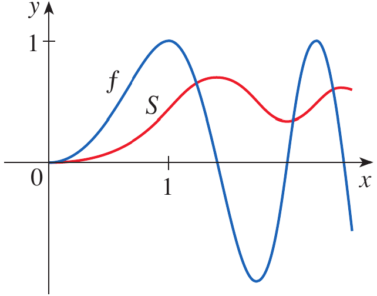
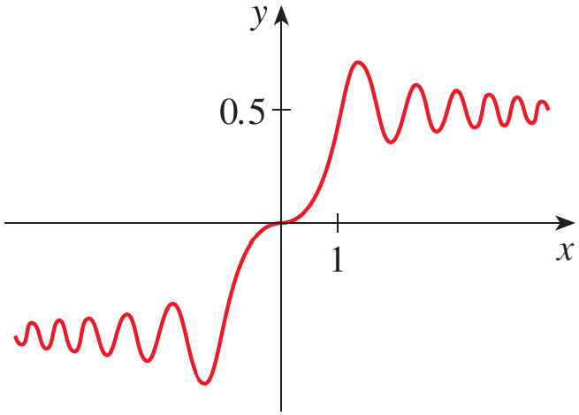

# Calculus and Analytical Geometry

## The Fundamental Theorem of Calculus

### Dr. Aamir Alaud Din

# Objectives

After preparing this topic, you should be able to:

1.  Explain the first part of the Fundamental Theorem of Calculus and
    use it to differentiate functions defined by definite integrals with
    variable upper limits.
2.  Apply the second part of the Fundamental Theorem of Calculus to
    evaluate definite integrals using antiderivatives.
3.  Explain how differentiation and integration act as inverse processes
    and use this relationship to solve mathematical and engineering
    problems.

# The Why Section

-   In mechanical engineering, sensors often record a changing quantity
    such as velocity, force, or temperature. Engineers may need to
    determine the accumulated effect of that quantity over a time
    interval and also understand how the accumulated quantity changes at
    a particular instant.

-   For example, the distance travelled by a moving mechanism can be
    obtained by accumulating its velocity over time. Conversely, if the
    position of the mechanism is known as a function of time,
    differentiation gives its instantaneous velocity.

-   Definite integrals provide a way to calculate accumulated
    quantities, while derivatives describe instantaneous rates of
    change. However, evaluating an integral directly from its definition
    can require a large number of calculations.

-   The Fundamental Theorem of Calculus establishes a connection between
    these two operations. Its first part explains how differentiating an
    accumulation function recovers the original continuous function. Its
    second part provides a practical method for evaluating definite
    integrals using an antiderivative.

-   This relationship is also useful in mechatronics and computer
    science. A controller may use sensor measurements of velocity to
    estimate a robot's displacement, while a known position function can
    be differentiated to estimate its velocity. The same mathematical
    relationship appears in signal processing, simulation, and numerical
    modelling.

-   Therefore, studying this topic gives us a systematic way to move
    between rates of change and accumulated quantities and allows many
    definite integrals to be evaluated without constructing Riemann
    sums.

# Objective 1: The Fundamental Theorem of Calculus, Part 1

## An Accumulation Function

-   Let $f$ be a continuous function on the interval $[a,b]$. We define
    a new function by integrating $f$ from a fixed lower limit $a$ to a
    variable upper limit $x$.

$$
g(x)=\int_a^x f(t)\,dt \qquad a\leq x\leq b
$$

-   The variable $t$ is the variable of integration. It is a dummy
    variable, so it can be replaced by another symbol without changing
    the integral.

-   The value of $g(x)$ represents the accumulated signed area under the
    graph of $f$ from $a$ to $x$. Areas above the horizontal axis
    contribute positively, while areas below the axis contribute
    negatively.

-   As $x$ changes, the amount accumulated also changes. If $f$ is
    positive, increasing the upper limit adds positive area; if $f$ is
    negative, increasing the upper limit adds negative signed area.

<strong>Figure 1.</strong> The area under the graph of $y=f(t)$ from the
fixed lower limit $a$ to the variable upper limit $x$.

## The Fundamental Theorem of Calculus, Part 1

## Theorem {#theorem .orange}

If $f$ is continuous on $[a,b]$ and

$$
g(x)=\int_a^x f(t)\,dt
$$

then $g$ is continuous on $[a,b]$, differentiable on $(a,b)$, and

$$
g'(x)=f(x)
$$

::: theorem-end
$\blacksquare$
:::

-   The theorem says that if we define a function by accumulating the
    values of a continuous function through integration, then
    differentiating that accumulation function gives us the original
    function.

-   In Leibniz notation, the result can be written as

$$
\frac{d}{dx}\int_a^x f(t)\,dt=f(x)
$$

-   This result is particularly useful because the integral may define a
    function even when the integral cannot be expressed conveniently
    using elementary functions.

-   For example, if $g(x)=\int_0^x \sqrt{1+t^2}\,dt$, the Fundamental
    Theorem allows us to find $g'(x)$ directly without first evaluating
    the integral.

## Understanding the Result

-   Suppose $g(x)=\int_a^x f(t)\,dt$. The difference $g(x+h)-g(x)$ is
    the signed area accumulated between $x$ and $x+h$.

$$
g(x+h)-g(x)=\int_x^{x+h} f(t)\,dt
$$

-   Dividing by $h$ gives the average value of $f$ over the short
    interval, with the orientation of the interval taken into account.

$$
\frac{g(x+h)-g(x)}{h}
=\frac{1}{h}\int_x^{x+h} f(t)\,dt
$$

-   When $h$ is close to zero and $f$ is continuous, the values of $f$
    on this short interval are close to $f(x)$. Thus the average value
    approaches $f(x)$ as $h$ approaches zero.

-   The left-hand side approaches the derivative $g'(x)$. Therefore,
    $g'(x)=f(x)$, which is the central conclusion of Part 1.

## Example 1 {#example-1 .green}

If $f$ is the function whose graph is shown in Figure 2 and
$g(x)=\int_0^x f(t)\,dt$, find the values of $g(0)$, $g(1)$, $g(2)$,
$g(3)$, $g(4)$, and $g(5)$. Then sketch a rough graph of $g$.

<strong>Figure 2.</strong> The graph of $y=f(t)$ used to determine
accumulated signed areas.

## Solution {#solution .green}

-   Since the upper and lower limits are equal, the integral is zero.

$$
g(0)=\int_0^0 f(t)\,dt=0
$$

-   From Figure 3, the area from $0$ to $1$ is a triangle with base $1$
    and height $2$. Therefore,

$$
g(1)=\int_0^1 f(t)\,dt=\frac12(1)(2)=1
$$

-   From $1$ to $2$, the graph forms a rectangle with width $1$ and
    height $2$. Adding this area to the previous accumulated area gives

$$
g(2)=g(1)+\int_1^2 f(t)\,dt=1+(1)(2)=3
$$

-   From $2$ to $3$, we add the area under the curved portion of the
    graph. From the figure, this area is approximately $1.3$.

$$
g(3)=g(2)+\int_2^3 f(t)\,dt\approx3+1.3=4.3
$$

-   For $t>3$, the graph lies below the horizontal axis. The signed area
    must therefore be subtracted. The area from $3$ to $4$ is
    approximately $1.3$.

$$
g(4)=g(3)+\int_3^4 f(t)\,dt\approx4.3-1.3=3.0
$$

-   The area below the axis from $4$ to $5$ is approximately $1.3$, so

$$
g(5)=g(4)+\int_4^5 f(t)\,dt\approx3.0-1.3=1.7
$$

-   The accumulated function increases while $f$ is positive and
    decreases while $f$ is negative. Its maximum occurs near the point
    where $f$ changes from positive to negative.

<strong>Figure 3.</strong> Accumulated areas used to estimate $g(1)$ through
$g(5)$.

<strong>Figure 4.</strong> A rough graph of the accumulation function
$g(x)=\int_0^x f(t)\,dt$.

::: example-end
$\blacksquare$
:::

## Example 2 {#example-2 .green}

Find the derivative of the function

$$
g(x)=\int_0^x \sqrt{1+t^2}\,dt
$$

## Solution {#solution-1 .green}

-   The integrand $f(t)=\sqrt{1+t^2}$ is continuous for all real $t$. By
    Part 1 of the Fundamental Theorem of Calculus, we differentiate the
    accumulation function by evaluating the integrand at the upper
    limit.

$$
g'(x)=\sqrt{1+x^2}
$$

::: example-end
$\blacksquare$
:::

## Example 3 {#example-3 .green}

The Fresnel function is defined by

$$
S(x)=\int_0^x \sin\left(\frac{\pi t^2}{2}\right)\,dt
$$

Find $S'(x)$.

## Solution {#solution-2 .green}

-   The integrand is continuous, so Part 1 of the Fundamental Theorem
    applies directly.

$$
S'(x)=\sin\left(\frac{\pi x^2}{2}\right)
$$

-   The integral defines a function whose derivative can be found even
    though the integral does not generally have an elementary
    antiderivative.

<strong>Figure 5.</strong> Graphs of the integrand $f(x)=\sin(\pi x^2/2)$ and
its accumulation function $S(x)$.

<strong>Figure 6.</strong> The Fresnel function
$S(x)=\int_0^x\sin(\pi t^2/2)\,dt$.

::: example-end
$\blacksquare$
:::

## When the Upper Limit Is a Function

-   Sometimes the upper limit is not simply $x$ but a differentiable
    function of $x$. In that case, the Chain Rule must be used along
    with Part 1.

-   If

$$
G(x)=\int_a^{u(x)} f(t)\,dt
$$

then

$$
G'(x)=f(u(x))u'(x)
$$

## Example 4 {#example-4 .green}

Find

$$
\frac{d}{dx}\int_1^{x^4}\sec t\,dt
$$

## Solution {#solution-3 .green}

-   Let $u=x^4$. By the Chain Rule and Part 1 of the Fundamental
    Theorem,

$$
\begin{aligned}
\frac{d}{dx}\int_1^{x^4}\sec t\,dt
&=\sec(x^4)\frac{d}{dx}(x^4)\\
&=4x^3\sec(x^4)
\end{aligned}
$$

::: example-end
$\blacksquare$
:::

# Quick Check

## Question 1 {#question-1 .red}

If $G(x)=\int_2^x (t^3+1)\,dt$, find $G'(x)$.

## Answer {#answer .red}

By Part 1 of the Fundamental Theorem of Calculus,

$$
G'(x)=x^3+1
$$

## Question 2 {#question-2 .red}

If $H(x)=\int_0^{3x}\cos t\,dt$, find $H'(x)$.

## Answer {#answer-1 .red}

Using the Chain Rule,

$$
H'(x)=3\cos(3x)
$$

::: question-end
$\blacksquare$
:::

# Objective 2: The Fundamental Theorem of Calculus, Part 2

## Evaluating Definite Integrals with Antiderivatives

-   The first part of the Fundamental Theorem connects an accumulation
    function with its derivative. The second part gives a practical
    method for evaluating definite integrals.

-   Suppose $f$ is continuous on $[a,b]$ and $F$ is any antiderivative
    of $f$, meaning that $F'(x)=f(x)$. Then the definite integral is the
    difference between the values of $F$ at the endpoints.

## Theorem {#theorem-1 .orange}

If $f$ is continuous on $[a,b]$ and $F'(x)=f(x)$ on the interval, then

$$
\int_a^b f(x)\,dx=F(b)-F(a)
$$

::: theorem-end
$\blacksquare$
:::

-   The expression $F(b)-F(a)$ is sometimes written as $[F(x)]_a^b$. To
    evaluate a definite integral, we find an antiderivative, substitute
    the upper endpoint, subtract the value at the lower endpoint, and
    simplify.

-   This method avoids calculating the limit of Riemann sums for each
    integral. Any antiderivative may be used because the constant of
    integration cancels when the endpoint values are subtracted.

## Example 5 {#example-5 .green}

Evaluate the integral

$$
\int_1^3 e^x\,dx
$$

## Solution {#solution-4 .green}

-   An antiderivative of $e^x$ is $F(x)=e^x$. Applying Part 2 gives

$$
\begin{aligned}
\int_1^3 e^x\,dx
&=F(3)-F(1)\\
&=e^3-e
\end{aligned}
$$

::: example-end
$\blacksquare$
:::

## Interpreting the Definite Integral

-   The definite integral represents signed accumulation over an
    interval. If the graph is above the horizontal axis, the
    corresponding contribution is positive; if it is below the axis, the
    contribution is negative.

-   In a motion problem, if $v(t)$ is velocity and $s'(t)=v(t)$, then

$$
\int_a^b v(t)\,dt=s(b)-s(a)
$$

-   Thus the integral of velocity gives displacement, not necessarily
    total distance travelled. When velocity changes sign, the
    displacement accounts for direction, whereas total distance requires
    accumulating the absolute value of velocity.

# Quick Check

## Question 1 {#question-1-1 .red}

Evaluate $\int_0^2 3x^2\,dx$ using an antiderivative.

## Answer {#answer-2 .red}

-   An antiderivative of $3x^2$ is $F(x)=x^3$. Therefore,

$$
\int_0^2 3x^2\,dx=2^3-0^3=8
$$

## Question 2 {#question-2-1 .red}

If $F'(x)=f(x)$, is $\int_a^b f(x)\,dx$ equal to $F(a)-F(b)$ or
$F(b)-F(a)$?

## Answer {#answer-3 .red}

-   The upper endpoint value is subtracted by the lower endpoint value,
    so the correct expression is

$$
\int_a^b f(x)\,dx=F(b)-F(a)
$$

::: question-end
$\blacksquare$
:::

# Objective 3: Differentiation and Integration as Inverse Processes

## The Relationship Between the Two Operations

-   Differentiation measures the instantaneous rate of change of a
    function, while integration accumulates the values of a function
    over an interval. The Fundamental Theorem shows that these processes
    are closely related.

-   If $f$ is continuous and we define $g(x)=\int_a^x f(t)\,dt$, Part 1
    states that $g'(x)=f(x)$. In this sense, differentiation reverses
    the accumulation represented by the integral.

-   Part 2 states that a definite integral can be evaluated using an
    antiderivative. If $F'=f$, then integrating $f$ from $a$ to $b$
    gives the net change $F(b)-F(a)$.

-   The two statements together explain why differentiation and
    integration are often described as inverse processes. They are not
    identical operations in every context, but the theorem establishes
    the precise relationship under its continuity and differentiability
    conditions.

## Differentiating an Integral and Integrating a Derivative

-   If $f$ is continuous, then

$$
\frac{d}{dx}\left(\int_a^x f(t)\,dt\right)=f(x)
$$

-   If $F$ is differentiable and $F'=f$, then

$$
\int_a^b F'(x)\,dx=F(b)-F(a)
$$

-   The first formula recovers the integrand from its accumulation
    function. The second formula recovers the net change in a function
    by integrating its derivative.

-   For example, if the position of a robot is $s(t)=t^3+2t$, then its
    velocity is $v(t)=3t^2+2$. Integrating this velocity from $t=a$ to
    $t=b$ gives the difference between the final and initial positions.

$$
\int_a^b (3t^2+2)\,dt=(b^3+2b)-(a^3+2a)
$$

-   This identity is useful in engineering because rates of change are
    often measured by sensors, while accumulated changes are needed to
    estimate positions, total energy, or other quantities.

## Why the Constant of Integration Does Not Matter

-   An indefinite integral gives a family of antiderivatives that differ
    by a constant. If $F'(x)=f(x)$, then $F(x)+C$ is also an
    antiderivative.

-   For a definite integral, the constant cancels when we subtract the
    endpoint values.

$$
[F(b)+C]-[F(a)+C]=F(b)-F(a)
$$

-   Therefore, any antiderivative of the integrand can be used in Part
    2.

# Quick Check

## Question 1 {#question-1-2 .red}

Let $F(x)=x^2+4$. Find $\int_1^3 F'(x)\,dx$ without first expanding the
derivative.

## Answer {#answer-4 .red}

-   By the Fundamental Theorem of Calculus,

$$
\int_1^3 F'(x)\,dx=F(3)-F(1)=13-5=8
$$

## Question 2 {#question-2-2 .red}

If $G(x)=\int_0^x f(t)\,dt$ and $f$ is continuous, what is $G'(x)$?

## Answer {#answer-5 .red}

$$
G'(x)=f(x)
$$

-   Differentiating the accumulation function recovers the original
    integrand.

::: question-end
$\blacksquare$
:::

# Scenario Problem

## Problem {.green}
A small autonomous mobile robot moves along a straight test track. Its
measured velocity is modelled by

$$
v(t)=3t^2+2
$$

where $v$ is measured in metres per second and $t$ is measured in
seconds. The robot's initial position is $s(0)=1$ metre. Use the
Fundamental Theorem of Calculus to determine the robot's displacement
between $t=0$ and $t=2$ seconds and its position at $t=2$ seconds.

## Solution {.green}

-   The displacement is the definite integral of velocity over the time
    interval.

$$
\begin{aligned}
\Delta s
&=\int_0^2 (3t^2+2)\,dt\\
&=[t^3+2t]_0^2\\
&=(8+4)-0\\
&=12\text{ m}
\end{aligned}
$$

-   The final position equals the initial position plus the
    displacement.

$$
s(2)=s(0)+\Delta s=1+12=13\text{ m}
$$

-   Therefore, the robot travels a displacement of $12$ metres and
    reaches a position of $13$ metres from the chosen origin at $t=2$
    seconds.

::: example-end
$\blacksquare$
:::

# Summary

-   The Fundamental Theorem of Calculus connects differential calculus
    with integral calculus.
-   Part 1 states that if $f$ is continuous and
    $g(x)=\int_a^x f(t)\,dt$, then $g'(x)=f(x)$.
-   The accumulation function represents signed area from a fixed lower
    endpoint to a variable upper endpoint.
-   When the upper limit is a differentiable function, the Chain Rule
    must be used with Part 1.
-   Part 2 states that a definite integral can be evaluated by
    subtracting the antiderivative's value at the lower endpoint from
    its value at the upper endpoint.
-   Areas below the horizontal axis contribute negatively to a definite
    integral.
-   The integral of velocity gives displacement, while total distance
    may require integrating the absolute value of velocity.
-   Differentiation recovers the integrand of an accumulation function,
    and integration of a derivative gives the net change in the original
    function.
-   The constant of integration cancels when endpoint values are
    subtracted in a definite integral.

# Exercises

## Exercises Set

Solve the odd number exercises from exercise 1 to 91.

* Exercises help transform theoretical concepts into practical understanding.

* Mathematics is learned by doing and solving exercises will train you to analyze problems, select appropriate methods, and construct logical solutions.

* Attempting problems sometimes leads to mistakes which provide opportunities for learning and improvement.

* Regular practice increases speed, accuracy, and confidence.

* Exercises are given in the Exercises file and you are expected to solve them on your own.