# Calculus and Analytical Geometry

## Area Between Curves: Integration With Respect to x

### Dr. Aamir Alaud Din

# Objectives

After preparing this topic, you should be able to
1. Determine the area of a region bounded by two curves by expressing the area as a Riemann sum and evaluating the corresponding definite integral with respect to $x$, including cases in which the upper and lower curves change order within the interval.
2. Determine the area of a region bounded by curves by integrating with respect to $y$, select an appropriate horizontal-strip representation, and apply the method to geometric and practical problems.

# The Why Section

In the previous topic, we used definite integrals to calculate the signed area between a curve and the horizontal axis. In this topic, we extend the same idea to regions enclosed by two curves. Many practical regions are not bounded by the horizontal axis; instead, their upper and lower boundaries are described by different functions. Finding the area of such regions requires us to calculate the difference between the two function values throughout the interval.

This idea has applications in mechanical engineering, computer science, and mechatronics. For example, the cross-sectional region between two curved surfaces may represent the material enclosed between the inner and outer boundaries of a mechanical component. In computer graphics, the area between two curves can describe a two-dimensional shape, while in data science it can measure the difference between two continuous models over a specified range.

**Mechatronics scenario.** Imagine that a computer-controlled cutting machine is designed to cut a component whose upper and lower boundaries are represented by two mathematical curves. The machine needs to determine the amount of material enclosed between these boundaries in a cross-section. If the curves intersect, or if their positions change relative to one another, the area must be calculated over the appropriate intervals. Studying the area between curves provides the mathematical method needed to solve this problem.

In the previous topic, we calculated areas between curves by using vertical approximating rectangles and integrating with respect to $x$. In this approach, the height of each rectangle is the difference between the upper and lower curves. However, some regions are more naturally described by their left and right boundaries. For such regions, horizontal approximating rectangles provide a simpler method because their lengths are determined by the difference between the right and left curves.

This method is useful in mechanical engineering and mechatronics when the cross-section of a component is described more conveniently by horizontal boundaries. For example, a computer-controlled manufacturing system may need to determine the cross-sectional area of a curved mechanical part whose left and right edges are represented as functions of height. In computer graphics, horizontal slices can also be used to calculate the area of a two-dimensional shape represented by curves. Studying integration with respect to $y$ provides a systematic way to determine these areas, particularly when integration with respect to $x$ would require splitting the region into several parts.

**Mechatronics scenario.** Imagine that a robotic cutting system is designed to manufacture a curved plate whose left and right boundaries change with its vertical position. The controller must determine the cross-sectional area of the plate to estimate the amount of material required. If the boundaries are expressed as $x=f(y)$ and $x=g(y)$, this problem can be solved by studying and applying integration with respect to $y$.

# Area Between Curves: Integration With Respect to x

## From the Definite Integral to the Area Between Two Curves

In the previous topic, we studied how a definite integral represents the area under a curve and above the $x$-axis when the function is nonnegative. We also interpreted the definite integral as a limit of Riemann sums. We now use the same limiting process to calculate the area of a region between two curves.

Consider a region $S$ bounded by the curves $y=f(x)$ and $y=g(x)$ and by the vertical lines $x=a$ and $x=b$, where both functions are continuous and $f(x)\geq g(x)$ throughout the interval $[a,b]$. As illustrated in Figure 1, the curve $y=f(x)$ forms the upper boundary of the region, while $y=g(x)$ forms its lower boundary.

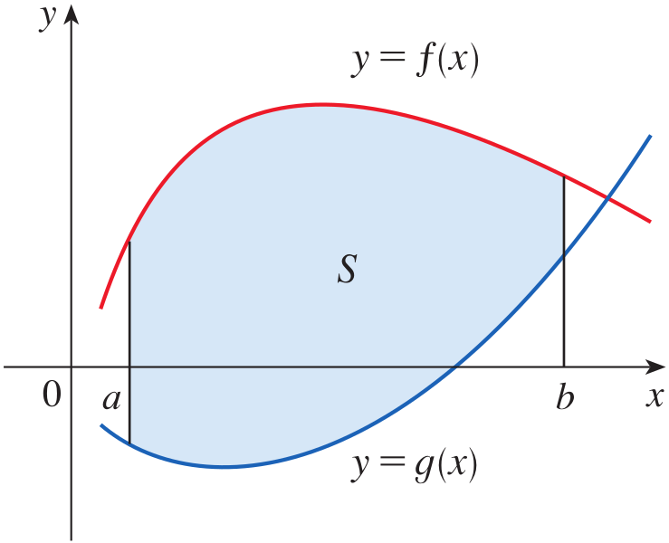

<strong>Figure 1.</strong> A region S bounded above by y=f(x), below by y=g(x), and on the sides by the vertical lines x=a and x=b.

To determine the area of this region, we divide it into narrow vertical strips. Each strip can be approximated by a rectangle whose width is $\Delta x$ and whose height is the vertical distance between the two curves. At a selected sample point $x_i^*$, this height is $f(x_i^*)-g(x_i^*)$. Therefore, the approximate area of the $i$th rectangle is

$$
[f(x_i^*)-g(x_i^*)]\Delta x
$$

Adding the areas of all the rectangles gives the Riemann sum

$$
\sum_{i=1}^{n}[f(x_i^*)-g(x_i^*)]\Delta x
$$

Figure 2(a) illustrates a typical approximating rectangle. Its height is the difference between the upper and lower function values, and its width is $\Delta x$. Figure 2(b) shows how the collection of rectangles approximates the entire region. As the number of rectangles increases, their widths become smaller and the approximation approaches the exact area.

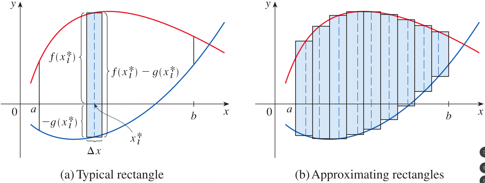

<strong>Figure 2.</strong> (a) A typical approximating rectangle of width Δx and height f(x_i*)−g(x_i*). (b) A collection of vertical rectangles approximating the region between the two curves.

For equal subdivisions, the width is $\Delta x=(b-a)/n$. Taking the limit as the number of subintervals approaches infinity gives the exact area:

$$
A=\lim_{n\to\infty}\sum_{i=1}^{n}[f(x_i^*)-g(x_i^*)]\Delta x
$$

The limit is the definite integral of the difference between the two functions. Thus, the area can be calculated by integrating the upper function minus the lower function over the interval.

## Definition: Area Between Curves {.blue}

Let $f$ and $g$ be continuous functions on $[a,b]$, and suppose that $f(x)\geq g(x)$ for every $x$ in the interval. The area $A$ of the region bounded by the curves $y=f(x)$ and $y=g(x)$ and the vertical lines $x=a$ and $x=b$ is

$$
A=\int_a^b[f(x)-g(x)]\,dx
$$

$\blacksquare$

The expression $f(x)-g(x)$ represents the vertical distance between the upper curve and the lower curve at each value of $x$. Integrating this distance from $a$ to $b$ adds the areas of all the vertical strips across the region. Figure 3 illustrates this relationship. In the special case where $g(x)=0$, the lower boundary is the $x$-axis, and the formula reduces to the familiar area under a nonnegative curve.

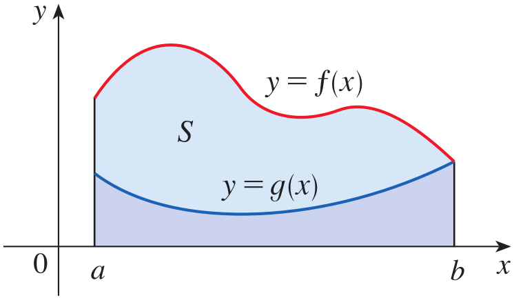

<strong>Figure 3.</strong> The area between the curves y=f(x) and y=g(x), obtained by subtracting the area under the lower curve from the area under the upper curve.

## Example 1 {.green}

Find the area of the region bounded above by $y=e^x$, bounded below by $y=x$, and bounded on the sides by $x=0$ and $x=1$.

## Solution {.green}

The upper boundary is $y=e^x$, and the lower boundary is $y=x$. The region extends from $x=0$ to $x=1$. Therefore, we identify

$$
f(x)=e^x,\qquad g(x)=x,\qquad a=0,\qquad b=1
$$

Using the area formula, we integrate the upper function minus the lower function:

$$
A=\int_0^1(e^x-x)\,dx
$$

An antiderivative of $e^x-x$ is $e^x-\frac{x^2}{2}$. Hence,

$$
\begin{aligned}
A&=\left[e^x-\frac{x^2}{2}\right]_0^1\\
&=\left(e-\frac12\right)-\left(1-0\right)\\
&=e-\frac32
\end{aligned}
$$

Therefore, the required area is

$$
\boxed{A=e-\frac32\approx1.2183}
$$

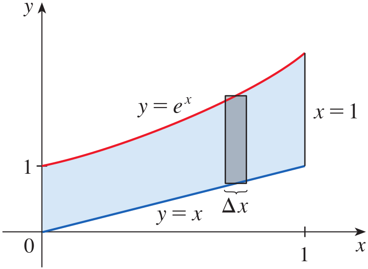

<strong>Figure 4.</strong> The region bounded above by y=e^x, below by y=x, and between x=0 and x=1, together with a typical vertical approximating rectangle.

$\blacksquare$

## Area Using Top and Bottom Functions

The area formula can be expressed in terms of the top and bottom boundaries of a region. Let $y_T$ represent the top function and $y_B$ represent the bottom function. A typical vertical rectangle has width $\Delta x$ and height $y_T-y_B$. Its approximate area is therefore

$$
\Delta A=(y_T-y_B)\Delta x
$$

Adding the areas of all such rectangles and taking the limit gives

$$
A=\lim_{n\to\infty}\sum_{i=1}^{n}
[y_T(x_i^*)-y_B(x_i^*)]\Delta x
$$

Consequently, the area between the curves is

$$
A=\int_a^b(y_T-y_B)\,dx
$$

The important point is that the upper function must be subtracted from the lower function in the correct order: top minus bottom. Figure 5 illustrates the vertical distance $y_T-y_B$ and the corresponding approximating rectangle.

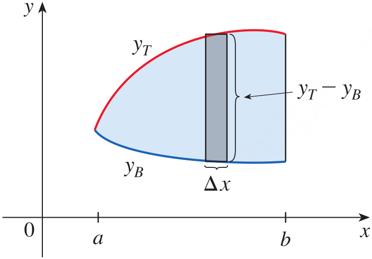

<strong>Figure 5.</strong> A typical vertical rectangle between the top curve y_T and the bottom curve y_B, with height y_T−y_B and width Δx.

## Example 2 {.green}

Find the area of the region enclosed by the parabolas $y=2x-x^2$ and $y=x^2$.

## Solution {.green}

First, we find the points of intersection of the two parabolas. At an intersection point, their $y$-coordinates are equal. Therefore,

$$
2x-x^2=x^2
$$

Rearranging gives

$$
2x^2-2x=0
$$

Factoring,

$$
2x(x-1)=0
$$

Thus, the curves intersect at $x=0$ and $x=1$. These values determine the limits of integration.

From the equations of the curves, the upper boundary is $y_T=2x-x^2$ and the lower boundary is $y_B=x^2$ on the interval $[0,1]$. The area is therefore

$$
\begin{aligned}
A&=\int_0^1[(2x-x^2)-x^2]\,dx\\
&=\int_0^1(2x-2x^2)\,dx
\end{aligned}
$$

Integrating,

$$
\begin{aligned}
A&=\left[x^2-\frac{2x^3}{3}\right]_0^1\\
&=\left(1-\frac23\right)-0\\
&=\frac13
\end{aligned}
$$

Hence, the area enclosed by the two parabolas is

$$
\boxed{A=\frac13}
$$

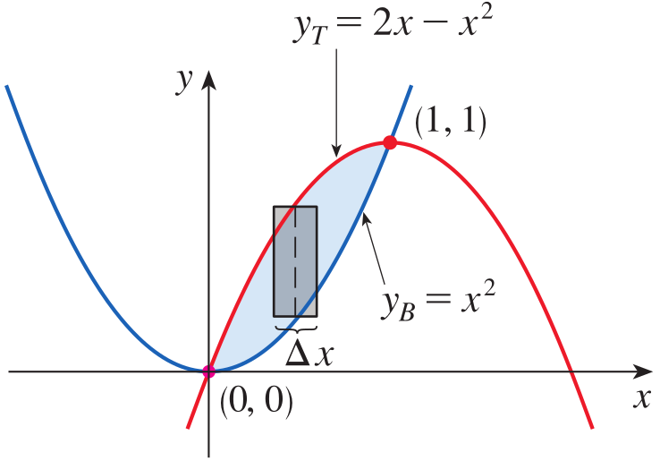

<strong>Figure 6.</strong> The region enclosed by the parabolas y=2x−x^2 and y=x^2, with intersection points (0,0) and (1,1) and a typical vertical rectangle.

$\blacksquare$

## Example 3 {.green}

Find the approximate area of the region bounded by the curves $y=\dfrac{x}{\sqrt{x^2+1}}$ and $y=x^4-x$.

## Solution {.green}

The region is bounded by the two curves. One intersection point is the origin. To find the other intersection point, we would need to solve

$$
\frac{x}{\sqrt{x^2+1}}=x^4-x
$$

This equation is difficult to solve exactly. We therefore use a graphing calculator or computer to approximate the second intersection point. From the graph, the second intersection occurs at approximately $x=1.18$.

On the interval from $x=0$ to $x\approx1.18$, the curve $y=\dfrac{x}{\sqrt{x^2+1}}$ lies above the curve $y=x^4-x$. Thus, the required area is approximately

$$
A\approx\int_0^{1.18}
\left[\frac{x}{\sqrt{x^2+1}}-(x^4-x)\right]dx
$$

We evaluate the first part using the substitution $u=x^2+1$. Then $du=2x\,dx$, so $x\,dx=\frac12du$. When $x=0$, $u=1$, and when $x=1.18$, $u=1.18^2+1\approx2.39$. Therefore,

$$
\begin{aligned}
\int_0^{1.18}\frac{x}{\sqrt{x^2+1}}\,dx
&=\frac12\int_1^{2.39}u^{-1/2}\,du\\
&=\left[\sqrt{u}\right]_1^{2.39}\\
&=\sqrt{2.39}-1
\end{aligned}
$$

For the second part,

$$
\int_0^{1.18}(x^4-x)\,dx
=
\left[\frac{x^5}{5}-\frac{x^2}{2}\right]_0^{1.18}
$$

Combining the two results,

$$
\begin{aligned}
A&\approx\sqrt{2.39}-1
-\left(\frac{1.18^5}{5}-\frac{1.18^2}{2}\right)\\
&\approx0.785
\end{aligned}
$$

Therefore, the approximate area between the curves is

$$
\boxed{A\approx0.785}
$$

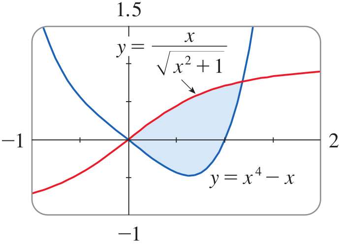

<strong>Figure 7.</strong> Graphs of y=x/√(x²+1) and y=x^4−x, showing their intersection points at the origin and approximately at x=1.18, and the region between the curves.

$\blacksquare$

## When the Curves Change Their Relative Positions

So far, we have considered regions in which one curve remains above the other throughout the interval. In some problems, the curves intersect inside the interval, and their relative positions change. In that situation, one function may be above the other on one part of the interval, while the order is reversed on another part.

Suppose that $f(x)\geq g(x)$ on one part of the interval. The area of that part is calculated by integrating $f(x)-g(x)$. Where $g(x)\geq f(x)$, the area is calculated by integrating $g(x)-f(x)$. Figure 8 illustrates a region divided into smaller regions at the points where the curves intersect. The total area is the sum of the individual positive areas.

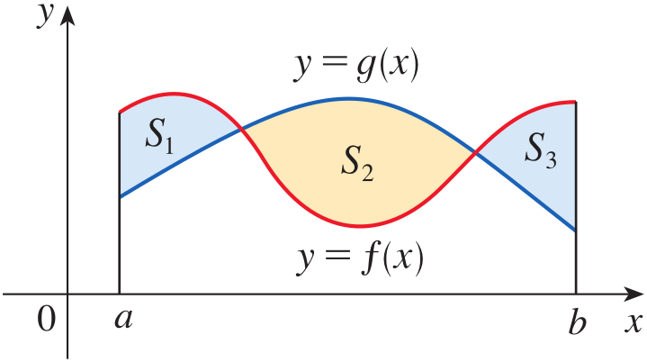

<strong>Figure 8.</strong> A region between two curves whose relative positions change, divided into subregions S_1, S_2, and S_3 at their intersection points.

The area can be represented by the absolute difference between the functions:

$$
A=\int_a^b|f(x)-g(x)|\,dx
$$

The absolute value ensures that the vertical distance between the curves is nonnegative, regardless of which function is above the other. When evaluating this integral, we must split the interval at the intersection points where the order of the curves changes and evaluate the resulting integrals separately.

## Definition: Area Between Curves When Their Order Changes {.blue}

If $f$ and $g$ are continuous functions on $[a,b]$, the area between their graphs is

$$
A=\int_a^b|f(x)-g(x)|\,dx
$$

This formula applies whether $f$ is above $g$ throughout the interval or the two curves change their relative positions. If the curves intersect at points inside the interval, divide the interval at those points and integrate the positive difference on each subinterval.

$\blacksquare$

## Example 4 {.green}

Find the area of the region bounded by the curves $y=\sin x$, $y=\cos x$, $x=0$, and $x=\dfrac{\pi}{2}$.

## Solution {.green}

First, we find where the two curves intersect. At an intersection point,

$$
\sin x=\cos x
$$

For $0\leq x\leq\frac{\pi}{2}$, this occurs at

$$
x=\frac{\pi}{4}
$$

The order of the curves changes at this point. On the interval $0\leq x\leq\frac{\pi}{4}$, $\cos x$ is above $\sin x$. On the interval $\frac{\pi}{4}\leq x\leq\frac{\pi}{2}$, $\sin x$ is above $\cos x$. Therefore, we divide the required region into two parts:

$$
A=\int_0^{\pi/4}(\cos x-\sin x)\,dx
+\int_{\pi/4}^{\pi/2}(\sin x-\cos x)\,dx
$$

For the first part,

$$
\begin{aligned}
A_1&=\int_0^{\pi/4}(\cos x-\sin x)\,dx\\
&=[\sin x+\cos x]_0^{\pi/4}\\
&=\left(\frac{\sqrt2}{2}+\frac{\sqrt2}{2}\right)-(0+1)\\
&=\sqrt2-1
\end{aligned}
$$

For the second part,

$$
\begin{aligned}
A_2&=\int_{\pi/4}^{\pi/2}(\sin x-\cos x)\,dx\\
&=[-\cos x-\sin x]_{\pi/4}^{\pi/2}\\
&=(-0-1)-\left(-\frac{\sqrt2}{2}-\frac{\sqrt2}{2}\right)\\
&=\sqrt2-1
\end{aligned}
$$

The total area is the sum of these two parts:

$$
\begin{aligned}
A&=A_1+A_2\\
&=(\sqrt2-1)+(\sqrt2-1)\\
&=2\sqrt2-2
\end{aligned}
$$

Hence, the required area is

$$
\boxed{A=2\sqrt2-2\approx0.8284}
$$

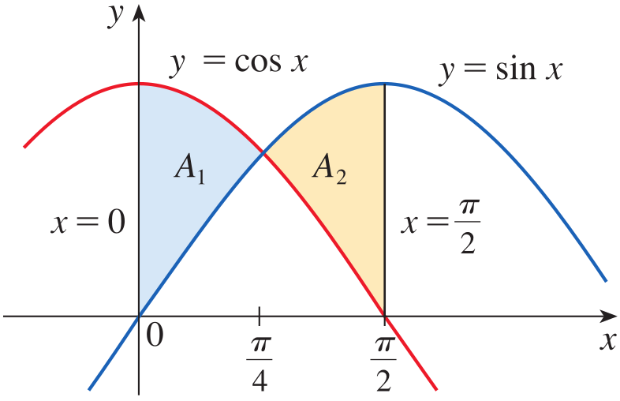

<strong>Figure 9.</strong> The region bounded by y=sin x, y=cos x, x=0, and x=π/2, divided at x=π/4 into two regions of equal area.

The figure also shows the symmetry of the two regions about $x=\frac{\pi}{4}$. Since the two areas are equal, the total area could alternatively be found by calculating one of them and multiplying by two.

$\blacksquare$

# Quick Check

## Question 1 {.red}

The upper curve is $y=5$ and the lower curve is $y=2$ on the interval $[1,4]$. Find the area between the curves.

## Answer {.red}

The area is the integral of the upper function minus the lower function:

$$
\begin{aligned}
A&=\int_1^4(5-2)\,dx\\
&=3(4-1)\\
&=9
\end{aligned}
$$

$$
\boxed{A=9}
$$

## Question 2 {.red}

Two curves intersect at $x=1$ inside the interval $[0,2]$, and their relative positions change at this point. Should the area be calculated using the signed integral of their difference over the whole interval or by splitting the interval at the intersection?

## Answer {.red}

The interval must be split at the intersection point. On each subinterval, subtract the lower function from the upper function so that each area is positive.

$\blacksquare$

# Scenario Problem

## Problem {.green}

A computer-controlled cutting machine is used to manufacture a thin mechanical plate. In a cross-section, the upper boundary of the plate is modelled by $y=4-x^2$, while the lower boundary is modelled by $y=x^2$. The two boundaries intersect at the ends of the region. Determine the cross-sectional area of the plate enclosed between the curves.

## Solution {.green}

First, find the points where the two curves intersect by equating their expressions:

$$
4-x^2=x^2
$$

Rearranging gives

$$
2x^2=4
$$

Thus, $x=\pm\sqrt2$. The region extends from $x=-\sqrt2$ to $x=\sqrt2$. On this interval, the upper curve is $y_T=4-x^2$ and the lower curve is $y_B=x^2$.

The cross-sectional area is therefore

$$
A=\int_{-\sqrt2}^{\sqrt2}[(4-x^2)-x^2]\,dx
$$

Simplifying and integrating,

$$
\begin{aligned}
A&=\int_{-\sqrt2}^{\sqrt2}(4-2x^2)\,dx\\
&=\left[4x-\frac{2x^3}{3}\right]_{-\sqrt2}^{\sqrt2}\\
&=\left(4\sqrt2-\frac{4\sqrt2}{3}\right)
-\left(-4\sqrt2+\frac{4\sqrt2}{3}\right)\\
&=\frac{16\sqrt2}{3}
\end{aligned}
$$

Therefore, the cross-sectional area of the plate is

$$
\boxed{A=\frac{16\sqrt2}{3}\approx7.543}
$$

The area is obtained by integrating the vertical distance between the upper and lower boundaries over the interval determined by their intersection points. This is the same method that can be used by a computer-controlled manufacturing system when the boundaries of a component are represented by mathematical functions.

$\blacksquare$

# Area Between Curves: Integration With Respect to y

## Integrating with Respect to y

Some regions are more conveniently treated by regarding $x$ as a function of $y$. Instead of dividing the region into vertical strips, we divide it into narrow horizontal strips. Consider a region bounded by the curves $x=f(y)$ and $x=g(y)$ and by the horizontal lines $y=c$ and $y=d$. Suppose that both functions are continuous and that $f(y)>g(y)$ for $c<y<d$. In this situation, the curve $x=f(y)$ forms the right boundary, while $x=g(y)$ forms the left boundary.

A typical horizontal approximating rectangle has height $\Delta y$. Its horizontal length is the difference between the right and left boundary values, namely $f(y)-g(y)$. Therefore, at a selected sample point $y_i^*$, the approximate area of the rectangle is

$$
\Delta A=[f(y_i^*)-g(y_i^*)]\Delta y
$$

Adding the areas of all the horizontal rectangles gives the Riemann sum

$$
\sum_{i=1}^{n}[f(y_i^*)-g(y_i^*)]\Delta y
$$

As the number of rectangles increases and their heights approach zero, the sum approaches the exact area of the region. Thus, the area is obtained by integrating the horizontal length from the lower $y$-value to the upper $y$-value.

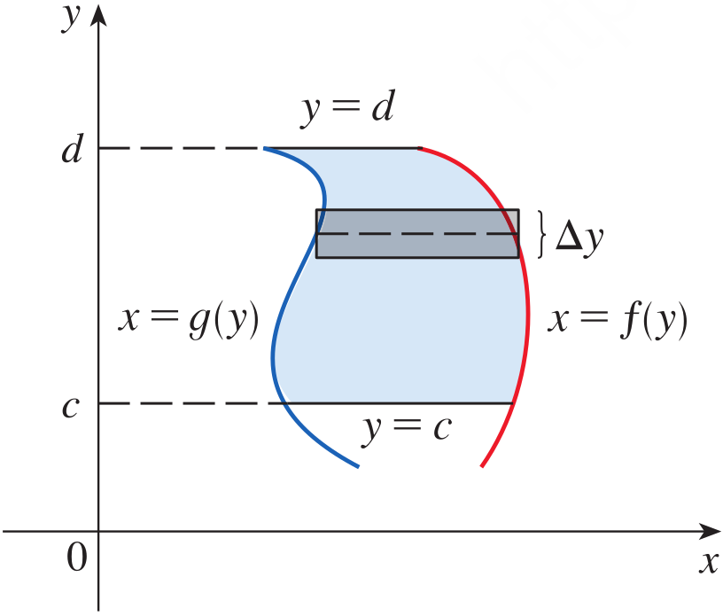

<strong>Figure 10.</strong> A region bounded by the curves $x=f(y)$ and $x=g(y)$ and the horizontal lines $y=c$ and $y=d$, showing a typical horizontal approximating rectangle of height $\Delta y$.

If we write $x_R$ for the right boundary and $x_L$ for the left boundary, the horizontal length of a typical rectangle is $x_R-x_L$. Consequently, its approximate area is $(x_R-x_L)\Delta y$. Integrating this horizontal distance from $y=c$ to $y=d$ gives the area of the complete region.

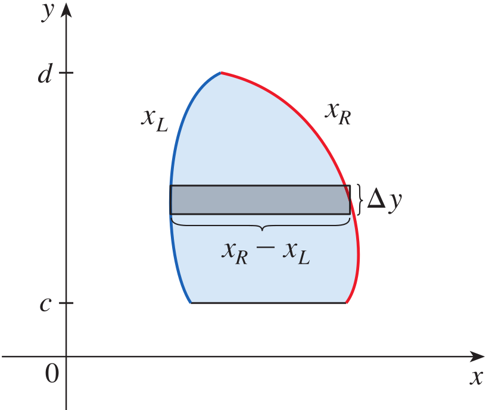

<strong>Figure 11.</strong> A horizontal approximating rectangle whose length is $x_R-x_L$ and whose height is $\Delta y$, extending across a region between $y=c$ and $y=d$.

## Definition: Area Between Curves Using Integration with Respect to y {.blue}

Let $x=f(y)$ and $x=g(y)$ be continuous functions on $[c,d]$, where $f(y)\geq g(y)$ throughout the interval. The area of the region bounded by these curves and the horizontal lines $y=c$ and $y=d$ is

$$
A=\int_c^d[f(y)-g(y)]\,dy
$$

If $x_R$ and $x_L$ represent the right and left boundaries, respectively, the same formula can be written as

$$
A=\int_c^d(x_R-x_L)\,dy
$$

The important point is that the right boundary must be subtracted by the left boundary. The limits of integration are the lower and upper $y$-coordinates of the region.

$\blacksquare$

## Example 5 {.green}

Find the area enclosed by the line $y=x-1$ and the parabola $y^2=2x+6$.

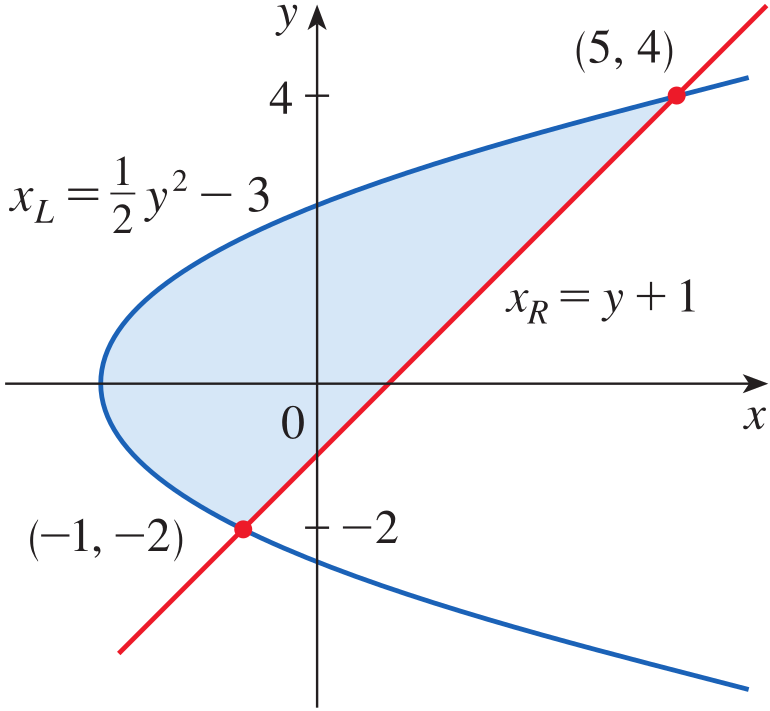

<strong>Figure 12.</strong> The region enclosed by the line $y=x-1$ and the parabola $y^2=2x+6$, with intersection points $(-1,-2)$ and $(5,4)$, and the left and right boundary curves indicated.

## Solution {.green}

We first find the points of intersection by solving the equations simultaneously. From the line $y=x-1$, we obtain $x=y+1$. Substituting this expression into the equation of the parabola gives

$$
y^2=2(y+1)+6
$$

Simplifying,

$$
y^2-2y-8=0
$$

Factoring,

$$
(y-4)(y+2)=0
$$

Therefore, the intersection values are $y=-2$ and $y=4$. Substituting these values into $x=y+1$ gives the intersection points $(-1,-2)$ and $(5,4)$. These $y$-coordinates determine the limits of integration.

Next, we express both curves in terms of $y$. From the parabola,

$$
y^2=2x+6
$$

we obtain

$$
x=\frac{1}{2}y^2-3
$$

The line gives $x=y+1$. From Figure 12, the line is the right boundary and the parabola is the left boundary. Thus,

$$
x_R=y+1,\qquad x_L=\frac{1}{2}y^2-3
$$

Using the area formula,

$$
\begin{aligned}
A&=\int_{-2}^{4}(x_R-x_L)\,dy\\
&=\int_{-2}^{4}\left[(y+1)-\left(\frac{1}{2}y^2-3\right)\right]dy\\
&=\int_{-2}^{4}\left(-\frac{1}{2}y^2+y+4\right)dy
\end{aligned}
$$

An antiderivative of the integrand is

$$
-\frac{y^3}{6}+\frac{y^2}{2}+4y
$$

Therefore,

$$
\begin{aligned}
A&=\left[-\frac{y^3}{6}+\frac{y^2}{2}+4y\right]_{-2}^{4}\\
&=\left(-\frac{64}{6}+8+16\right)
-\left(\frac{8}{6}+2-8\right)\\
&=18
\end{aligned}
$$

Hence, the area enclosed by the line and the parabola is

$$
\boxed{A=18}
$$

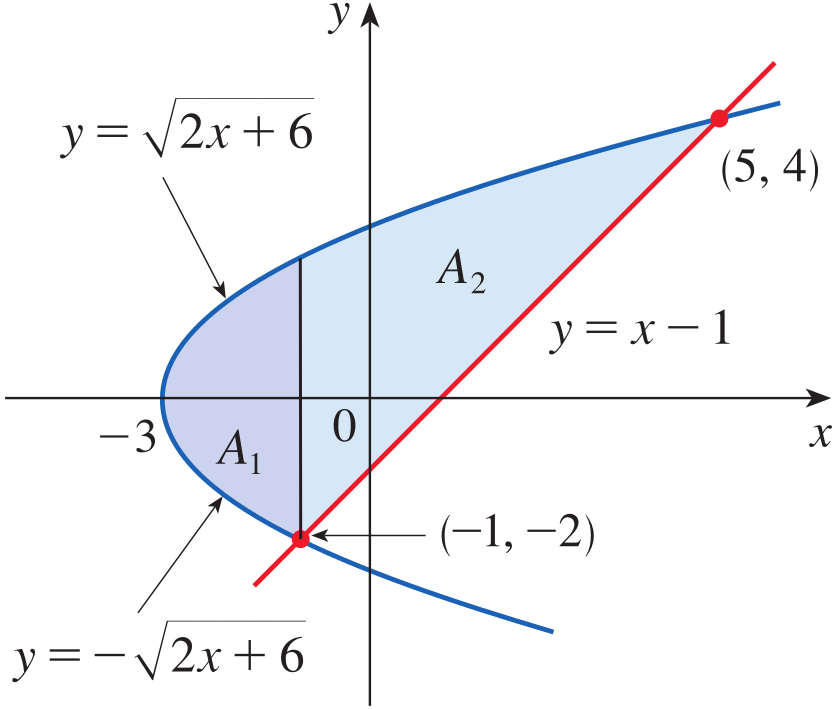

<strong>Figure 13.</strong> The same region shown using vertical approximating strips. The lower boundary changes from one curve to another, dividing the region into two parts, $A_1$ and $A_2$.

**Note.** The area in Example 5 could also be found by integrating with respect to $x$. However, this calculation is more involved because the bottom boundary of the region consists of two different curves. As illustrated in Figure 13, the region would have to be divided into two parts, $A_1$ and $A_2$, and the areas of these parts would then be calculated separately. Integrating with respect to $y$ avoids this additional work because the region has a single right boundary and a single left boundary throughout the interval. This example illustrates why choosing the variable of integration carefully can simplify an area problem.

$\blacksquare$

## Example 6 {.green}

Find the area of the region enclosed by the curves $y=\frac{1}{x}$, $y=x$, and $y=\frac{1}{4}x$, using (a) $x$ as the variable of integration and (b) $y$ as the variable of integration.

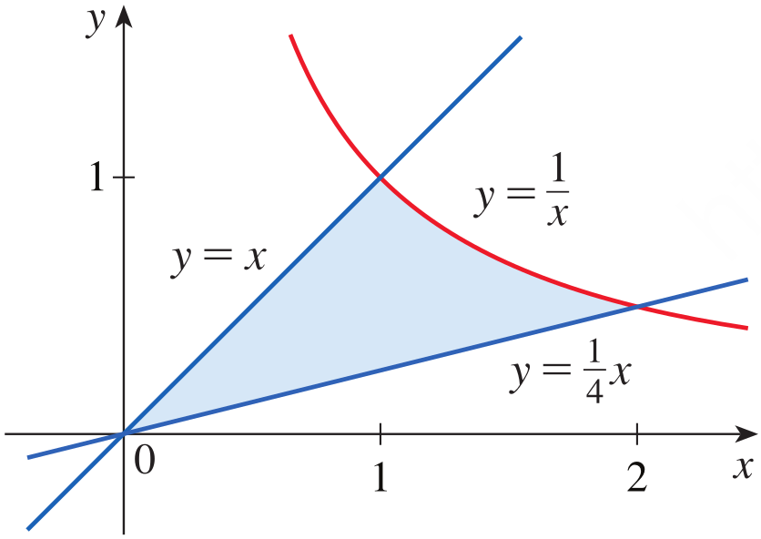

<strong>Figure 14.</strong> The region enclosed by $y=\frac{1}{x}$, $y=x$, and $y=\frac{1}{4}x$, showing the intersection points $(1,1)$ and $(2,\frac{1}{2})$ and the two straight-line boundaries.

## Solution {.green}

The region is shown in Figure 14. The curves $y=x$ and $y=\frac{1}{4}x$ intersect at the origin. The curve $y=\frac{1}{x}$ intersects $y=x$ at $(1,1)$ and intersects $y=\frac{1}{4}x$ at $(2,\frac{1}{2})$.

**(a) Integration with respect to $x$.** When we integrate with respect to $x$, we use vertical approximating rectangles. The upper boundary changes at $x=1$. For $0\leq x\leq1$, the upper curve is $y=x$ and the lower curve is $y=\frac{1}{4}x$. For $1\leq x\leq2$, the upper curve is $y=\frac{1}{x}$ and the lower curve is $y=\frac{1}{4}x$. Therefore, the region must be divided into two parts, as illustrated in Figure 15(a).

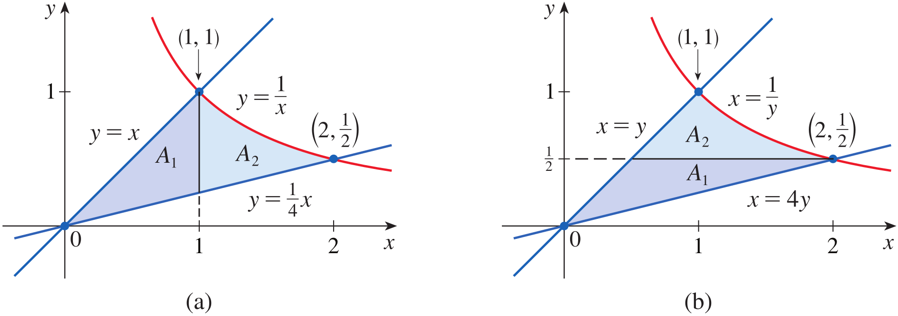

<strong>Figure 15.</strong> (a) The region of Figure 14 divided into two subregions, $A_1$ and $A_2$, using vertical strips. The top boundary is $y=x$ on the first interval and $y=\frac{1}{x}$ on the second interval. (b) The region of Figure 14 divided into two subregions, $A_1$ and $A_2$, using horizontal strips. The right boundary is $x=4y$ on the first interval and $x=\frac{1}{y}$ on the second interval, while the left boundary is $x=y$.

The total area is

$$
\begin{aligned}
A&=A_1+A_2\\
&=\int_0^1\left(x-\frac{1}{4}x\right)dx
+\int_1^2\left(\frac{1}{x}-\frac{1}{4}x\right)dx
\end{aligned}
$$

Simplifying the first integral,

$$
\begin{aligned}
A_1&=\int_0^1\frac{3}{4}x\,dx\\
&=\left[\frac{3}{8}x^2\right]_0^1\\
&=\frac{3}{8}
\end{aligned}
$$

For the second integral,

$$
\begin{aligned}
A_2&=\int_1^2\left(\frac{1}{x}-\frac{1}{4}x\right)dx\\
&=\left[\ln x-\frac{1}{8}x^2\right]_1^2\\
&=\ln 2-\frac{1}{2}-\left(0-\frac{1}{8}\right)\\
&=\ln 2-\frac{3}{8}
\end{aligned}
$$

Adding the two parts,

$$
\begin{aligned}
A&=\frac{3}{8}+\ln 2-\frac{3}{8}\\
&=\ln 2
\end{aligned}
$$

**(b) Integration with respect to $y$.** When we integrate with respect to $y$, we use horizontal approximating rectangles. The right boundary changes at $y=\frac{1}{2}$. For $0\leq y\leq\frac{1}{2}$, the right boundary is the line $y=\frac{1}{4}x$, or $x=4y$, and the left boundary is $y=x$, or $x=y$. For $\frac{1}{2}\leq y\leq1$, the right boundary is the curve $y=\frac{1}{x}$, or $x=\frac{1}{y}$, and the left boundary remains $x=y$. Therefore, the region must again be divided into two parts, as shown in Figure 15(b).

The total area is

$$
\begin{aligned}
A&=A_1+A_2\\
&=\int_0^{1/2}(4y-y)\,dy
+\int_{1/2}^{1}\left(\frac{1}{y}-y\right)dy
\end{aligned}
$$

For the first part,

$$
\begin{aligned}
A_1&=\int_0^{1/2}3y\,dy\\
&=\left[\frac{3}{2}y^2\right]_0^{1/2}\\
&=\frac{3}{8}
\end{aligned}
$$

For the second part,

$$
\begin{aligned}
A_2&=\int_{1/2}^{1}\left(\frac{1}{y}-y\right)dy\\
&=\left[\ln y-\frac{1}{2}y^2\right]_{1/2}^{1}\\
&=\left(0-\frac{1}{2}\right)
-\left(-\ln2-\frac{1}{8}\right)\\
&=\ln2-\frac{3}{8}
\end{aligned}
$$

Therefore,

$$
\begin{aligned}
A&=\frac{3}{8}+\ln2-\frac{3}{8}\\
&=\ln2
\end{aligned}
$$

Thus, both methods give the same area:

$$
\boxed{A=\ln2\approx0.6931}
$$

This example demonstrates that the same region can be evaluated using either variable of integration. The choice of variable determines the direction of the approximating rectangles and the boundary functions used. In some problems, one method may require fewer subregions and simpler calculations than the other.

$\blacksquare$

## Applications of the Area Between Curves

The area between two curves also has practical interpretations. For example, if two objects move along the same straight road and their velocities are represented by two curves, the area under each velocity curve gives the distance travelled by the corresponding object. The difference between these distances gives the separation between the objects, provided they start side by side and the first object remains ahead of the second.

## Example 7 {.green}

Figure 16 shows velocity curves for two cars, A and B, that start side by side and move along the same road. What does the area between the curves represent? Use the Midpoint Rule to estimate it.

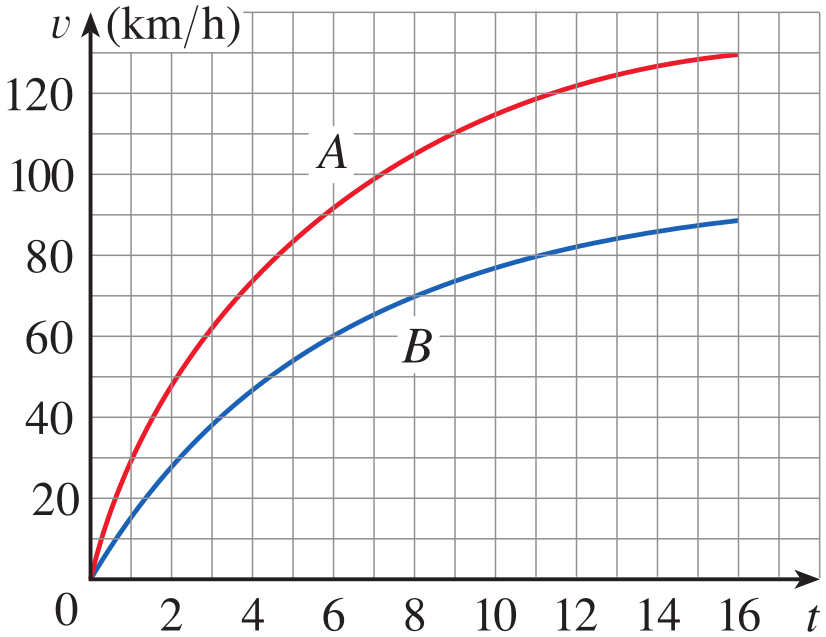

<strong>Figure 16.</strong> Velocity curves for two cars, A and B, plotted against time from $0$ to $16$ seconds. Car A has the greater velocity throughout the interval.

## Solution {.green}

The area under the velocity curve of car A represents the distance travelled by car A during the first $16$ seconds. Similarly, the area under the velocity curve of car B represents the distance travelled by car B during the same period. Since the cars start side by side, the area between their velocity curves represents the difference between the distances travelled by the two cars. Therefore, it gives the distance between the cars after $16$ seconds.

The velocities are read from the graph and converted from kilometres per hour to metres per second using

$$
1\text{ km/h}=\frac{1000}{3600}\text{ m/s}
$$

The velocity values and their differences are given below.

| $t$ (seconds) | $v_A$ (m/s) | $v_B$ (m/s) | $v_A-v_B$ (m/s) |
|---:|---:|---:|---:|
| 0 | 0 | 0 | 0 |
| 2 | 10.4 | 6.4 | 4.0 |
| 4 | 16.5 | 10.4 | 6.1 |
| 6 | 20.4 | 13.4 | 7.0 |
| 8 | 23.2 | 15.5 | 7.7 |
| 10 | 25.6 | 17.1 | 8.5 |
| 12 | 27.1 | 18.3 | 8.8 |
| 14 | 28.0 | 19.2 | 8.8 |
| 16 | 29.0 | 19.8 | 9.2 |

We use the Midpoint Rule with $n=4$ subintervals. The interval is $[0,16]$, so the width of each subinterval is

$$
\Delta t=\frac{16-0}{4}=4
$$

The four subintervals are $[0,4]$, $[4,8]$, $[8,12]$, and $[12,16]$. Their midpoints are $t=2$, $t=6$, $t=10$, and $t=14$. From the table, the corresponding differences in velocity are $4.0$, $7.0$, $8.5$, and $8.8$ metres per second.

Applying the Midpoint Rule,

$$
\begin{aligned}
\int_0^{16}(v_A-v_B)\,dt
&\approx\Delta t[4.0+7.0+8.5+8.8]\\
&=4(28.3)\\
&=113.2\text{ m}
\end{aligned}
$$

Therefore, the estimated distance between the two cars after $16$ seconds is

$$
\boxed{113.2\text{ m}}
$$

$\blacksquare$

## Example 8 {.green}

Figure 17 shows an example of a pathogenesis curve for a measles infection. It shows how the disease develops in an individual with no immunity after the measles virus spreads to the bloodstream from the respiratory tract.

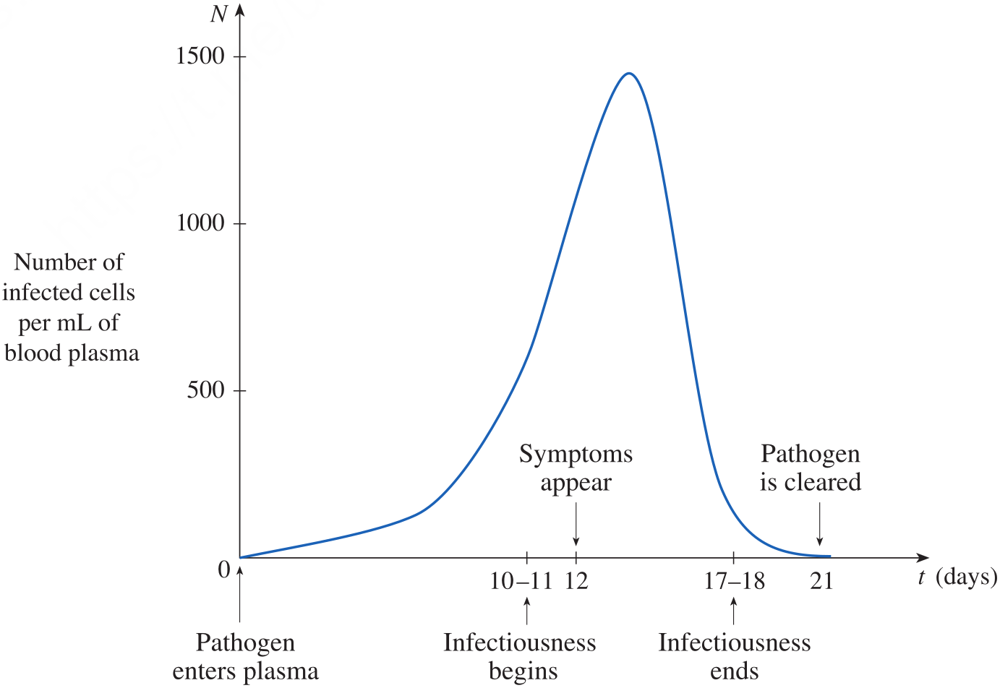

<strong>Figure 17.</strong> A measles pathogenesis curve showing the number of infected cells per millilitre of blood plasma against time in days. The graph indicates when the pathogen enters the plasma, infectiousness begins, symptoms appear, infectiousness ends, and the pathogen is cleared.

The patient becomes infectious to others once the concentration of infected cells becomes great enough and remains infectious until the immune system manages to prevent further transmission. However, symptoms do not develop until the amount of infection reaches a particular threshold. The amount of infection needed to develop symptoms depends on both the concentration of infected cells and time, and corresponds to the area under the pathogenesis curve until symptoms appear.

**(a)** The pathogenesis curve in Figure 17 has been modelled by

$$
f(t)=-t(t-21)(t+1)
$$

If infectiousness begins on day $t_1=10$ and ends on day $t_2=18$, what are the corresponding concentration levels of infected cells?

**(b)** The level of infectiousness for an infected person is the area between $N=f(t)$ and the line through the points $P_1(t_1,f(t_1))$ and $P_2(t_2,f(t_2))$, measured in $(\text{cells/mL})\cdot\text{days}$. Compute the level of infectiousness for this particular patient.

## Solution {.green}

**(a) Concentration levels at the beginning and end of infectiousness.** The concentration at the beginning of infectiousness is obtained by evaluating the function at $t=10$:

$$
\begin{aligned}
f(10)&=-10(10-21)(10+1)\\
&=-10(-11)(11)\\
&=1210
\end{aligned}
$$

Thus, infectiousness begins when the concentration reaches $1210$ cells/mL.

At the end of infectiousness, $t=18$:

$$
\begin{aligned}
f(18)&=-18(18-21)(18+1)\\
&=-18(-3)(19)\\
&=1026
\end{aligned}
$$

Therefore, infectiousness ends when the concentration reduces to $1026$ cells/mL.

**(b) Level of infectiousness.** The level of infectiousness is the area between the pathogenesis curve and the straight line joining the points $P_1$ and $P_2$. These points are

$$
P_1=(10,1210),\qquad P_2=(18,1026)
$$

First, we find the slope of the line through these points:

$$
\begin{aligned}
m&=\frac{1026-1210}{18-10}\\
&=\frac{-184}{8}\\
&=-23
\end{aligned}
$$

Using the point-slope form of a straight line and the point $(10,1210)$,

$$
N-1210=-23(t-10)
$$

Simplifying,

$$
N=-23t+1440
$$

The required area is obtained by subtracting the straight-line function from the pathogenesis function and integrating from $t=10$ to $t=18$:

$$
A=\int_{10}^{18}[f(t)-(-23t+1440)]\,dt
$$

Substituting $f(t)=-t(t-21)(t+1)$ and expanding,

$$
\begin{aligned}
A&=\int_{10}^{18}[-t(t-21)(t+1)+23t-1440]\,dt\\
&=\int_{10}^{18}(-t^3+20t^2+44t-1440)\,dt
\end{aligned}
$$

An antiderivative is

$$
-\frac{t^4}{4}+\frac{20t^3}{3}+\frac{44t^2}{2}-1440t
$$

Therefore,

$$
\begin{aligned}
A&=\left[-\frac{t^4}{4}+\frac{20t^3}{3}+\frac{44t^2}{2}-1440t\right]_{10}^{18}\\
&=-6156-\left(-8033\frac{1}{3}\right)\\
&\approx1877
\end{aligned}
$$

Hence, the level of infectiousness for this patient is approximately

$$
\boxed{1877\;(\text{cells/mL})\cdot\text{days}}
$$

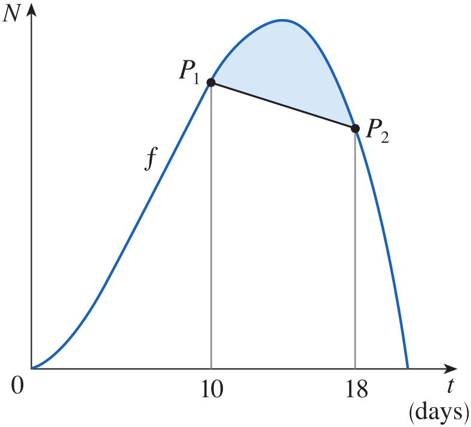

<strong>Figure 18.</strong> The area between the pathogenesis curve $N=f(t)$ and the straight line joining $P_1$ at $t=10$ and $P_2$ at $t=18$, representing the level of infectiousness.

$\blacksquare$

# Quick Check

## Question 1 {.red}

A region is bounded on the left by $x=2y$ and on the right by $x=6-y$, for $0\leq y\leq2$. Set up the integral for its area using integration with respect to $y$.

## Answer {.red}

The right boundary is $x_R=6-y$ and the left boundary is $x_L=2y$. Therefore,

$$
\begin{aligned}
A&=\int_0^2(x_R-x_L)\,dy\\
&=\int_0^2(6-3y)\,dy
\end{aligned}
$$

## Question 2 {.red}

When integrating with respect to $y$, should the integrand be the upper function minus the lower function or the right function minus the left function?

## Answer {.red}

The integrand must be the horizontal distance between the boundaries. Therefore, we subtract the left boundary from the right boundary:

$$
A=\int_c^d(x_R-x_L)\,dy
$$

$\blacksquare$

# Scenario Problem

## Problem {.green}

A computer-controlled laser cutter is used to manufacture a curved mechanical plate. In a cross-section, the right boundary of the plate is modelled by $x=6-y$, while the left boundary is modelled by $x=y^2$. The plate extends vertically from $y=0$ to the point where the two boundaries intersect. Determine the cross-sectional area of the plate.

## Solution {.green}

First, we find the upper limit by equating the left and right boundaries:

$$
y^2=6-y
$$

Rearranging,

$$
y^2+y-6=0
$$

Factoring,

$$
(y+3)(y-2)=0
$$

The intersection values are $y=-3$ and $y=2$. Since the plate extends upward from $y=0$, the required interval is $0\leq y\leq2$. On this interval, the right boundary is $x_R=6-y$ and the left boundary is $x_L=y^2$.

Using integration with respect to $y$, the cross-sectional area is

$$
\begin{aligned}
A&=\int_0^2(x_R-x_L)\,dy\\
&=\int_0^2(6-y-y^2)\,dy
\end{aligned}
$$

Integrating,

$$
\begin{aligned}
A&=\left[6y-\frac{y^2}{2}-\frac{y^3}{3}\right]_0^2\\
&=12-2-\frac{8}{3}\\
&=\frac{22}{3}
\end{aligned}
$$

Therefore, the cross-sectional area of the mechanical plate is

$$
\boxed{A=\frac{22}{3}\text{ square units}}
$$

The area is obtained by integrating the horizontal distance between the right and left boundaries over the vertical interval. This is the same approach that can be used by a computer-controlled manufacturing system when the boundaries of a component are represented as functions of its vertical position.

$\blacksquare$

# Summary

The area between two curves can be calculated by dividing the region into narrow vertical strips and approximating each strip by a rectangle. The height of each rectangle is the difference between the upper and lower function values, so the Riemann-sum formula is $A=\lim_{n\to\infty}\sum_{i=1}^{n}[f(x_i^*)-g(x_i^*)]\Delta x$. Taking the limit gives the definite-integral formula $A=\int_a^b(y_T-y_B)\,dx$, where the top function is always subtracted by the bottom function. If the curves change their relative positions, the interval must be divided at their intersection points, and the area is calculated using $A=\int_a^b|f(x)-g(x)|\,dx$.

The worked examples demonstrate how to identify the boundaries, determine intersection points, set up the appropriate integral, and evaluate the area. When exact intersection points are difficult to obtain, graphical or computational methods can provide approximations. The method is useful in applications such as determining cross-sectional areas of mechanical components and calculating regions bounded by mathematical models.

The area of a region can be calculated by integrating with respect to $y$ when its left and right boundaries are conveniently expressed as functions of $y$. A horizontal approximating rectangle has height $\Delta y$ and length equal to the difference between the right and left boundaries. Taking the limit of the corresponding Riemann sum gives the formula $A=\int_c^d(x_R-x_L)\,dy$. The limits of integration are determined by the lower and upper $y$-coordinates of the region. If the left or right boundary changes within the interval, the region must be divided into subregions and the corresponding integrals evaluated separately.

The worked examples demonstrate how to identify intersection points, express curves in terms of $y$, select the right and left boundaries, and evaluate the area. Example 6 shows that the same region can be evaluated using either $x$ or $y$ as the variable of integration, while Examples 7 and 8 illustrate applications of area between curves to motion and infectiousness. Choosing the variable of integration that produces the simplest boundaries can reduce the number of calculations required.

# Exercises

Exercises help in transforming theoretical concepts into practical understanding. Mathematics is learned by doing and solving exercises which train you to analyze problems, select appropriate methods, and construct logical solutions. Attempting problems sometimes leads to mistakes which provide opportunities for learning and improvement. Regular practice increases speed, accuracy, and confidence. Exercises are given in the recommended book which has also been provided to you and you are expected to solve them on your own.

## Exercises

Solve the odd number exercises from exercise 1 to 70 skipping the exercises requiring computer algebra system or computerized plotting of the curves.
