# Calculus and Analytical Geometry

## Volume

### Dr. Aamir Alaud Din

# Objectives

After preparing this topic, you should be able to

1. Determine the volume of a solid by expressing its cross-sectional area as a function, constructing a Riemann sum of approximating slabs, and evaluating the corresponding definite integral.

2. Determine the volume of a solid of revolution by expressing the area of a typical cross-section as a function of the variable of integration and evaluating the corresponding definite integral using the disk or washer method.

3. Determine the volume of a solid by expressing the area of a representative cross-section as a function of position and integrating that area over the interval occupied by the solid.

# The Why Section

In engineering and computer science, many objects and systems have three-dimensional structures whose volumes cannot be determined directly using the familiar formulas for simple geometric solids. Mechanical components, machine housings, pipes, robotic parts, and manufactured objects may have cross-sections that change in size or shape along their length. To determine their volumes, we need a mathematical method that can account for these variations.

For simple solids such as cylinders and rectangular boxes, volume can be calculated by multiplying the area of the base by the height. However, when the cross-sectional area changes from one position to another, this formula is no longer sufficient. Calculus provides a systematic method for dividing such a solid into thin slices, approximating the volume of each slice, and adding these approximations to obtain the exact volume through a definite integral.

This concept has applications in mechanical engineering, mechatronics, computer science, and computer-aided design. For example, a computer-controlled manufacturing system may need to determine the amount of material required to produce a mechanical component whose cross-sectional dimensions vary along its length. Similarly, a three-dimensional modelling system can use cross-sectional information to calculate the volume of a complex object.

**Mechatronics scenario.** Imagine that a computer-controlled manufacturing machine is designed to produce a mechanical housing for an actuator. The housing has a nonuniform cross-section, meaning that its cross-sectional area changes along its length. The manufacturing system needs to calculate the exact volume of material required to produce the housing. Studying the definition of volume using cross-sections and definite integrals provides the mathematical method needed to solve this problem.

Many objects used in mechanical engineering are three-dimensional and have shapes that can be described by rotating a two-dimensional region around a straight line. Examples include shafts, rollers, pipes, nozzles, pulleys, cylindrical housings, and parts of machine tools. To manufacture these components, engineers need to determine their volumes. The volume may be used to estimate the amount of material required, the mass of a component when its density is known, or the capacity of a hollow part.

The same mathematical idea is useful in mechatronics. A computer-controlled manufacturing system may receive a mathematical description of the cross-section of a component. The system can use this description to calculate the volume of material that will be removed or added during production. In computer-aided design, a two-dimensional profile can be revolved around an axis to generate a three-dimensional model. Calculating the volume of the resulting solid is therefore an important step in geometric modelling and manufacturing.

**Mechatronics scenario.** Imagine that a robotic manufacturing system is required to produce a rotating mechanical part from a specified two-dimensional profile. The profile is represented by one or more curves, and the machine generates the component by rotating the enclosed region around a prescribed axis. Before manufacturing begins, the system must calculate the volume of the resulting solid to estimate the material requirement. If the component has a hollow central region or is rotated about an axis that does not coincide with a coordinate axis, the cross-sectional areas must be determined carefully. The disk and washer methods studied in this topic provide the mathematical tools needed to solve this problem.

Many solid objects have shapes that cannot be described conveniently by the familiar formulas for cylinders, cones, spheres, or other standard solids. However, their volumes can still be determined when the areas of their cross-sections are known. The central idea is to divide a solid into thin slices, calculate the area of each cross-section, and add the volumes of these slices through a definite integral. This method is particularly useful when the cross-sectional shape changes along the length or height of a solid.

In mechanical engineering, a component may have a nonuniform shape whose cross-sections are designed to be triangular, square, circular, or another prescribed shape. In mechatronics, a computer-controlled manufacturing system may use a mathematical model of these cross-sections to estimate the volume of material required to manufacture a component. Similarly, in computer graphics and three-dimensional modelling, cross-sectional information can be used to represent and calculate the volume of complex objects.

**Mechatronics scenario.** Imagine that a computer-controlled manufacturing system is producing a mechanical component whose cross-sections perpendicular to a selected axis are equilateral triangles. The dimensions of these triangles change along the component. The system must estimate the total volume of material required before manufacturing begins. This problem can be solved by expressing the area of a typical triangular cross-section as a function of its position and integrating that area over the length of the component. Studying volume using cross-sectional area provides the mathematical method needed for this calculation.

# Definition of Volume

## Volume of a Cylinder

We begin by considering a simple three-dimensional solid called a cylinder. More precisely, we consider a right cylinder, which is bounded by two congruent plane regions lying in parallel planes. These regions are called the bases of the cylinder. The cylinder consists of all line segments perpendicular to the bases that join corresponding points of the two regions.

Suppose the area of each base is $A$ and the perpendicular distance between the two bases is $h$. The volume of the cylinder is the product of its base area and height. Therefore,

$$
V=Ah
$$

This formula states that the volume of a cylinder can be obtained by multiplying the area of its base by its height.

A circular cylinder is a special case in which the base is a circle of radius $r$. Since the area of a circle is $\pi r^2$, its volume is

$$
V=\pi r^2h
$$

Similarly, if the base is a rectangle with length $l$ and width $w$, the cylinder becomes a rectangular box, also called a rectangular parallelepiped. Its base area is $A=lw$. Therefore, its volume is

$$
V=lwh
$$

These formulas provide the volume of solids whose cross-sectional areas remain constant throughout their heights.

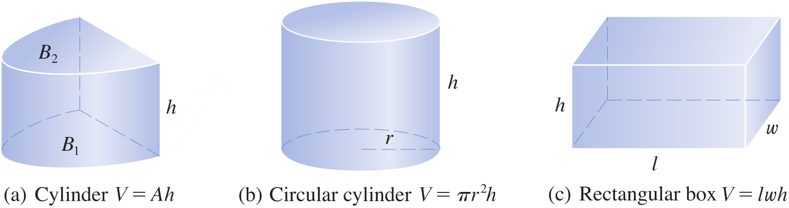

<strong>Figure 1.</strong> (a) A cylinder with volume $V=Ah$. (b) A circular cylinder with volume $V=\pi r^2h$. (c) A rectangular box with volume $V=lwh$.

## Finding the Volume of a General Solid

For a solid that is not a cylinder, its cross-sectional area may change as we move from one end of the solid to the other. Consequently, we cannot simply multiply one fixed cross-sectional area by the height to determine its volume.

To develop a method for finding the volume of such a solid, consider a general solid $S$ extending from $x=a$ to $x=b$. We begin by intersecting the solid with a plane perpendicular to the $x$-axis. The intersection produces a plane region called a cross-section of the solid.

Let $A(x)$ represent the area of the cross-section obtained by passing a plane perpendicular to the $x$-axis through the point $x$, where $a\leq x\leq b$. As the position $x$ changes from $a$ to $b$, the cross-sectional area may also change.

Imagine cutting the solid into thin slices using planes perpendicular to the $x$-axis. Each slice has a small thickness, and its cross-sectional area is determined by the position at which the slice is taken. By calculating the approximate volume of each slice and adding these volumes, we can obtain an approximation to the total volume of the solid.

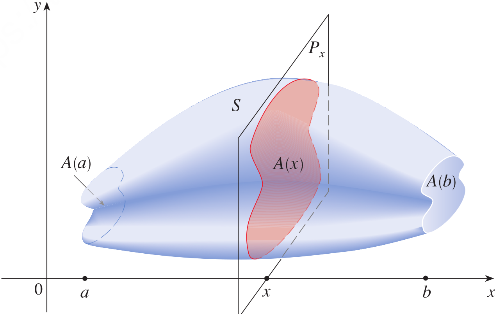

<strong>Figure 2.</strong> A general solid $S$ between $x=a$ and $x=b$, with cross-sectional areas $A(a)$, $A(x)$, and $A(b)$.

## Approximating the Volume of One Slice

To construct an approximation, we divide the interval $[a,b]$ into $n$ equal subintervals. The width of each subinterval is

$$
\Delta x=\frac{b-a}{n}
$$

The corresponding planes perpendicular to the $x$-axis divide the solid into $n$ thin slabs. The $i$th slab, denoted by $S_i$, lies between two consecutive planes at $x=x_{i-1}$ and $x=x_i$.

We choose a sample point $x_i^*$ in the interval $[x_{i-1},x_i]$. The cross-sectional area at this sample point is $A(x_i^*)$. Since the slab is very thin, we can approximate it by a cylinder whose base area is $A(x_i^*)$ and whose height is $\Delta x$.

Recall that the volume of a cylinder is the product of its base area and height. Therefore, the approximate volume of the $i$th slab is

$$
V(S_i)\approx A(x_i^*)\Delta x
$$

The accuracy of this approximation improves as the thickness of the slab decreases. In other words, thinner slabs provide a better approximation to the actual shape of the solid.

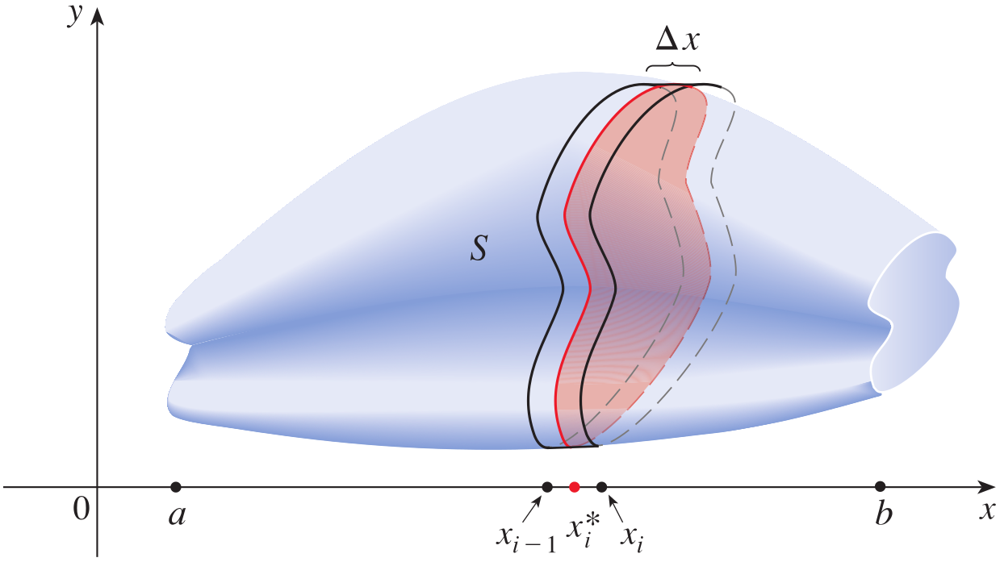
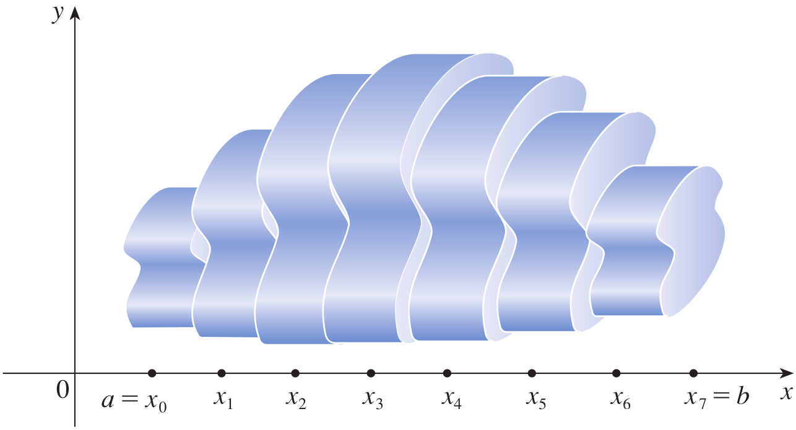

<strong>Figure 3.</strong> Approximation of one thin slab $S_i$ by a cylinder with base area $A(x_i^*)$ and height $\Delta x$.

## Adding the Volumes of All Slices

We have established that the volume of one thin slab can be approximated by $A(x_i^*)\Delta x$. To approximate the volume of the entire solid, we add the approximate volumes of all $n$ slabs.

Thus, the total approximate volume is

$$
V\approx\sum_{i=1}^{n}A(x_i^*)\Delta x
$$

This expression is a Riemann sum. Each term represents the approximate volume of one cylindrical slab, and the sum represents the approximate volume of the entire solid.

As the number of slabs increases, their individual thicknesses decrease. Consequently, the cylindrical approximations become increasingly accurate because each thin cylinder more closely resembles the corresponding portion of the original solid.

## Definition: Volume {.blue}

Let $S$ be a solid that lies between $x=a$ and $x=b$. If the cross-sectional area of $S$ in the plane perpendicular to the $x$-axis at position $x$ is $A(x)$, where $A$ is a continuous function, then the volume of $S$ is defined as the limit of the Riemann sums

$$
V=\lim_{n\to\infty}\sum_{i=1}^{n}A(x_i^*)\Delta x
$$

Since the limit of a Riemann sum represents a definite integral, the volume can be expressed as

$$
\boxed{V=\int_a^b A(x)\,dx}
$$

$\blacksquare$

The definition of volume provides a general method for determining the volume of solids whose cross-sectional areas vary along an interval. Instead of requiring the solid to have a uniform cross-section, we express its cross-sectional area as a function of position and integrate this function over the interval.

It is important to remember that $A(x)$ represents the area of a moving cross-section obtained by slicing the solid with a plane perpendicular to the $x$-axis. The integral adds the volumes of infinitely many infinitesimally thin slices to determine the exact volume.

For a cylinder, the cross-sectional area is constant, so $A(x)=A$ throughout the interval. Therefore, the definition gives

$$
\begin{aligned}
V&=\int_a^b A\,dx\\
&=A\int_a^b dx\\
&=A(b-a)
\end{aligned}
$$

Since the height of the cylinder is $h=b-a$, we obtain

$$
V=Ah
$$

Thus, the general definition of volume agrees with the familiar formula for a cylinder.

An important property of this definition is that the calculated volume does not depend on how the solid is positioned relative to the coordinate axes. We may use different directions of slicing, provided that the cross-sectional area and the corresponding integration limits are determined correctly. The resulting volume remains the same.

## Example 1 {.green}

Show that the volume of a sphere of radius $r$ is

$$
V=\frac{4}{3}\pi r^3
$$

## Solution {.green}

We place the sphere of radius $r$ so that its centre is at the origin of the coordinate system. The sphere extends from $x=-r$ to $x=r$ along the $x$-axis.

Consider a cross-sectional plane perpendicular to the $x$-axis passing through an arbitrary point $x$. The intersection of this plane with the sphere is a circle.

Let the radius of this circular cross-section be $y$. From the Pythagorean theorem, the relationship between $x$, $y$, and the radius $r$ of the sphere is

$$
x^2+y^2=r^2
$$

Solving for $y$, we obtain

$$
y=\sqrt{r^2-x^2}
$$

The cross-sectional area is the area of a circle with radius $y$. Therefore,

$$
\begin{aligned}
A(x)&=\pi y^2\\
&=\pi(r^2-x^2)
\end{aligned}
$$

Using the definition of volume, we integrate the cross-sectional area from $x=-r$ to $x=r$.

$$
V=\int_{-r}^{r}A(x)\,dx
$$

Substituting the expression for $A(x)$ gives

$$
V=\int_{-r}^{r}\pi(r^2-x^2)\,dx
$$

Taking the constant $\pi$ outside the integral,

$$
V=\pi\int_{-r}^{r}(r^2-x^2)\,dx
$$

Since the integrand is an even function, we can evaluate the integral from $0$ to $r$ and multiply the result by $2$.

$$
V=2\pi\int_0^r(r^2-x^2)\,dx
$$

Integrating,

$$
\begin{aligned}
V&=2\pi\left[r^2x-\frac{x^3}{3}\right]_0^r\\
&=2\pi\left[\left(r^3-\frac{r^3}{3}\right)-0\right]\\
&=2\pi\left(\frac{2r^3}{3}\right)
\end{aligned}
$$

Therefore, the volume of the sphere is

$$
\boxed{V=\frac{4}{3}\pi r^3}
$$

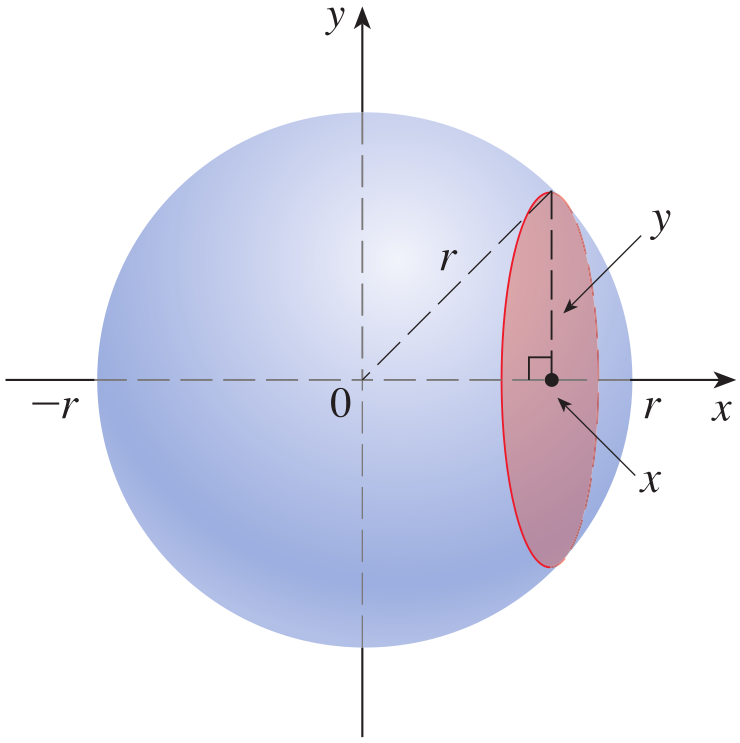

<strong>Figure 4.</strong> A sphere of radius $r$ centred at the origin, with a circular cross-section of radius $y=\sqrt{r^2-x^2}$ at position $x$.

The result establishes the familiar formula for the volume of a sphere using the general definition of volume developed through cross-sectional areas and definite integrals.

### Approximating the Volume of a Sphere Using Riemann Sums

We now consider a sphere of radius $1$ to understand how the Riemann sums approximate its volume.

For a sphere of radius $1$, the cross-sectional area at position $x$ is

$$
A(x)=\pi(1-x^2)
$$

The sphere extends from $x=-1$ to $x=1$. Therefore, the exact volume is represented by

$$
V=\int_{-1}^{1}\pi(1-x^2)\,dx
$$

To approximate this volume, we divide the interval $[-1,1]$ into $n$ equal subintervals. The width of each subinterval is

$$
\Delta x=\frac{2}{n}
$$

Choosing the midpoint of each subinterval as the sample point, we denote it by $\bar{x}_i$. The cross-sectional area at this midpoint is

$$
A(\bar{x}_i)=\pi(1-\bar{x}_i^2)
$$

Thus, the Riemann sum for approximating the volume is

$$
\sum_{i=1}^{n}A(\bar{x}_i)\Delta x
=
\sum_{i=1}^{n}\pi(1-\bar{x}_i^2)\Delta x
$$

Each term represents the volume of a thin cylindrical slab whose base is a circular cross-section at the midpoint and whose height is $\Delta x$.

As the number of slabs increases, their thickness decreases, and the approximation approaches the exact volume of the sphere.

For a sphere of radius $1$, the exact volume is

$$
V=\frac{4}{3}\pi\approx4.18879
$$

The book illustrates this approximation using $5$, $10$, and $20$ cylindrical slabs. The corresponding approximate volumes are:

| Number of disks | Approximate volume |
|:---:|---:|
| 5 | 4.2726 |
| 10 | 4.2097 |
| 20 | 4.1940 |

These values demonstrate that increasing the number of approximating cylinders produces a more accurate estimate of the actual volume. In particular, the approximations approach the exact value $4.18879$ as the number of slices increases.

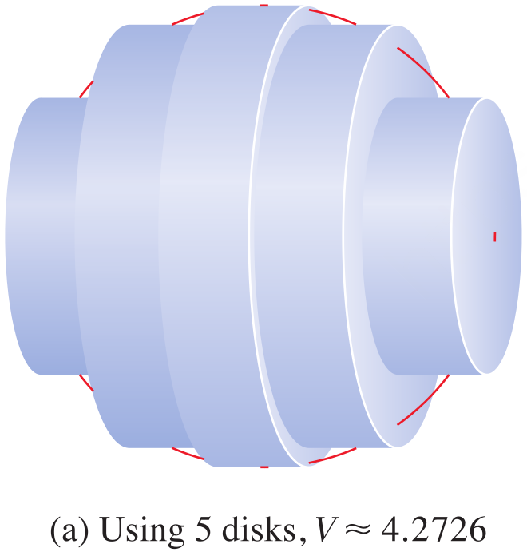
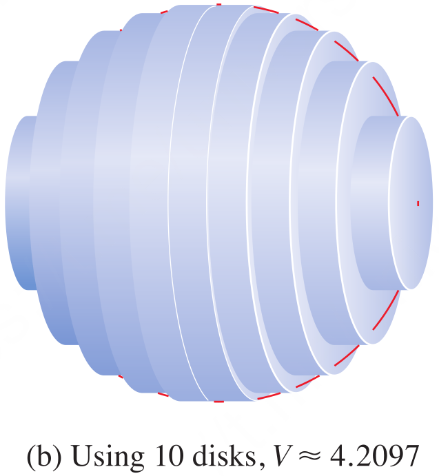
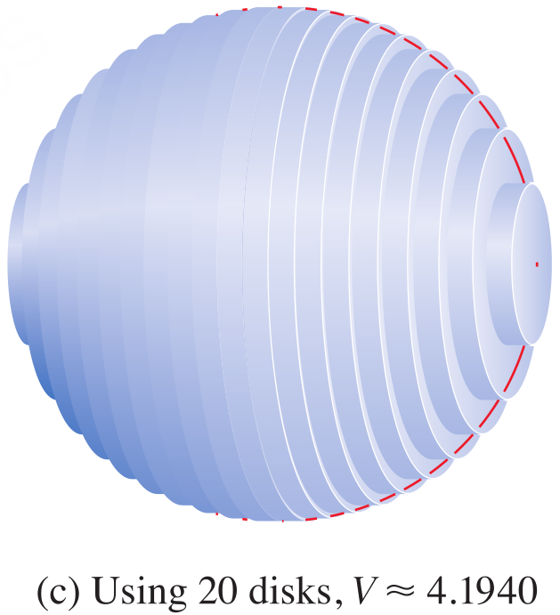

<strong>Figure 5.</strong> Approximating the volume of a sphere of radius $1$ using cylindrical slabs: (a) 5 disks, $V\approx4.2726$; (b) 10 disks, $V\approx4.2097$; and (c) 20 disks, $V\approx4.1940$.

$\blacksquare$

# Quick Check

## Question 1 {.red}

A cylinder has a circular base of radius $3$ cm and height $5$ cm. Find its volume.

## Answer {.red}

The volume of a circular cylinder is

$$
V=\pi r^2h
$$

Substituting $r=3$ and $h=5$,

$$
\begin{aligned}
V&=\pi(3)^2(5)\\
&=45\pi
\end{aligned}
$$

Therefore,

$$
\boxed{V=45\pi\text{ cm}^3}
$$

## Question 2 {.red}

A solid extends from $x=0$ to $x=4$, and its cross-sectional area perpendicular to the $x$-axis is constant at $A(x)=6$ square units. Find its volume using a definite integral.

## Answer {.red}

Using the definition of volume,

$$
\begin{aligned}
V&=\int_0^4 A(x)\,dx\\
&=\int_0^4 6\,dx\\
&=6[x]_0^4\\
&=6(4-0)\\
&=24
\end{aligned}
$$

Therefore,

$$
\boxed{V=24\text{ cubic units}}
$$

$\blacksquare$

# Scenario Problem

## Problem {.green}

A computer-controlled manufacturing machine is designed to produce a cylindrical mechanical housing for an actuator. The housing has a circular cross-section perpendicular to its longitudinal axis, but its radius increases gradually along its length.

Suppose the radius of the housing at a distance $x$ from its starting point is modelled by

$$
r(x)=2+0.1x
$$

where $r$ and $x$ are measured in millimetres. The housing extends from $x=0$ to $x=20$ mm.

Determine the volume of material required to manufacture the housing.

## Solution {.green}

The cross-section perpendicular to the longitudinal axis is circular. Therefore, its area at position $x$ is

$$
A(x)=\pi[r(x)]^2
$$

Substituting the given radius function,

$$
A(x)=\pi(2+0.1x)^2
$$

Since the housing extends from $x=0$ to $x=20$, the volume can be calculated using the definition of volume:

$$
V=\int_0^{20}A(x)\,dx
$$

Substituting the cross-sectional area,

$$
V=\pi\int_0^{20}(2+0.1x)^2\,dx
$$

Expanding the expression,

$$
V=\pi\int_0^{20}(4+0.4x+0.01x^2)\,dx
$$

Integrating,

$$
\begin{aligned}
V&=\pi\left[4x+0.2x^2+\frac{0.01x^3}{3}\right]_0^{20}\\
&=\pi\left[80+80+\frac{8}{3}-0\right]\\
&=\frac{488\pi}{3}
\end{aligned}
$$

Therefore, the required volume of material is

$$
\boxed{V=\frac{488\pi}{3}\text{ mm}^3}
$$

Numerically,

$$
\boxed{V\approx511.02\text{ mm}^3}
$$

Thus, the manufacturing system requires approximately $511.02$ cubic millimetres of material to produce the mechanical housing. The volume is determined by integrating the changing cross-sectional area along the length of the component.

$\blacksquare$

# Volumes of Solids of Revolution

## From Cross-Sections to Volume

A solid can be studied by examining the areas of its cross-sections. Suppose a solid extends from $x=a$ to $x=b$, and the cross-sectional area perpendicular to the $x$-axis at a point $x$ is $A(x)$. Divide the interval $[a,b]$ into $n$ subintervals of equal width $\Delta x=(b-a)/n$. A thin slice of the solid can be approximated by a rectangular slab whose base area is $A(x_i^*)$ and whose thickness is $\Delta x$. Its approximate volume is therefore $A(x_i^*)\Delta x$.

Adding the volumes of all the approximating slabs gives the Riemann sum

$$
\sum_{i=1}^{n}A(x_i^*)\Delta x
$$

As the number of subintervals increases, the thickness of each slab approaches zero and the approximation approaches the exact volume. Thus, the volume is defined by

$$
V=\lim_{n\to\infty}\sum_{i=1}^{n}A(x_i^*)\Delta x
$$

When the cross-sectional area function is continuous, this limit is the definite integral

$$
V=\int_a^b A(x)\,dx
$$

Similarly, if the solid is described using cross-sections perpendicular to the $y$-axis, its volume can be calculated by integrating with respect to $y$:

$$
V=\int_c^d A(y)\,dy
$$

The main task in a volume problem is therefore to determine the area of a typical cross-section and express it in terms of the variable of integration.

## Volumes of Solids of Revolution

If a plane region is revolved around a straight line, the resulting three-dimensional solid is called a **solid of revolution**. When the region is rotated around a horizontal or vertical line, cross-sections perpendicular to the axis of rotation are circular. Depending on the region and the axis of rotation, these cross-sections may be disks or washers.

A **disk** is a circular cross-section with no hole in its centre. A **washer** is a circular cross-section with a hole in its centre, similar to an annular ring. The volume of a solid of revolution is obtained by integrating the areas of these circular cross-sections along the axis of the solid.

## Example 2 {.green}

Find the volume of the solid obtained by rotating about the $x$-axis the region under the curve $y = \sqrt{x}$ from 0 to 1. Illustrate the definition of volume by sketching a typical approximating cylinder.

## Solution {.green}

The region under $y=\sqrt{x}$ from $x=0$ to $x=1$ is revolved around the $x$-axis. A cross-section perpendicular to the $x$-axis is a circular disk. At a position $x$, the radius of the disk is the distance from the $x$-axis to the curve, so

$$
R(x)=\sqrt{x}
$$

The cross-sectional area is

$$
A(x)=\pi[R(x)]^2=\pi(\sqrt{x})^2=\pi x
$$

A typical approximating cylinder has this circular base area and thickness $\Delta x$. Its approximate volume is $\pi x\Delta x$. Integrating the cross-sectional area from $x=0$ to $x=1$ gives

$$
\begin{aligned}
V&=\int_0^1 A(x)\,dx\\
&=\pi\int_0^1 x\,dx\\
&=\pi\left[\frac{x^2}{2}\right]_0^1\\
&=\frac{\pi}{2}
\end{aligned}
$$

Therefore, the volume of the solid is

$$
\boxed{V=\frac{\pi}{2}}
$$

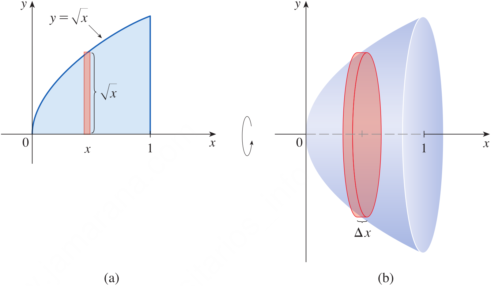

<strong>Figure 6.</strong> A sphere of radius $r$ and a typical circular cross-section perpendicular to the $x$-axis.

$\blacksquare$

The definition of volume can also be visualized by approximating the sphere with a collection of thin circular cylinders. Each cylinder has a circular base and a small thickness. Increasing the number of cylinders makes the approximation more accurate because the thickness of each cylinder becomes smaller.

The approximations shown in Figure 5 become progressively closer to the exact volume as the number of disks increases. This illustrates the limiting process used to define the volume of a solid.

## The Disk Method

When a region is revolved around an axis and each cross-section perpendicular to that axis is a disk, the cross-sectional area is the area of a circle. If the disk has radius $R$, then

$$
A=\pi R^2
$$

If the solid extends from $x=a$ to $x=b$, its volume is

$$
V=\pi\int_a^b [R(x)]^2\,dx
$$

For a solid described by horizontal cross-sections, the corresponding formula is

$$
V=\pi\int_c^d [R(y)]^2\,dy
$$

The radius must be expressed in terms of the variable of integration. It is the distance from the axis of rotation to the outer boundary of the cross-section.

## Choosing the Variable of Integration

The direction of the cross-sections is determined by the axis of rotation. If the axis of rotation is the $y$-axis, horizontal cross-sections are perpendicular to the axis, so it is natural to integrate with respect to $y$. If the axis of rotation is the $x$-axis, vertical cross-sections are perpendicular to the axis, so it is natural to integrate with respect to $x$.

The curves must be rewritten, when necessary, so that the radius of a typical disk is expressed in terms of the variable of integration. The limits of integration are the coordinates along the axis of rotation over which the solid extends.

## Example 3 {.green}

Find the volume of the solid obtained by rotating the region bounded by $y=x^3$, $y=8$, and $x=0$ about the $y$-axis.

## Solution {.green}

The region is bounded by the curve $y=x^3$, the horizontal line $y=8$, and the vertical line $x=0$. Since the region is rotated about the $y$-axis, we use horizontal cross-sections and integrate with respect to $y$.

First, express $x$ in terms of $y$:

$$
y=x^3\quad\Longrightarrow\quad x=\sqrt[3]{y}
$$

At a height $y$, the cross-section is a circular disk whose radius is the horizontal distance from the $y$-axis to the curve. Thus,

$$
R(y)=\sqrt[3]{y}
$$

The area of the cross-section is

$$
A(y)=\pi[R(y)]^2=\pi(\sqrt[3]{y})^2=\pi y^{2/3}
$$

The region extends vertically from $y=0$ to $y=8$. Therefore, the volume is

$$
\begin{aligned}
V&=\int_0^8 A(y)\,dy\\
&=\pi\int_0^8 y^{2/3}\,dy\\
&=\pi\left[\frac{3}{5}y^{5/3}\right]_0^8\\
&=\frac{3\pi}{5}(8)^{5/3}\\
&=\frac{3\pi}{5}(32)\\
&=\frac{96\pi}{5}
\end{aligned}
$$

Hence, the volume of the solid is

$$
\boxed{V=\frac{96\pi}{5}}
$$

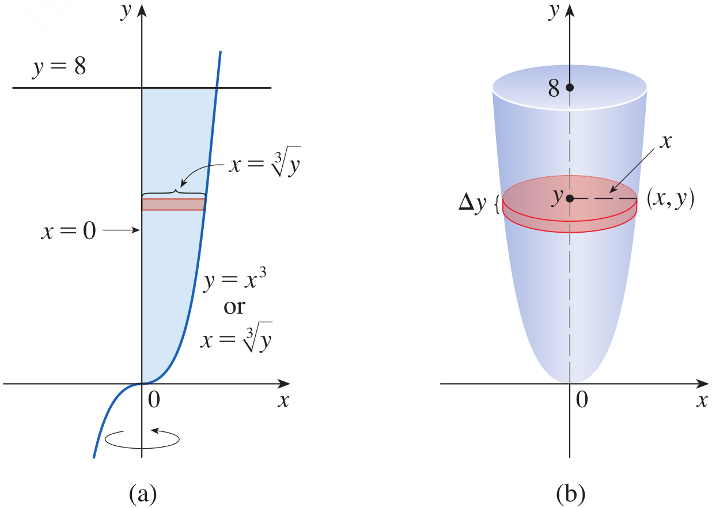

<strong>Figure 7.</strong> Approximating the volume of a sphere of radius 1 using 5, 10, and 20 disks.

$\blacksquare$

## The Washer Method

When the region being revolved does not extend all the way to the axis of rotation, the cross-section perpendicular to the axis has a hole in its centre. Such a cross-section is called a **washer**. Its area is the area of the outer circle minus the area of the inner circle.

If $R_{\text{outer}}$ is the outer radius and $R_{\text{inner}}$ is the inner radius, then

$$
A=\pi R_{\text{outer}}^2-\pi R_{\text{inner}}^2
$$

or, equivalently,

$$
A=\pi\left(R_{\text{outer}}^2-R_{\text{inner}}^2\right)
$$

The outer radius is the distance from the axis of rotation to the farther boundary of the region, while the inner radius is the distance from the axis to the nearer boundary. Both radii are nonnegative distances. A sketch of the region and its cross-section is often the best way to identify them correctly.

## Example 4 {.green}

The region $S$ enclosed by the curves $y=x$ and $y=x^2$ is rotated about the $x$-axis. Find the volume of the resulting solid.

## Solution {.green}

First, find the points of intersection of the curves. Equating their expressions gives

$$
x=x^2
$$

Therefore,

$$
x(x-1)=0
$$

and the curves intersect at $x=0$ and $x=1$. These values are the limits of integration.

On the interval $[0,1]$, the curve $y=x$ lies above the curve $y=x^2$. When the region is rotated about the $x$-axis, a cross-section perpendicular to the $x$-axis is a washer. The outer radius is the distance from the $x$-axis to the upper curve, and the inner radius is the distance from the $x$-axis to the lower curve:

$$
R_{\text{outer}}=x,\qquad R_{\text{inner}}=x^2
$$

The area of a typical washer is

$$
\begin{aligned}
A(x)&=\pi R_{\text{outer}}^2-\pi R_{\text{inner}}^2\\
&=\pi x^2-\pi(x^2)^2\\
&=\pi(x^2-x^4)
\end{aligned}
$$

Integrating this area from $0$ to $1$ gives

$$
\begin{aligned}
V&=\int_0^1 A(x)\,dx\\
&=\pi\int_0^1(x^2-x^4)\,dx\\
&=\pi\left[\frac{x^3}{3}-\frac{x^5}{5}\right]_0^1\\
&=\pi\left(\frac13-\frac15\right)\\
&=\frac{2\pi}{15}
\end{aligned}
$$

Hence, the volume of the solid is

$$
\boxed{V=\frac{2\pi}{15}}
$$

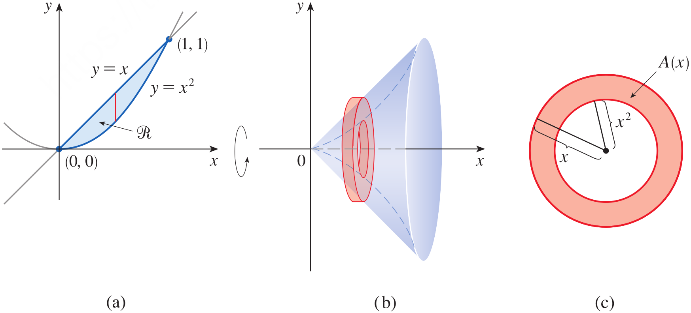

<strong>Figure 8.</strong> The region under $y=\sqrt{x}$ and the solid obtained by rotating it about the $x$-axis, with a typical circular disk of thickness $\Delta x$.

$\blacksquare$

## Rotation About a Line Other Than a Coordinate Axis

When a region is rotated about a horizontal or vertical line that is not one of the coordinate axes, the disk or washer method can still be used. However, the radii must be measured from the actual axis of rotation, not from the $x$-axis or $y$-axis.

For a horizontal axis $y=k$, the radius is a vertical distance from $y=k$ to a boundary of the region. For a vertical axis $x=h$, the radius is a horizontal distance from $x=h$ to a boundary. The outer radius is always the larger distance, and the inner radius is the smaller distance when the cross-section is a washer.

## Example 5 {.green}

Find the volume of the solid obtained by rotating the region in Example 4 about the line $y=2$.

## Solution {.green}

The region is the same as in Example 4: it is enclosed by $y=x$ and $y=x^2$, and extends from $x=0$ to $x=1$. This time, the region is rotated about the horizontal line $y=2$.

A vertical cross-section perpendicular to the axis of rotation is a washer. Since the axis $y=2$ lies above the region, the outer radius is the distance from $y=2$ to the lower curve $y=x^2$, while the inner radius is the distance from $y=2$ to the upper curve $y=x$:

$$
R_{\text{outer}}=2-x^2,\qquad R_{\text{inner}}=2-x
$$

The area of a typical washer is

$$
\begin{aligned}
A(x)&=\pi(2-x^2)^2-\pi(2-x)^2\\
&=\pi\left[(4-4x^2+x^4)-(4-4x+x^2)\right]\\
&=\pi(x^4-5x^2+4x)
\end{aligned}
$$

The volume is obtained by integrating this cross-sectional area from $x=0$ to $x=1$:

$$
\begin{aligned}
V&=\pi\int_0^1(x^4-5x^2+4x)\,dx\\
&=\pi\left[\frac{x^5}{5}-\frac{5x^3}{3}+2x^2\right]_0^1\\
&=\pi\left(\frac15-\frac53+2\right)\\
&=\pi\left(\frac{3-25+30}{15}\right)\\
&=\frac{8\pi}{15}
\end{aligned}
$$

Therefore, the volume of the solid is

$$
\boxed{V=\frac{8\pi}{15}}
$$

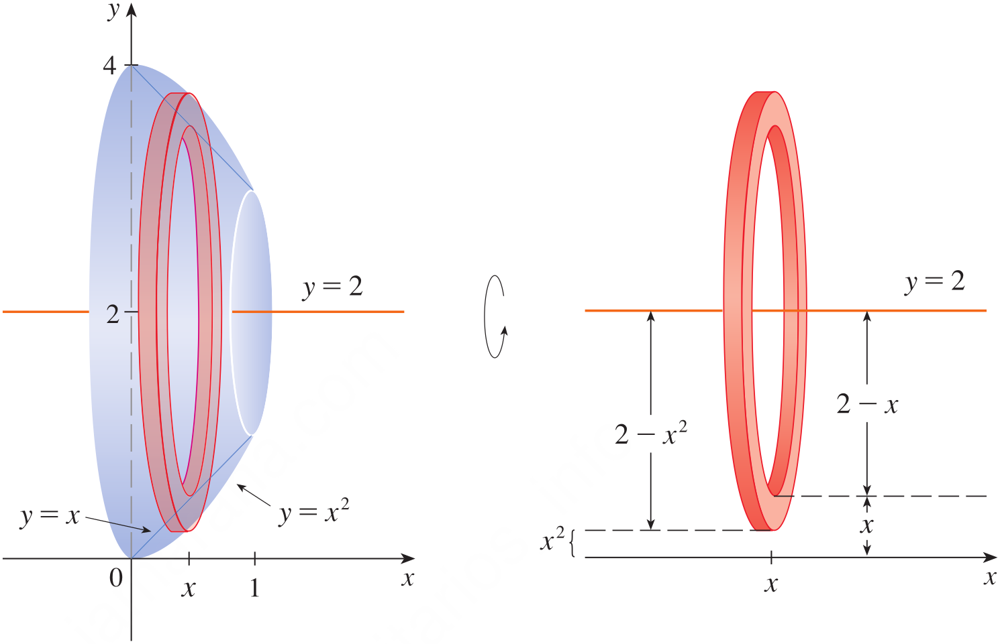

<strong>Figure 9.</strong> The region bounded by $y=x^3$, $y=8$, and $x=0$, and the solid of revolution about the $y$-axis with a typical disk cross-section.

$\blacksquare$

## Choosing Between a Disk and a Washer

The examples illustrate two possible forms of circular cross-sectional area. When the region reaches the axis of rotation, the cross-section is a disk. Its area is

$$
A=\pi(\text{radius})^2
$$

For example, in Figures 6 and 7, the rotated regions meet the axes of rotation. Each cross-section is a disk, and its area is found by squaring the radius and multiplying by $\pi$.

When the region does not reach the axis of rotation, the cross-section is a washer. Its area is the area of the outer disk minus the area of the inner disk:

$$
A=\pi(\text{outer radius})^2-\pi(\text{inner radius})^2
$$

Figures 8 and 9 illustrate this situation. The central hole is not part of the solid, so its circular area must be subtracted from the area of the outer circle. Figure 10 shows the general geometry of a washer, identifying its inner radius and outer radius. The radii must be measured from the axis of rotation to the two boundaries of the region.

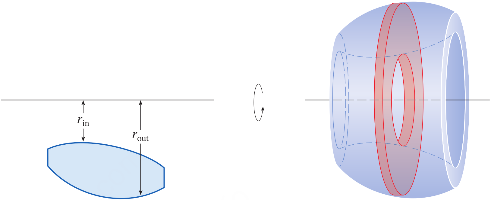

<strong>Figure 10.</strong> The region enclosed by $y=x$ and $y=x^2$, its solid of revolution about the $x$-axis, and a typical washer cross-section.

In general, the volume of a solid of revolution can be calculated using either of the following formulas, depending on the direction of the cross-sections:

$$
V=\int_a^b A(x)\,dx
\qquad\text{or}\qquad
V=\int_c^d A(y)\,dy
$$

For a disk, the cross-sectional area is $\pi R^2$. For a washer, the cross-sectional area is $\pi(R_{\text{outer}}^2-R_{\text{inner}}^2)$. The appropriate formula is selected after sketching the region, identifying the axis of rotation, and determining the shape and dimensions of a typical cross-section.

## Example 6 {.green}

Find the volume of the solid obtained by rotating the region in Example 4 about the line $x=-1$.

## Solution {.green}

The region is again enclosed by $y=x$ and $y=x^2$, with intersection points at $(0,0)$ and $(1,1)$. Since the axis of rotation is the vertical line $x=-1$, we use horizontal cross-sections and integrate with respect to $y$.

To express the boundaries in terms of $y$, rewrite the two curves:

$$
y=x\quad\Longrightarrow\quad x=y
$$

and

$$
y=x^2\quad\Longrightarrow\quad x=\sqrt{y}
$$

For $0\leq y\leq1$, the horizontal region extends from $x=y$ to $x=\sqrt y$. The axis $x=-1$ is to the left of the entire region. Therefore, a horizontal cross-section is a washer. The inner radius is the distance from the axis to the nearer boundary $x=y$, and the outer radius is the distance from the axis to the farther boundary $x=\sqrt y$:

$$
R_{\text{inner}}=1+y,\qquad
R_{\text{outer}}=1+\sqrt y
$$

The cross-sectional area is

$$
\begin{aligned}
A(y)&=\pi(1+\sqrt y)^2
-\pi(1+y)^2\\
&=\pi\left[\left(1+2\sqrt y+y\right)
-\left(1+2y+y^2\right)\right]\\
&=\pi(2\sqrt y-y-y^2)
\end{aligned}
$$

The solid extends from $y=0$ to $y=1$. Hence,

$$
\begin{aligned}
V&=\int_0^1 A(y)\,dy\\
&=\pi\int_0^1(2\sqrt y-y-y^2)\,dy\\
&=\pi\left[\frac{4}{3}y^{3/2}-\frac{y^2}{2}-\frac{y^3}{3}\right]_0^1\\
&=\pi\left(\frac43-\frac12-\frac13\right)\\
&=\frac{\pi}{2}
\end{aligned}
$$

Therefore, the volume of the solid is

$$
\boxed{V=\frac{\pi}{2}}
$$

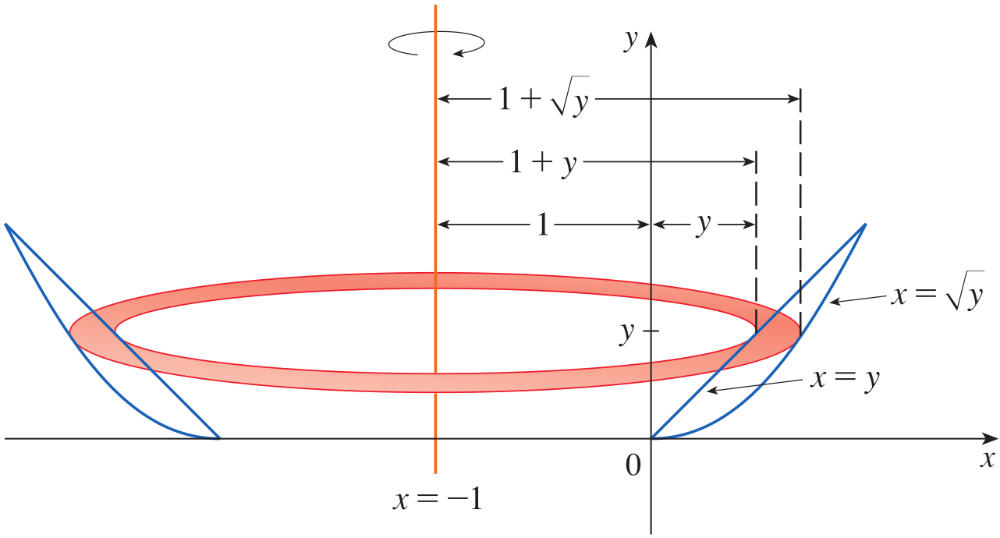

<strong>Figure 11.</strong> The solid obtained by rotating the region between $y=x$ and $y=x^2$ about $x=-1$, with a typical horizontal washer cross-section.

$\blacksquare$

# Quick Check

## Question 1 {.red}

A region is revolved around the $x$-axis. A typical cross-section perpendicular to the $x$-axis is a disk of radius $R(x)=3$. Find its area.

## Answer {.red}

The area of a disk is $A=\pi R^2$. Therefore,

$$
A=\pi(3)^2=9\pi
$$

Thus, the cross-sectional area is

$$
\boxed{A=9\pi}
$$

## Question 2 {.red}

A washer has an outer radius of 5 units and an inner radius of 3 units. Find its cross-sectional area.

## Answer {.red}

The area of a washer is the area of the outer disk minus the area of the inner disk:

$$
\begin{aligned}
A&=\pi(5)^2-\pi(3)^2\\
&=25\pi-9\pi\\
&=16\pi
\end{aligned}
$$

Therefore,

$$
\boxed{A=16\pi}
$$

$\blacksquare$

# Scenario Problem

## Problem {.green}

A mechatronics company manufactures a hollow mechanical roller by rotating a two-dimensional profile around a horizontal axis. The cross-section of the material is bounded above by $y=x$ and below by $y=x^2$, for $0\leq x\leq1$. The profile is rotated about the line $y=2$. Determine the volume of material in the roller.

## Solution {.green}

The region is bounded by $y=x$ and $y=x^2$. The curves intersect where

$$
x=x^2
$$

which gives $x=0$ and $x=1$. Thus, the limits of integration are 0 and 1.

Since the region is rotated about the horizontal line $y=2$, a vertical cross-section perpendicular to the axis of rotation is a washer. The outer radius is the distance from $y=2$ to the lower curve $y=x^2$, and the inner radius is the distance from $y=2$ to the upper curve $y=x$:

$$
R_{\text{outer}}=2-x^2,\qquad R_{\text{inner}}=2-x
$$

The cross-sectional area is

$$
\begin{aligned}
A(x)&=\pi(2-x^2)^2-\pi(2-x)^2\\
&=\pi(x^4-5x^2+4x)
\end{aligned}
$$

The required volume is

$$
\begin{aligned}
V&=\int_0^1 A(x)\,dx\\
&=\pi\int_0^1(x^4-5x^2+4x)\,dx\\
&=\pi\left[\frac{x^5}{5}-\frac{5x^3}{3}+2x^2\right]_0^1\\
&=\pi\left(\frac15-\frac53+2\right)\\
&=\frac{8\pi}{15}
\end{aligned}
$$

Therefore, the volume of material in the hollow roller is

$$
\boxed{V=\frac{8\pi}{15}\text{ cubic units}}
$$

The calculation shows how a computer-controlled manufacturing system can use the mathematical profile of a component to determine the volume of material required. The washer method accounts for the hollow central portion by subtracting the inner circular area from the outer circular area at every cross-section.

$\blacksquare$

# Finding Volume Using Cross-Sectional Area

## Introduction

The volume of a solid can be determined by using the areas of its cross-sections perpendicular to a fixed axis. This method is not restricted to solids of revolution. It can also be applied to solids whose cross-sections have other shapes, provided that the area of a typical cross-section can be expressed as a function of its position.

Consider a solid that extends from $x=a$ to $x=b$. At a position $x$, let $A(x)$ denote the area of the cross-section perpendicular to the $x$-axis. Divide the interval $[a,b]$ into $n$ subintervals, each of width $\Delta x$. A thin slice of the solid can be approximated by a slab whose base area is $A(x_i^*)$ and whose thickness is $\Delta x$. Its approximate volume is therefore $A(x_i^*)\Delta x$.

Adding the volumes of all the slabs gives the Riemann sum

$$
V\approx\sum_{i=1}^{n}A(x_i^*)\Delta x
$$

As the number of slices increases and their thicknesses approach zero, the approximation approaches the exact volume. Thus, the volume is given by the definite integral

$$
V=\int_a^b A(x)\,dx
$$

The main task in applying this method is to determine the area function $A(x)$. This requires identifying the shape of a typical cross-section, expressing its dimensions in terms of $x$, and using the appropriate geometric area formula. The limits of integration are the positions at which the solid begins and ends.

## Example 7 {.green}

Figure 12 shows a solid with a circular base of radius 1. Parallel cross-sections perpendicular to the base are equilateral triangles. Find the volume of the solid.

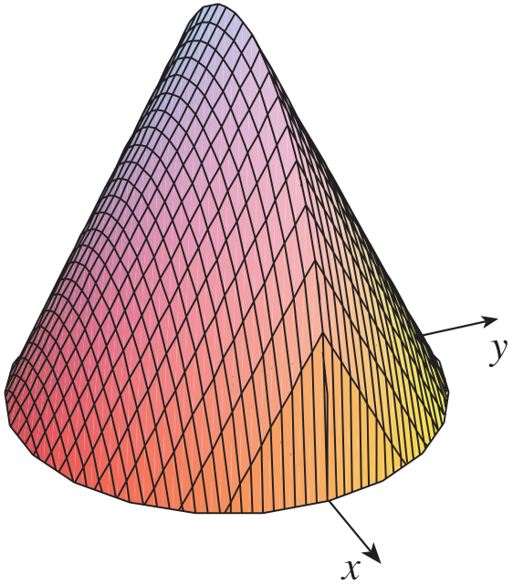

<strong>Figure 12.</strong> A computer-generated picture of the solid in Example 7, showing a solid with a circular base and parallel equilateral-triangle cross-sections.

## Solution {.green}

We take the circular base to be the disk

$$
x^2+y^2=1
$$

The solid, its circular base, and a typical cross-section at a distance $x$ from the origin are illustrated in Figure 13. Since the base is a circle of radius 1, its equation can be written as

$$
x^2+y^2=1
$$

Solving for the positive value of $y$ gives

$$
y=\sqrt{1-x^2}
$$

The point $B$ lies on the circle, so its vertical coordinate is $y=\sqrt{1-x^2}$. By symmetry, the base $AB$ of the equilateral triangle is twice this distance. Therefore, the side length of the triangle is

$$
s=|AB|=2y=2\sqrt{1-x^2}
$$

Since the cross-section is an equilateral triangle, its height is $\sqrt{3}/2$ times its side length. Hence,

$$
h=\frac{\sqrt{3}}{2}s
=\frac{\sqrt{3}}{2}\left(2\sqrt{1-x^2}\right)
=\sqrt{3}\sqrt{1-x^2}
$$

The area of an equilateral triangle is one-half the product of its base and height. Thus, the cross-sectional area is

$$
\begin{aligned}
A(x)
&=\frac12\left(2\sqrt{1-x^2}\right)
\left(\sqrt{3}\sqrt{1-x^2}\right)\\
&=\sqrt{3}(1-x^2)
\end{aligned}
$$

The circular base extends from $x=-1$ to $x=1$. Therefore, the volume is

$$
V=\int_{-1}^{1}A(x)\,dx
$$

Substituting the cross-sectional area gives

$$
V=\int_{-1}^{1}\sqrt{3}(1-x^2)\,dx
$$

Since the integrand is an even function, we can write

$$
V=2\sqrt{3}\int_0^1(1-x^2)\,dx
$$

Integrating,

$$
\begin{aligned}
V
&=2\sqrt{3}\left[x-\frac{x^3}{3}\right]_0^1\\
&=2\sqrt{3}\left(1-\frac13\right)\\
&=2\sqrt{3}\left(\frac23\right)\\
&=\frac{4\sqrt{3}}{3}
\end{aligned}
$$

Therefore, the volume of the solid is

$$
\boxed{V=\frac{4\sqrt{3}}{3}}
$$

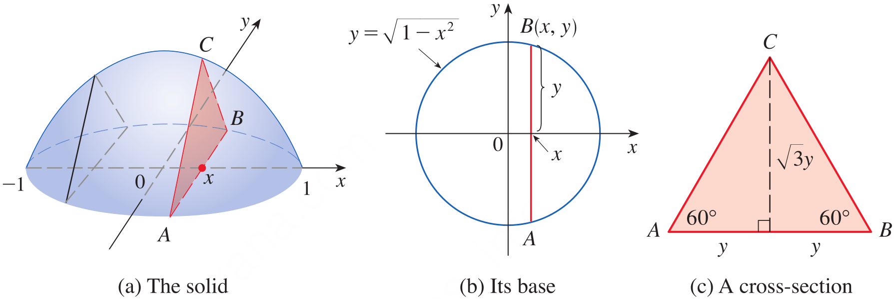

<strong>Figure 13.</strong> The solid in (a), its circular base in (b), and a typical equilateral-triangle cross-section in (c), showing the chord length and triangle height used to determine the cross-sectional area.

$\blacksquare$

## Example 8 {.green}

Find the volume of a pyramid whose base is a square with side $L$ and whose height is $h$.

## Solution {.green}

We place the origin $O$ at the vertex of the pyramid and take the $x$-axis along its central axis, as shown in Figure 14. The vertex is therefore at $x=0$, while the square base is at $x=h$.

A plane perpendicular to the $x$-axis at a position $x$ intersects the pyramid in a square. Let the side length of this square be $s$. Figure 15 shows the relationship between the side length $s$ of the cross-section and the side length $L$ of the base.

The cross-section and the base form similar triangles in the diagram. Consequently,

$$
\frac{x}{h}=\frac{s/2}{L/2}=\frac{s}{L}
$$

Solving for $s$ gives

$$
s=\frac{Lx}{h}
$$

The cross-sectional area is the area of a square, so

$$
\begin{aligned}
A(x)
&=s^2\\
&=\left(\frac{Lx}{h}\right)^2\\
&=\frac{L^2}{h^2}x^2
\end{aligned}
$$

The pyramid extends from $x=0$ at its vertex to $x=h$ at its base. Therefore, its volume is

$$
V=\int_0^h A(x)\,dx
$$

Substituting the expression for $A(x)$,

$$
V=\int_0^h\frac{L^2}{h^2}x^2\,dx
$$

Since $L$ and $h$ are constants,

$$
\begin{aligned}
V
&=\frac{L^2}{h^2}\int_0^h x^2\,dx\\
&=\frac{L^2}{h^2}\left[\frac{x^3}{3}\right]_0^h\\
&=\frac{L^2}{h^2}\left(\frac{h^3}{3}\right)\\
&=\frac{L^2h}{3}
\end{aligned}
$$

Hence, the volume of the pyramid is

$$
\boxed{V=\frac{L^2h}{3}}
$$

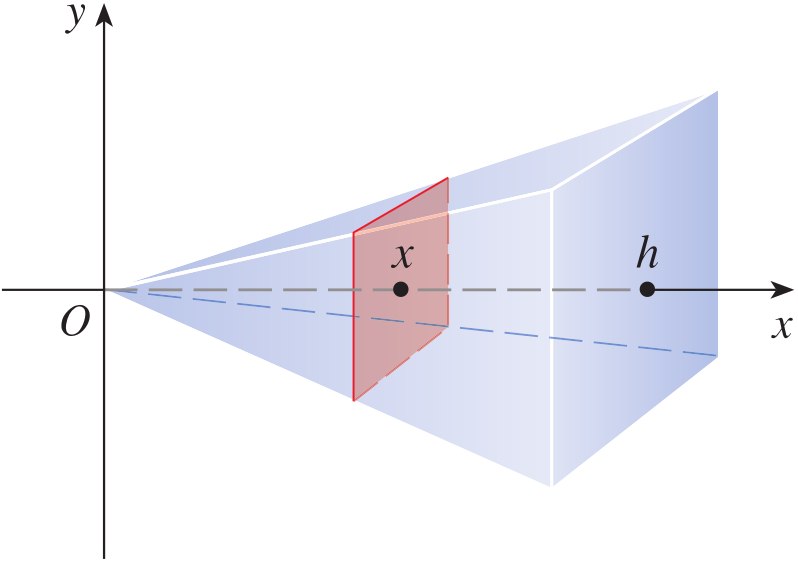

<strong>Figure 14.</strong> A pyramid with its vertex at the origin, its central axis along the $x$-axis, and a typical square cross-section perpendicular to the axis.

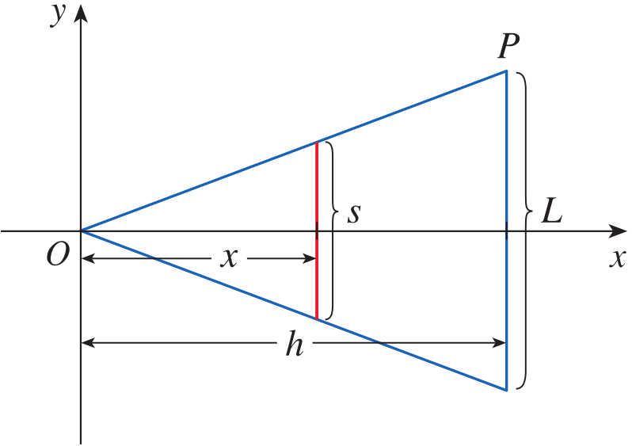

<strong>Figure 15.</strong> A side view of the pyramid showing the similar triangles used to obtain the relationship $s=Lx/h$ between the side length of the square cross-section and its distance from the vertex.

$\blacksquare$

## An Alternative Positioning of the Pyramid

The vertex of the pyramid does not have to be placed at the origin. In Example 8, this placement was selected because it made the equations simple. We could instead place the centre of the square base at the origin and the vertex on the positive $y$-axis, as shown in Figure 16.

With this coordinate system, the base is at $y=0$ and the vertex is at $y=h$. A cross-section at height $y$ is a square whose side length decreases linearly from $L$ at the base to zero at the vertex. By similar triangles, its side length is

$$
s=\frac{L}{h}(h-y)
$$

Therefore, its cross-sectional area is

$$
A(y)=s^2=\frac{L^2}{h^2}(h-y)^2
$$

The volume can now be expressed by integrating with respect to $y$:

$$
V=\int_0^h\frac{L^2}{h^2}(h-y)^2\,dy
$$

Evaluating this integral gives

$$
\begin{aligned}
V
&=\frac{L^2}{h^2}\int_0^h(h-y)^2\,dy\\
&=\frac{L^2}{h^2}
\left[-\frac{(h-y)^3}{3}\right]_0^h\\
&=\frac{L^2}{h^2}\left(\frac{h^3}{3}\right)\\
&=\frac{L^2h}{3}
\end{aligned}
$$

Thus, the alternative placement of the coordinate system produces the same volume. The choice of coordinate system does not change the solid or its volume; it only changes the expression used to describe the cross-sectional area.

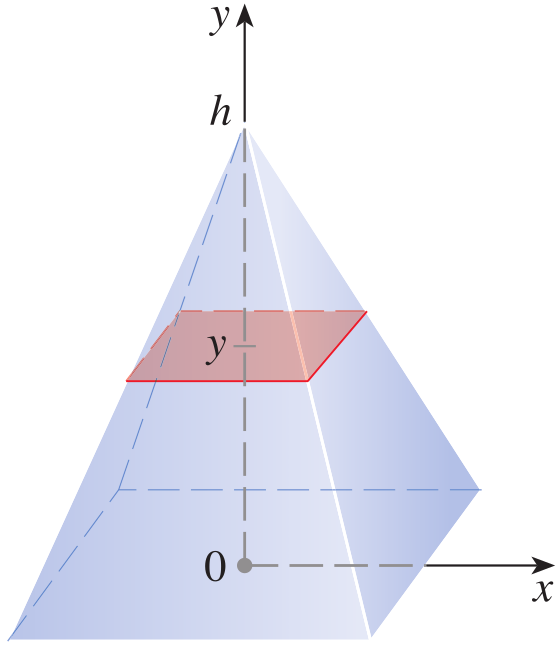

<strong>Figure 16.</strong> A pyramid with its square base centred at the origin and its vertex on the positive $y$-axis, illustrating the alternative coordinate system for calculating the volume.

## Example 9 {.green}

A wedge is cut out of a circular cylinder of radius 4 by two planes. One plane is perpendicular to the axis of the cylinder. The other intersects the first at an angle of $30^\circ$ along a diameter of the cylinder. Find the volume of the wedge.

## Solution {.green}

We place the $x$-axis along the diameter where the two planes meet. The base of the solid is then a semicircle with equation

$$
y=\sqrt{16-x^2}
$$

where $-4\leq x\leq4$. A cross-section perpendicular to the $x$-axis at a distance $x$ from the origin is a triangle $ABC$, as shown in Figure 17.

The base of this triangle is the vertical distance from the diameter to the semicircular boundary. Hence,

$$
|AB|=y=\sqrt{16-x^2}
$$

The two planes meet at an angle of $30^\circ$. From the right triangle shown in Figure 17, the height of the cross-sectional triangle is

$$
\begin{aligned}
|BC|
&=y\tan30^\circ\\
&=\sqrt{16-x^2}\left(\frac{1}{\sqrt{3}}\right)\\
&=\frac{\sqrt{16-x^2}}{\sqrt{3}}
\end{aligned}
$$

The cross-sectional area is one-half the product of the base and height:

$$
\begin{aligned}
A(x)
&=\frac12|AB||BC|\\
&=\frac12\sqrt{16-x^2}
\left(\frac{\sqrt{16-x^2}}{\sqrt{3}}\right)\\
&=\frac{16-x^2}{2\sqrt{3}}
\end{aligned}
$$

The solid extends from $x=-4$ to $x=4$. Therefore, its volume is

$$
V=\int_{-4}^{4}A(x)\,dx
$$

Substituting the cross-sectional area,

$$
V=\int_{-4}^{4}\frac{16-x^2}{2\sqrt{3}}\,dx
$$

The integrand is even, so

$$
V=\frac{1}{\sqrt{3}}\int_0^4(16-x^2)\,dx
$$

Integrating,

$$
\begin{aligned}
V
&=\frac{1}{\sqrt{3}}
\left[16x-\frac{x^3}{3}\right]_0^4\\
&=\frac{1}{\sqrt{3}}
\left(64-\frac{64}{3}\right)\\
&=\frac{1}{\sqrt{3}}\left(\frac{128}{3}\right)\\
&=\frac{128}{3\sqrt{3}}
\end{aligned}
$$

Therefore, the volume of the wedge is

$$
\boxed{V=\frac{128}{3\sqrt{3}}}
$$

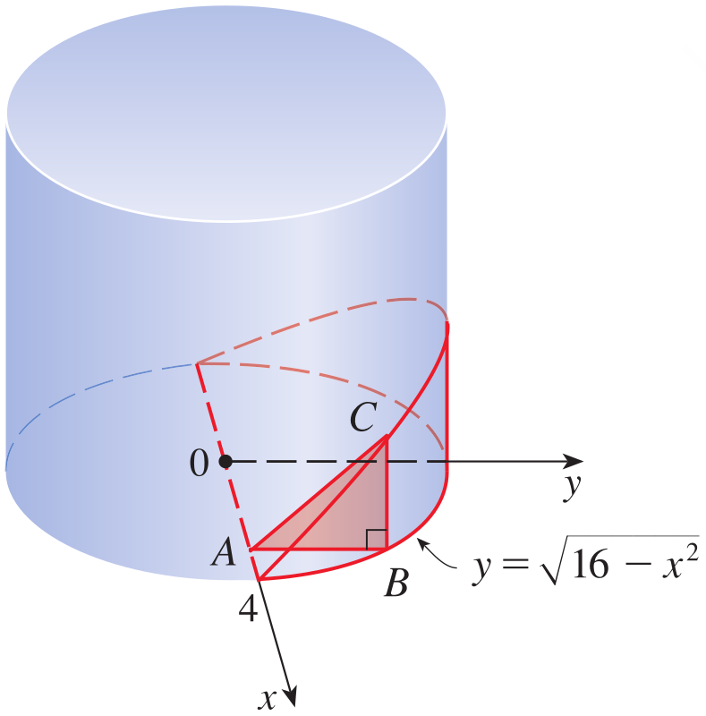
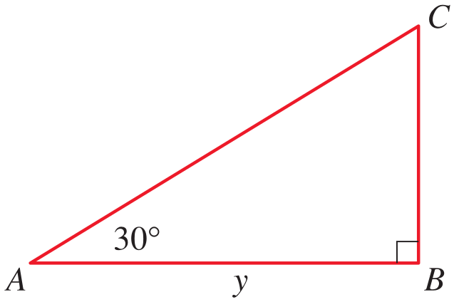

<strong>Figure 17.</strong> A typical triangular cross-section of the wedge, showing its base $y=\sqrt{16-x^2}$, its height $y\tan30^\circ$, and the right angle between the base and height.

$\blacksquare$

# Quick Check

## Question 1 {.red}

A solid extends from $x=0$ to $x=3$. If the area of every cross-section perpendicular to the $x$-axis is $A(x)=4$, find its volume.

## Answer {.red}

The volume is the integral of the cross-sectional area over the interval:

$$
\begin{aligned}
V
&=\int_0^3 4\,dx\\
&=4[x]_0^3\\
&=12
\end{aligned}
$$

Therefore,

$$
\boxed{V=12}
$$

## Question 2 {.red}

A solid has square cross-sections perpendicular to the $x$-axis. If the side length of a typical square is $s(x)=2x$, what is its cross-sectional area?

## Answer {.red}

The area of a square is the square of its side length. Thus,

$$
\begin{aligned}
A(x)
&=[s(x)]^2\\
&=(2x)^2\\
&=4x^2
\end{aligned}
$$

Therefore,

$$
\boxed{A(x)=4x^2}
$$

$\blacksquare$

# Scenario Problem

## Problem {.green}

A mechatronics company is designing a tapered mechanical component using a computer-controlled manufacturing system. The component has a circular base of radius $2$ cm. At every position $x$ along its central axis, where $-2\leq x\leq2$, the cross-section perpendicular to the axis is an equilateral triangle. The side of each triangular cross-section is equal to the chord of the circular base at that position. Determine the volume of the component.

## Solution {.green}

The circular base has radius $2$ cm, so its equation is

$$
x^2+y^2=4
$$

At a position $x$, the positive vertical coordinate of the circle is

$$
y=\sqrt{4-x^2}
$$

The chord across the circle is twice this value. Therefore, the side length of the equilateral-triangle cross-section is

$$
s(x)=2\sqrt{4-x^2}
$$

The area of an equilateral triangle with side length $s$ is $\frac{\sqrt{3}}{4}s^2$. Hence,

$$
\begin{aligned}
A(x)
&=\frac{\sqrt{3}}{4}
\left(2\sqrt{4-x^2}\right)^2\\
&=\sqrt{3}(4-x^2)
\end{aligned}
$$

The component extends from $x=-2$ to $x=2$. Its volume is therefore

$$
V=\int_{-2}^{2}\sqrt{3}(4-x^2)\,dx
$$

Since the integrand is even,

$$
V=2\sqrt{3}\int_0^2(4-x^2)\,dx
$$

Evaluating,

$$
\begin{aligned}
V
&=2\sqrt{3}\left[4x-\frac{x^3}{3}\right]_0^2\\
&=2\sqrt{3}\left(8-\frac83\right)\\
&=2\sqrt{3}\left(\frac{16}{3}\right)\\
&=\frac{32\sqrt{3}}{3}
\end{aligned}
$$

Therefore, the volume of the mechanical component is

$$
\boxed{V=\frac{32\sqrt{3}}{3}\text{ cm}^3}
$$

The manufacturing system can use this result to estimate the volume of material required to produce the component. The calculation follows the same procedure used throughout this topic: determine the cross-sectional area as a function of position and integrate it over the length of the solid.

$\blacksquare$

# Summary

The volume of a general solid can be determined by dividing it into thin slabs using planes perpendicular to a coordinate axis. Each slab can be approximated by a cylinder whose base area is $A(x_i^*)$ and whose height is $\Delta x$. Adding the approximate volumes gives the Riemann sum $V\approx\sum_{i=1}^{n}A(x_i^*)\Delta x$. Taking the limit as the number of slabs approaches infinity gives the definition of volume, $V=\int_a^b A(x)\,dx$. This definition applies to solids with varying cross-sectional areas and reduces to the familiar formula $V=Ah$ when the cross-sectional area is constant.

The volume of a sphere was derived by considering its circular cross-sections and integrating their areas, resulting in $V=\frac{4}{3}\pi r^3$. The approximations for a sphere of radius $1$ using 5, 10, and 20 cylindrical slabs demonstrate how Riemann sums approach the exact volume as the number of slices increases. The method provides a general mathematical foundation for determining the volumes of complex mechanical components and other three-dimensional objects.

The volume of a solid can be calculated by dividing it into thin slabs, approximating each slab by a cross-sectional area multiplied by its thickness, and taking the limit of the resulting Riemann sum. This gives the general formulas $V=\int_a^b A(x)\,dx$ and $V=\int_c^d A(y)\,dy$. When a plane region is revolved around a line, the resulting solid is a solid of revolution, and cross-sections perpendicular to the axis of rotation are circular. If the cross-section is a disk, its area is $A=\pi R^2$. If it is a washer, its area is $A=\pi(R_{\text{outer}}^2-R_{\text{inner}}^2)$.

To solve a volume problem, sketch the region and the axis of rotation, choose cross-sections perpendicular to that axis, identify the radius or the inner and outer radii, and express the cross-sectional area in terms of the variable of integration. The examples demonstrate disk and washer cross-sections for rotation about both coordinate axes and other horizontal or vertical lines. The same method can be applied to determine the volume of mechanical components and three-dimensional shapes generated from mathematical profiles.

The volume of a solid can be calculated by dividing it into thin slices perpendicular to a selected axis. If $A(x)$ is the area of a typical cross-section at position $x$, then the volume of a thin slice is approximately $A(x)\Delta x$. Adding these approximations and taking the limit gives the volume formula $V=\int_a^b A(x)\,dx$. The essential step is to express the dimensions of the cross-section in terms of the position variable and then use the appropriate geometric area formula.

The examples demonstrate this method for solids with equilateral-triangle, square, and triangular cross-sections. Similar triangles, circle equations, and basic trigonometry are used to determine the dimensions of the cross-sections. The pyramid example also shows that different coordinate systems can be used to describe the same solid and produce the same volume. This method applies to solids that are not necessarily solids of revolution whenever their cross-sectional areas can be determined.

# Exercises

Exercises help in transforming theoretical concepts into practical understanding. Mathematics is learned by doing and solving exercises which train you to analyze problems, select appropriate methods, and construct logical solutions. Attempting problems sometimes leads to mistakes which provide opportunities for learning and improvement. Regular practice increases speed, accuracy, and confidence. Exercises are given in the recommended book which has also been provided to you and you are expected to solve them on your own.

## Exercises

Solve the odd number exercises from exercise 1 to 87 skipping exercises which require computer algebra system or computerized graphics.