# Calculus and Analytical Geometry

## Volumes by Cylindrical Shells

### Dr. Aamir Alaud Din

# Objectives

After preparing this topic, you should be able to:

1. Explain the method of cylindrical shells by developing the shell-volume formula from the geometry of a hollow cylinder and deriving the corresponding definite-integral formula from a Riemann sum.
2. Set up and evaluate volumes of solids of revolution using cylindrical shells, identify the radius, height, thickness, and limits of integration for different axes of rotation, and select an appropriate method by comparing shells with disks and washers.

# The Why Section

When a two-dimensional region is rotated about a line, it generates a three-dimensional solid. Determining the volume of that solid is an important application of definite integration. The disk and washer methods are effective when cross-sections perpendicular to the axis of rotation are easy to describe. However, these methods can become difficult when the boundaries of a region are complicated or when expressing the boundaries in terms of the other variable requires solving a difficult equation. The method of cylindrical shells provides an alternative: instead of adding disks or washers, we add the volumes of thin cylindrical shells.

This method is useful in mechanical engineering when estimating the volume of a rotational component, such as a hollow-shaped casing, a machined part, or a component whose cross-section is described by a mathematical curve. It is also relevant to mechatronics, where a computer-controlled manufacturing system may use a mathematical model of a component to estimate the material required for production. In computer science, the same geometric calculation can be used when constructing or processing three-dimensional models. A solid can be represented as a collection of thin shells, and the volume can be estimated by summing their contributions.

**Mechatronics scenario.** Imagine that a computer-controlled lathe is used to manufacture a rotational mechanical component. The cross-section of the component is described by a curve, and the component is produced by rotating the region under that curve about an axis. A controller must estimate the volume of material in the finished component. In some designs, the disk or washer method requires difficult boundary calculations. The method of cylindrical shells provides another way to calculate the volume by using the circumference, height, and thickness of each thin shell. This manufacturing problem can be solved by studying and preparing the method of cylindrical shells.

# Volumes by Cylindrical Shells

## Why Another Method Is Needed

In the preceding topic, we studied the disk and washer methods for finding the volume of a solid obtained by rotating a plane region about an axis. These methods use cross-sections perpendicular to the axis of rotation. A disk is obtained when the cross-section has no hole, while a washer is obtained when the cross-section has a hole.

Some volume problems are very difficult to handle by these methods. Consider the solid obtained by rotating about the $y$-axis the region bounded by

$$
y=2x^2-x^3
$$

and the $x$-axis, $y=0$. The region extends from $x=0$ to $x=2$. If we take slices perpendicular to the $y$-axis, the cross-sections are washers. To calculate the inner and outer radii of a typical washer, however, we must solve the equation $y=2x^2-x^3$ for $x$ in terms of $y$. This requires solving a cubic equation and identifying the appropriate left and right branches of the curve. The calculation is therefore awkward.

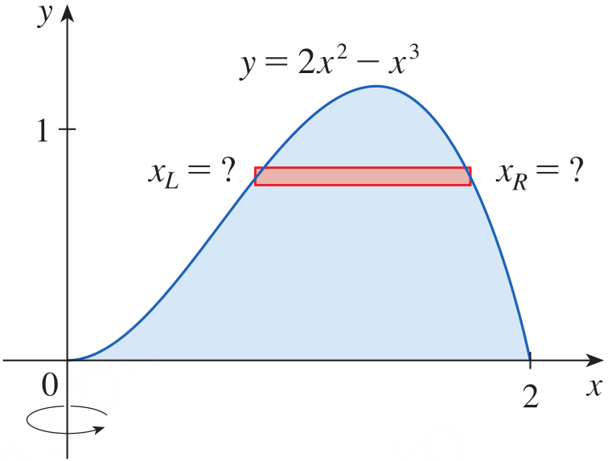

<strong>Figure 1.</strong> The region bounded by $y=2x^2-x^3$ and $y=0$, rotated about the $y$-axis; a horizontal slice produces a washer whose inner and outer radii require solving the cubic equation for $x$.

 

The difficulty in this example comes from the choice of cross-section. A horizontal slice is perpendicular to the $y$-axis and produces a washer, but its radii are not easy to express. A vertical slice, on the other hand, is parallel to the axis of rotation and produces a cylindrical shell. The radius and height of this shell can be read directly from the original graph. This motivates the method of cylindrical shells.

## The Method of Cylindrical Shells

A cylindrical shell is a thin hollow cylinder. It has an inner radius $r_1$, an outer radius $r_2$, a height $h$, and a thickness $\Delta r=r_2-r_1$. Its volume can be calculated by subtracting the volume of the inner cylinder from the volume of the outer cylinder. This gives a useful formula that will form the basis of the shell method.

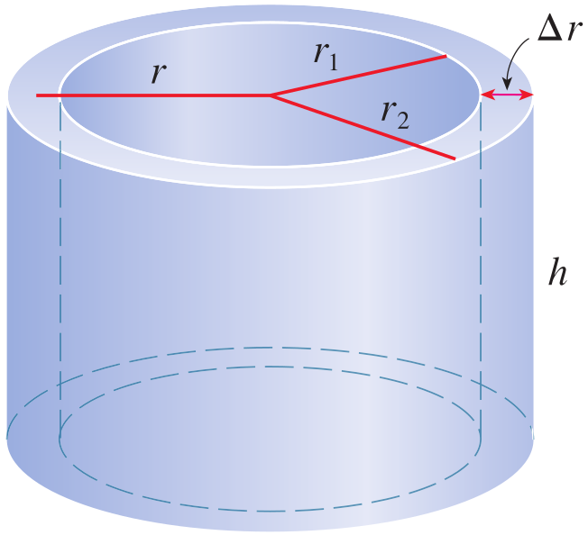

<strong>Figure 2.</strong> A cylindrical shell with inner radius $r_1$, outer radius $r_2$, height $h$, and thickness $\Delta r$.

## Deriving the Volume of a Cylindrical Shell

Let $V_2$ be the volume of the outer cylinder and $V_1$ be the volume of the inner cylinder. The volume of a cylinder is $\pi r^2h$. Therefore,

$$
V_2=\pi r_2^2h
$$

and

$$
V_1=\pi r_1^2h
$$

The volume of the cylindrical shell is the difference between these two cylinder volumes:

$$
V=V_2-V_1
$$

Substituting the expressions for $V_2$ and $V_1$, we obtain

$$
\begin{aligned}
V&=\pi r_2^2h-\pi r_1^2h\\
&=\pi h(r_2^2-r_1^2)
\end{aligned}
$$

Using the difference-of-squares identity, $r_2^2-r_1^2=(r_2+r_1)(r_2-r_1)$, we can write

$$
V=\pi h(r_2+r_1)(r_2-r_1)
$$

Now define the thickness of the shell as

$$
\Delta r=r_2-r_1
$$

and its average radius as

$$
r=\frac{r_2+r_1}{2}
$$

Thus, $r_2+r_1=2r$. Substituting these expressions into the volume formula gives

$$
\begin{aligned}
V&=\pi h(2r)(\Delta r)\\
&=2\pi rh\Delta r
\end{aligned}
$$

Therefore, the volume of a cylindrical shell is

$$
V=2\pi rh\Delta r
$$

The quantity $2\pi r$ is the circumference of a circle of radius $r$. Hence, the formula can be remembered as

$$
V=[\text{circumference}][\text{height}][\text{thickness}]
$$

This interpretation is especially useful when the shell is very thin. Its volume is approximately the product of its circumference, height, and thickness.

## Applying the Shell Method to a Region Under a Curve

Let $S$ be the region bounded by $y=f(x)$, the $x$-axis, and the vertical lines $x=a$ and $x=b$, where $f(x)\geq 0$ and $0\leq a<b$. Rotate this region about the $y$-axis. A vertical rectangle in the region generates a cylindrical shell when it is revolved around the $y$-axis. The shell has radius $x$, height $f(x)$, and thickness $\Delta x$.

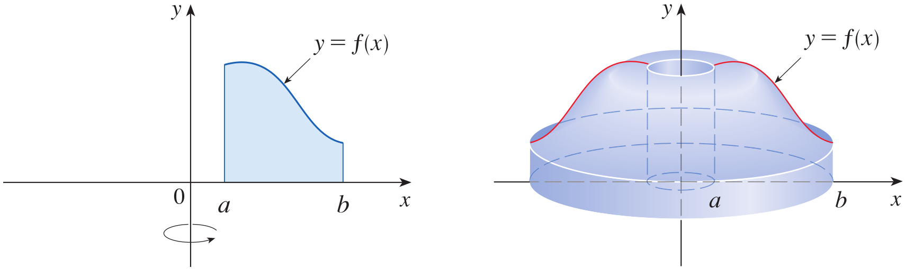

<strong>Figure 3.</strong> A region under $y=f(x)$ between $x=a$ and $x=b$, together with the solid generated by rotating the region about the $y$-axis.

To understand how the solid is formed, divide the interval $[a,b]$ into $n$ subintervals of equal width $\Delta x$. In each subinterval, choose a sample point $x_i^*$. A vertical rectangle of height $f(x_i^*)$ and width $\Delta x$, when rotated about the $y$-axis, produces a thin cylindrical shell. Its radius is approximately $x_i^*$, its height is $f(x_i^*)$, and its thickness is $\Delta x$.

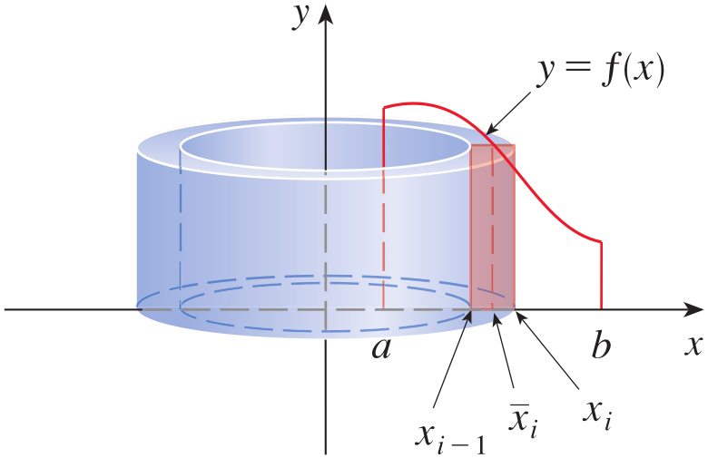
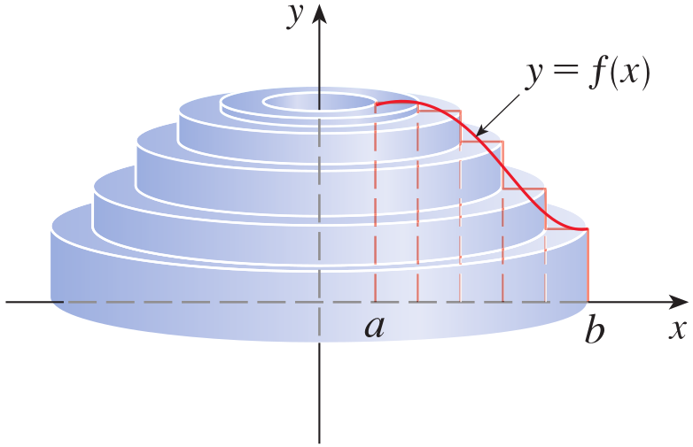
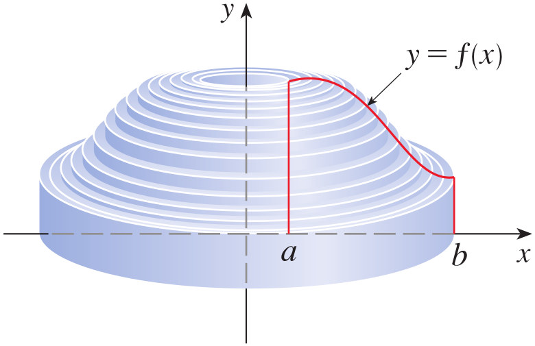

<strong>Figure 4.</strong> A vertical rectangle under $y=f(x)$ being rotated about the $y$-axis to form one cylindrical shell, followed by several shells and the resulting solid.

Using the cylindrical-shell formula, the volume of the $i$th shell is approximately

$$
V_i=2\pi x_i^*f(x_i^*)\Delta x
$$

The total volume is approximated by adding the volumes of all the shells:

$$
V\approx\sum_{i=1}^{n}V_i
$$

Therefore,

$$
V\approx\sum_{i=1}^{n}2\pi x_i^*f(x_i^*)\Delta x
$$

As the number of subintervals increases, the thickness $\Delta x$ becomes smaller and the sum gives a better approximation to the volume. Taking the limit as $n\to\infty$ gives the exact volume:

$$
V=\lim_{n\to\infty}\sum_{i=1}^{n}2\pi x_i^*f(x_i^*)\Delta x
$$

By the definition of the definite integral, this limit is

$$
V=\int_a^b2\pi xf(x)\,dx
$$

## Definition: Volume by Cylindrical Shells {.blue}

The volume of the solid obtained by rotating about the $y$-axis the region under the curve $y=f(x)$ from $x=a$ to $x=b$, where $f(x)\geq0$ and $0\leq a<b$, is

$$
V=\int_a^b2\pi xf(x)\,dx
$$

The integrand is the product of the circumference $2\pi x$ of a typical shell and its height $f(x)$. The differential $dx$ represents the shell's thickness. Thus, the formula is the integral form of the relationship

$$
V=\int_a^b[\text{circumference}][\text{height}][\text{thickness}]
$$

$\blacksquare$

## Remembering the Formula: Flattening a Shell

A useful way to remember the shell formula is to imagine cutting a cylindrical shell vertically and then unrolling or flattening it. The curved surface becomes approximately a rectangle. The length of this rectangle is the circumference of the shell, $2\pi x$, its height is $f(x)$, and its width corresponding to the shell's thickness is $dx$. The volume contribution is therefore represented by

$$
dV=(2\pi x)f(x)\,dx
$$

Adding these contributions from $x=a$ to $x=b$ gives the volume integral.

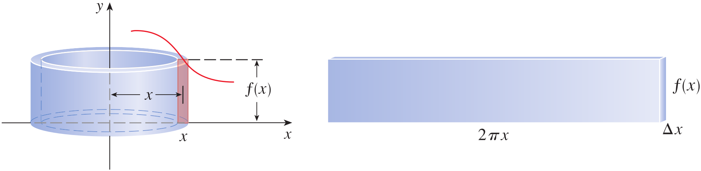

<strong>Figure 5.</strong> A typical cylindrical shell of radius $x$, height $f(x)$, and thickness $dx$, shown beside its flattened rectangular representation with length $2\pi x$ and thickness $dx$.

The shell method is not restricted to rotation about the $y$-axis. It can also be used for rotation about the $x$-axis or about a vertical or horizontal line that is not an axis. In each case, we draw a typical rectangle and identify the shell's radius, circumference, height, and thickness. The integration variable is determined by the direction of the rectangle's thickness.

## Example 1 {.green}

Find the volume of the solid obtained by rotating about the $y$-axis the region bounded by $y=2x^2-x^3$ and $y=0$.

## Solution {.green}

The region is bounded above by $y=2x^2-x^3$ and below by the $x$-axis. The curve meets the $x$-axis when

$$
2x^2-x^3=0
$$

Factoring gives

$$
x^2(2-x)=0
$$

Thus, the endpoints of the region are $x=0$ and $x=2$. We rotate the region about the $y$-axis and use vertical rectangles. Each rectangle generates a cylindrical shell. The radius of a typical shell is the distance from the $y$-axis to the rectangle, so $r=x$. Its circumference is $2\pi x$, its height is the vertical distance from the curve to the $x$-axis, so $h=2x^2-x^3$, and its thickness is $dx$.

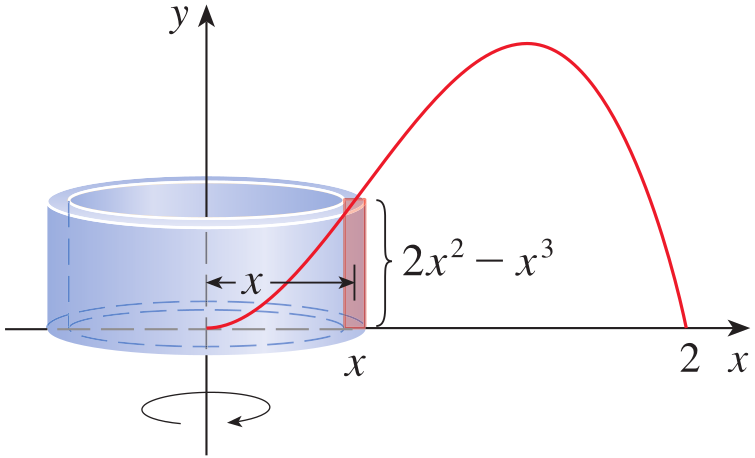

<strong>Figure 6.</strong> The region under $y=2x^2-x^3$ from $x=0$ to $x=2$, rotated about the $y$-axis, with a typical vertical cylindrical shell labelled by radius $x$ and height $2x^2-x^3$.

Using circumference multiplied by height multiplied by thickness, the volume is

$$
\begin{aligned}
V&=\int_0^2(2\pi x)(2x^2-x^3)\,dx\\
&=2\pi\int_0^2(2x^3-x^4)\,dx
\end{aligned}
$$

Integrating,

$$
\begin{aligned}
V&=2\pi\left[\frac{x^4}{2}-\frac{x^5}{5}\right]_0^2\\
&=2\pi\left[\left(\frac{16}{2}-\frac{32}{5}\right)-0\right]\\
&=2\pi\left(8-\frac{32}{5}\right)\\
&=2\pi\left(\frac{8}{5}\right)\\
&=\frac{16\pi}{5}
\end{aligned}
$$

Therefore, the volume of the solid is

$$
\boxed{V=\frac{16\pi}{5}}
$$

The shell method is particularly convenient for this problem. As discussed earlier, using washers would require horizontal slices and the inner and outer radii would be obtained by solving $y=2x^2-x^3$ for $x$. That means solving a cubic equation and identifying the two branches that form the washer's boundaries. With cylindrical shells, the radius and height are read directly from the original function, and only one integral with respect to $x$ is needed.

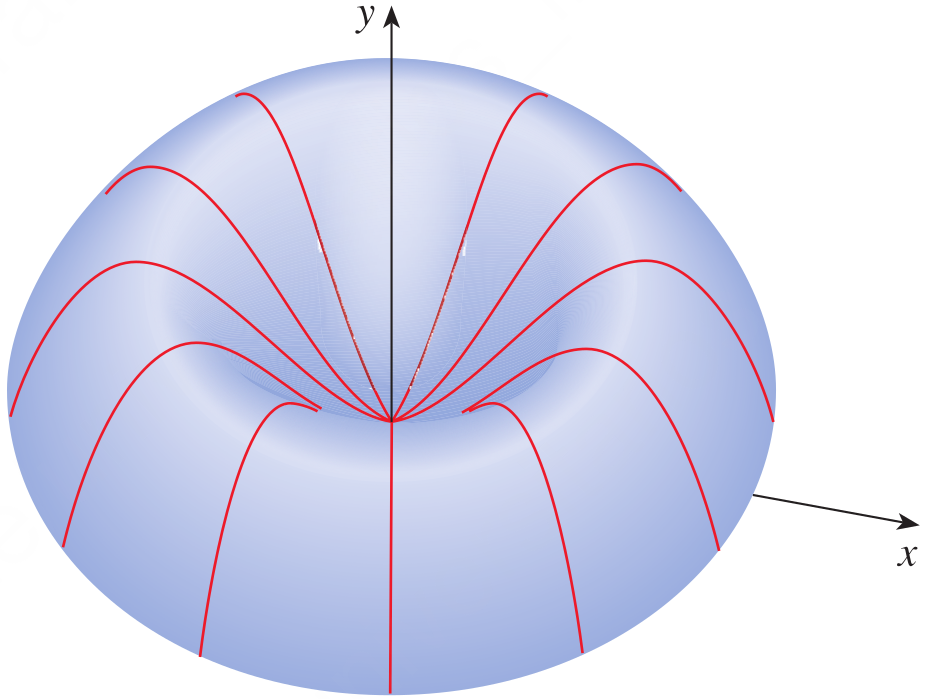

<strong>Figure 7.</strong> A computer-generated three-dimensional view of the solid obtained by rotating the region under $y=2x^2-x^3$ about the $y$-axis.

$\blacksquare$

## Example 2 {.green}

Find the volume of the solid obtained by rotating about the $y$-axis the region between $y=x$ and $y=x^2$.

## Solution {.green}

First, find the points of intersection of the two curves by setting their equations equal:

$$
x=x^2
$$

Rearranging and factoring,

$$
x(x-1)=0
$$

Therefore, the curves intersect at $x=0$ and $x=1$. On the interval $[0,1]$, the line $y=x$ lies above the parabola $y=x^2$. A vertical rectangle between the curves generates a cylindrical shell when rotated about the $y$-axis.

The radius of the shell is $x$, and its height is the upper function minus the lower function:

$$
h=x-x^2
$$

The circumference is $2\pi x$, and the thickness is $dx$. Hence,

$$
\begin{aligned}
V&=\int_0^1(2\pi x)(x-x^2)\,dx\\
&=2\pi\int_0^1(x^2-x^3)\,dx
\end{aligned}
$$

Integrating,

$$
\begin{aligned}
V&=2\pi\left[\frac{x^3}{3}-\frac{x^4}{4}\right]_0^1\\
&=2\pi\left(\frac13-\frac14\right)\\
&=2\pi\left(\frac{1}{12}\right)\\
&=\frac{\pi}{6}
\end{aligned}
$$

Therefore, the required volume is

$$
\boxed{V=\frac{\pi}{6}}
$$

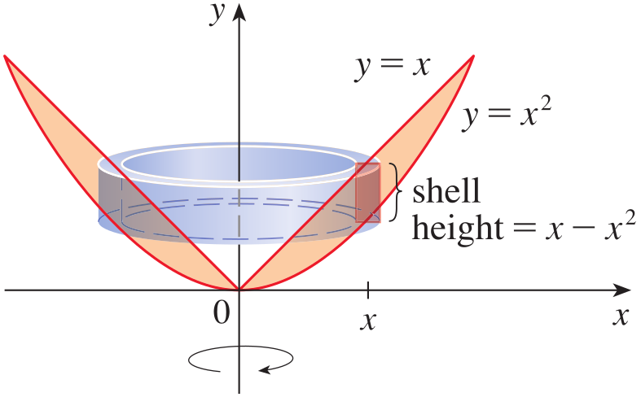

<strong>Figure 8.</strong> The region between $y=x$ and $y=x^2$ from $x=0$ to $x=1$, rotated about the $y$-axis, with a typical shell whose radius is $x$ and whose height is $x-x^2$.

$\blacksquare$

## Example 3 {.green}

Use cylindrical shells to find the volume of the solid obtained by rotating about the $x$-axis the region under the curve $y=\sqrt{x}$ from $0$ to $1$.

## Solution {.green}

The given region is under $y=\sqrt{x}$ and above the $x$-axis, between $x=0$ and $x=1$. We are rotating the region about the $x$-axis. To use cylindrical shells, we take horizontal rectangles, which are parallel to the axis of rotation. These rectangles generate cylindrical shells around the $x$-axis.

We first express the curve in terms of $y$. From

$$
y=\sqrt{x}
$$

we obtain

$$
x=y^2
$$

The horizontal extent of the region is from the curve $x=y^2$ to the vertical line $x=1$. Therefore, the height of a typical shell is

$$
h=1-y^2
$$

The radius is the distance from the $x$-axis to the horizontal rectangle, so $r=y$. Its circumference is $2\pi y$, and its thickness is $dy$. The values of $y$ range from $0$ to $1$.

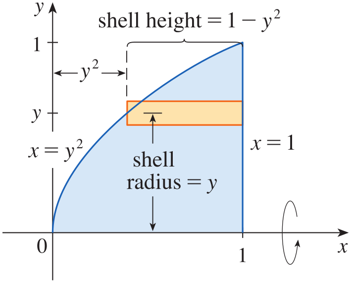

<strong>Figure 9.</strong> The region under $y=\sqrt{x}$ from $x=0$ to $x=1$, rewritten as $x=y^2$, with a typical horizontal shell labelled by radius $y$ and height $1-y^2$.

The shell formula gives

$$
\begin{aligned}
V&=\int_0^1(2\pi y)(1-y^2)\,dy\\
&=2\pi\int_0^1(y-y^3)\,dy
\end{aligned}
$$

Integrating,

$$
\begin{aligned}
V&=2\pi\left[\frac{y^2}{2}-\frac{y^4}{4}\right]_0^1\\
&=2\pi\left(\frac12-\frac14\right)\\
&=2\pi\left(\frac14\right)\\
&=\frac{\pi}{2}
\end{aligned}
$$

Therefore, the volume is

$$
\boxed{V=\frac{\pi}{2}}
$$

For this problem, the disk method is simpler because slices perpendicular to the $x$-axis are disks with radius $\sqrt{x}$. The example nevertheless demonstrates that the shell method can also be applied to rotation about the $x$-axis by using horizontal rectangles and integrating with respect to $y$.

$\blacksquare$

## Example 4 {.green}

Find the volume of the solid obtained by rotating the region bounded by $y=x-x^2$ and $y=0$ about the line $x=2$.

## Solution {.green}

The region is bounded by the curve $y=x-x^2$ and the $x$-axis. To find the limits of integration, set the curve equal to zero:

$$
x-x^2=0
$$

Factoring,

$$
x(1-x)=0
$$

Thus, the region extends from $x=0$ to $x=1$. The axis of rotation is the vertical line $x=2$, which is to the right of the region. We use vertical rectangles, so the resulting cross-sections are cylindrical shells.

The radius of a typical shell is the horizontal distance from the rectangle at $x$ to the axis $x=2$:

$$
r=2-x
$$

The height is the vertical distance between the curve and the $x$-axis:

$$
h=x-x^2
$$

The circumference is $2\pi(2-x)$, and the thickness is $dx$. Therefore,

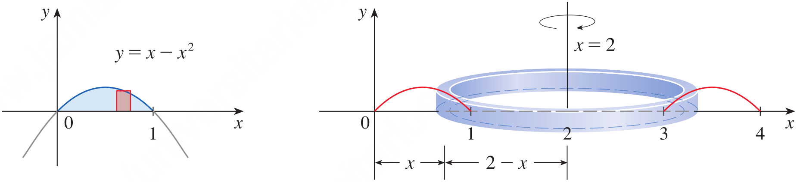

<strong>Figure 10.</strong> The region under $y=x-x^2$ from $x=0$ to $x=1$, together with the vertical axis of rotation $x=2$ and a typical cylindrical shell of radius $2-x$ and height $x-x^2$.

$$
\begin{aligned}
V&=\int_0^1 2\pi(2-x)(x-x^2)\,dx\\
&=2\pi\int_0^1(2x-3x^2+x^3)\,dx
\end{aligned}
$$

Integrating,

$$
\begin{aligned}
V&=2\pi\left[x^2-x^3+\frac{x^4}{4}\right]_0^1\\
&=2\pi\left(1-1+\frac14\right)\\
&=2\pi\left(\frac14\right)\\
&=\frac{\pi}{2}
\end{aligned}
$$

Hence, the volume of the solid is

$$
\boxed{V=\frac{\pi}{2}}
$$

$\blacksquare$

## Choosing Between Disks, Washers, and Cylindrical Shells

When finding the volume of a solid of revolution, the choice of method depends on the shape of the region, the axis of rotation, and the ease of describing the cross-sections. Disks and washers use slices perpendicular to the axis of rotation. Cylindrical shells use slices parallel to the axis of rotation. A vertical rectangle rotated about a vertical axis produces a cylindrical shell, whereas a horizontal rectangle rotated about a vertical axis produces a disk or washer. Similarly, a horizontal rectangle rotated about a horizontal axis produces a shell, while a vertical rectangle rotated about a horizontal axis produces a disk or washer.

The variable of integration follows the thickness of the chosen rectangle. A vertical rectangle has thickness $dx$, so the integral is with respect to $x$. A horizontal rectangle has thickness $dy$, so the integral is with respect to $y$. Before setting up an integral, draw the region, mark the axis of rotation, and sketch a representative rectangle. Imagine rotating that rectangle around the axis. This reveals whether the cross-section is a disk, washer, or shell and helps identify its dimensions.

For disks and washers, the volume is calculated using the cross-sectional area. A disk has radius $R$, while a washer has outer radius $R$ and inner radius $r$:

$$
V=\pi\int_a^b R^2\,dx
$$

or

$$
V=\pi\int_a^b(R^2-r^2)\,dx
$$

when vertical slices are used. For cylindrical shells, the volume is calculated using circumference multiplied by height and thickness:

$$
V=2\pi\int_a^b(\text{radius})(\text{height})\,dx
$$

or the corresponding integral with respect to $y$ for horizontal shells.

The boundaries determine the limits and the shell height. For vertical shells, the height is the upper boundary minus the lower boundary. For horizontal shells, the height is the right boundary minus the left boundary. The radius is always the distance from the representative rectangle to the axis of rotation. If the axis is $x=c$ or $y=c$, the radius is the appropriate nonnegative distance from the shell to that line. For example, rotation about $x=2$ gives radius $2-x$ for a region to the left of the axis, while rotation about $x=-1$ gives radius $x+1$ for a region to the right of the axis.

There is no single method that is best for every problem. Consider whether the boundaries are easier to express as top and bottom functions or as right and left functions, whether the limits are easier to determine in $x$ or $y$, whether one method requires splitting the region into multiple integrals, and whether the resulting integral is straightforward to evaluate. Sometimes either method gives the same volume, as the next example demonstrates.

## Example 5 {.green}

The region in the first quadrant bounded by the curves $y=x^2$ and $y=2x$ is rotated about the line $x=-1$. Find the volume of the solid using (a) $x$ as the variable of integration and (b) $y$ as the variable of integration.

## Solution {.green}

First, find the points of intersection of the two curves:

$$
x^2=2x
$$

Rearranging and factoring,

$$
x(x-2)=0
$$

Thus, the curves intersect at $x=0$ and $x=2$. In the first quadrant, the region lies between $y=x^2$ and $y=2x$ for $0\leq x\leq2$. The axis of rotation is the vertical line $x=-1$.

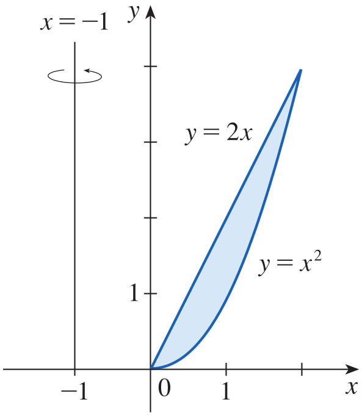

<strong>Figure 11.</strong> The first-quadrant region bounded by $y=x^2$ and $y=2x$, with the vertical axis of rotation $x=-1$.

### (a) Using $x$ as the Variable of Integration

To integrate with respect to $x$, draw a vertical rectangle in the region. Since the rectangle is parallel to the vertical axis of rotation, it generates a cylindrical shell. The radius is the distance from $x$ to $x=-1$:

$$
r=x+1
$$

The height is the upper curve minus the lower curve:

$$
h=2x-x^2
$$

The circumference is $2\pi(x+1)$ and the thickness is $dx$. Therefore,

$$
\begin{aligned}
V&=\int_0^2 2\pi(x+1)(2x-x^2)\,dx\\
&=2\pi\int_0^2(2x+x^2-x^3)\,dx
\end{aligned}
$$

Integrating,

$$
\begin{aligned}
V&=2\pi\left[x^2+\frac{x^3}{3}-\frac{x^4}{4}\right]_0^2\\
&=2\pi\left(4+\frac83-4\right)\\
&=2\pi\left(\frac83\right)\\
&=\frac{16\pi}{3}
\end{aligned}
$$

### (b) Using $y$ as the Variable of Integration

To integrate with respect to $y$, draw a horizontal rectangle. Since it is perpendicular to the vertical axis of rotation, it generates a washer when revolved about $x=-1$. We must express both curves as $x$ in terms of $y$.

From $y=x^2$, in the first quadrant,

$$
x=\sqrt{y}
$$

From $y=2x$,

$$
x=\frac{y}{2}
$$

The values of $y$ range from $0$ to $4$, since the curves meet at $(2,4)$. The axis of rotation is $x=-1$. The outer radius is the distance from $x=-1$ to the right boundary $x=\sqrt{y}$:

$$
R=\sqrt{y}+1
$$

The inner radius is the distance from $x=-1$ to the left boundary $x=\frac{y}{2}$:

$$
r=\frac{y}{2}+1
$$

The washer method therefore gives

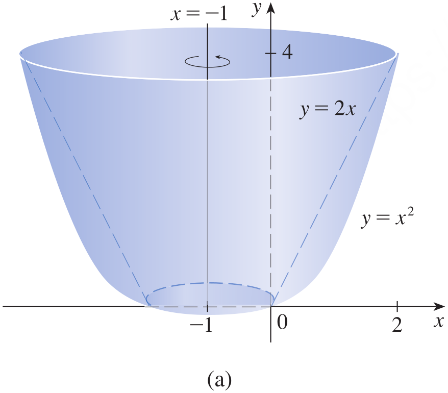
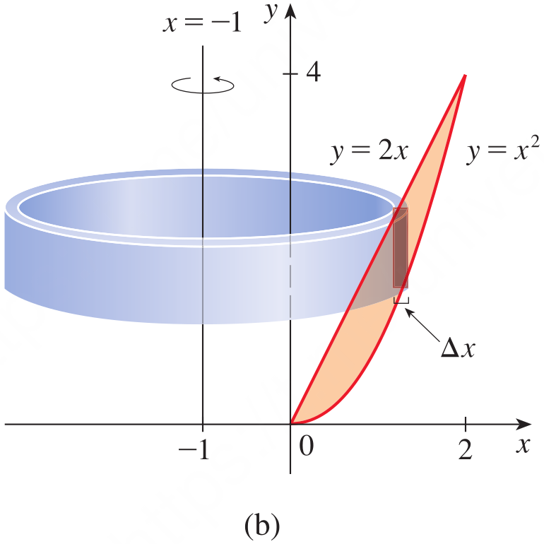
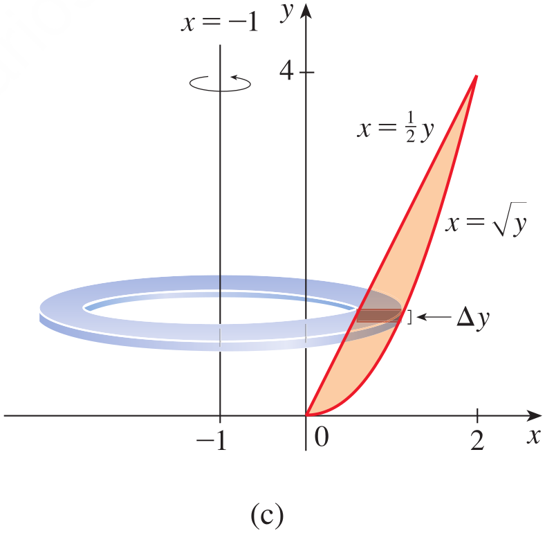

<strong>Figure 12.</strong> Three views of the solid formed by rotating the region bounded by $y=x^2$ and $y=2x$ about $x=-1$: (a) the resulting solid, (b) a vertical rectangle producing a cylindrical shell, and (c) a horizontal rectangle producing a washer with outer radius $\sqrt{y}+1$ and inner radius $\frac{y}{2}+1$.

$$
\begin{aligned}
V&=\int_0^4\pi\left[(\sqrt{y}+1)^2-\left(\frac{y}{2}+1\right)^2\right]\,dy\\
&=\pi\int_0^4\left(2\sqrt{y}-\frac14y^2\right)\,dy
\end{aligned}
$$

Integrating,

$$
\begin{aligned}
V&=\pi\left[\frac43y^{3/2}-\frac{y^3}{12}\right]_0^4\\
&=\pi\left(\frac43(8)-\frac{64}{12}\right)\\
&=\pi\left(\frac{32}{3}-\frac{16}{3}\right)\\
&=\frac{16\pi}{3}
\end{aligned}
$$

Both methods give the same result:

$$
\boxed{V=\frac{16\pi}{3}}
$$

This example illustrates that the same solid can be described using different types of cross-sections. With $x$ as the variable, vertical rectangles produce cylindrical shells. With $y$ as the variable, horizontal rectangles produce washers. The shell method avoids expressing the curves as $x$-functions, while the washer method requires those expressions but is also manageable in this example.

$\blacksquare$

# Quick Check

## Question 1 {.red}

A cylindrical shell has radius $3$ units, height $5$ units, and thickness $0.1$ unit. Use the shell formula to find its approximate volume.

## Answer {.red}

The volume of a thin cylindrical shell is approximately circumference multiplied by height multiplied by thickness:

$$
\begin{aligned}
V&=2\pi rh\Delta r\\
&=2\pi(3)(5)(0.1)\\
&=3\pi
\end{aligned}
$$

Therefore,

$$
\boxed{V=3\pi\text{ cubic units}}
$$

## Question 2 {.red}

A region is rotated about the $y$-axis. A vertical representative rectangle is located at $x=4$, has height $6$, and thickness $dx$. What are the radius and circumference of the cylindrical shell?

## Answer {.red}

The radius is the distance from the vertical rectangle to the $y$-axis, so $r=4$. Its circumference is

$$
2\pi r=2\pi(4)=8\pi
$$

Thus, the shell has radius $4$ units and circumference $8\pi$ units.

$\blacksquare$

# Scenario Problem

## Problem {.green}

A mechatronics company is designing a rotational protective casing for a sensor assembly. The cross-section of the casing's solid material is modelled by the region under the curve

$$
y=4-x^2
$$

and above the $x$-axis, for $0\leq x\leq2$. The region is rotated about the $y$-axis to produce the casing's rotational body. Determine the volume of material required using the method of cylindrical shells.

## Solution {.green}

A vertical rectangle at position $x$ generates a cylindrical shell when rotated about the $y$-axis. Its radius is the distance to the $y$-axis:

$$
r=x
$$

Its height is the vertical distance between the curve and the $x$-axis:

$$
h=4-x^2
$$

Its circumference is $2\pi x$, and its thickness is $dx$. The interval is $0\leq x\leq2$. Therefore, the volume is

$$
\begin{aligned}
V&=\int_0^2 2\pi x(4-x^2)\,dx\\
&=2\pi\int_0^2(4x-x^3)\,dx
\end{aligned}
$$

Integrating,

$$
\begin{aligned}
V&=2\pi\left[2x^2-\frac{x^4}{4}\right]_0^2\\
&=2\pi\left[(8-4)-0\right]\\
&=8\pi
\end{aligned}
$$

Therefore, the volume of material required for the rotational casing is

$$
\boxed{V=8\pi\text{ cubic units}}
$$

The result gives the volume of the idealized solid represented by the mathematical model. In an actual manufacturing design, the dimensions and units of the model would be specified, and the calculated volume could then be used to estimate the required material.

$\blacksquare$

# Summary

The method of cylindrical shells is an alternative to the disk and washer methods for finding volumes of solids of revolution. A thin shell has volume approximately equal to its circumference multiplied by its height and thickness, so $V=2\pi rh\Delta r$. This formula is obtained by subtracting the volume of the inner cylinder from that of the outer cylinder. When a region under $y=f(x)$ from $a$ to $b$ is rotated about the $y$-axis, vertical rectangles generate shells with radius $x$, height $f(x)$, and thickness $dx$. Adding the shell volumes and taking the limit of the Riemann sums gives $V=\int_a^b2\pi xf(x)\,dx$.

For other axes of rotation, the same principle applies: identify the radius as the distance from the shell to the axis, the height as the length of the rectangle within the region, and the thickness as $dx$ or $dy$. Vertical rectangles generate shells about vertical axes, while horizontal rectangles generate shells about horizontal axes. The choice between disks, washers, and shells depends on the orientation of the representative rectangle, the ease of expressing the region's boundaries, the limits of integration, and the simplicity of the resulting integral. The worked examples show that different methods can describe the same solid and must produce the same volume when applied correctly.

# Exercises

Exercises help in transforming theoretical concepts into practical understanding. Mathematics is learned by doing and solving exercises which train you to analyze problems, select appropriate methods, and construct logical solutions. Attempting problems sometimes leads to mistakes which provide opportunities for learning and improvement. Regular practice increases speed, accuracy, and confidence. Exercises are given in the recommended book which has also been provided to you and you are expected to solve them on your own.

## Exercises

Solve the odd number exercises from exercise 1 to 64 skipping the topics requiring computer algebra system or computerized graphics generation.